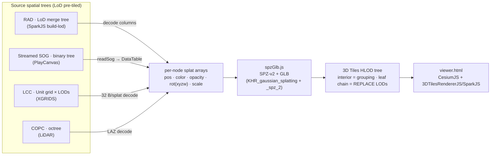
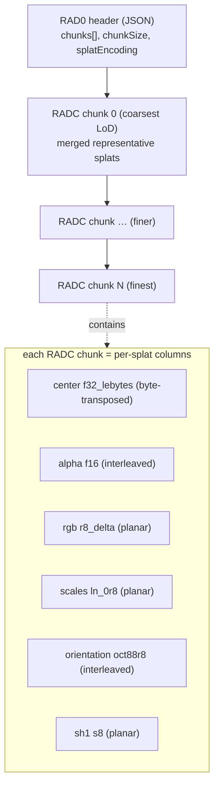
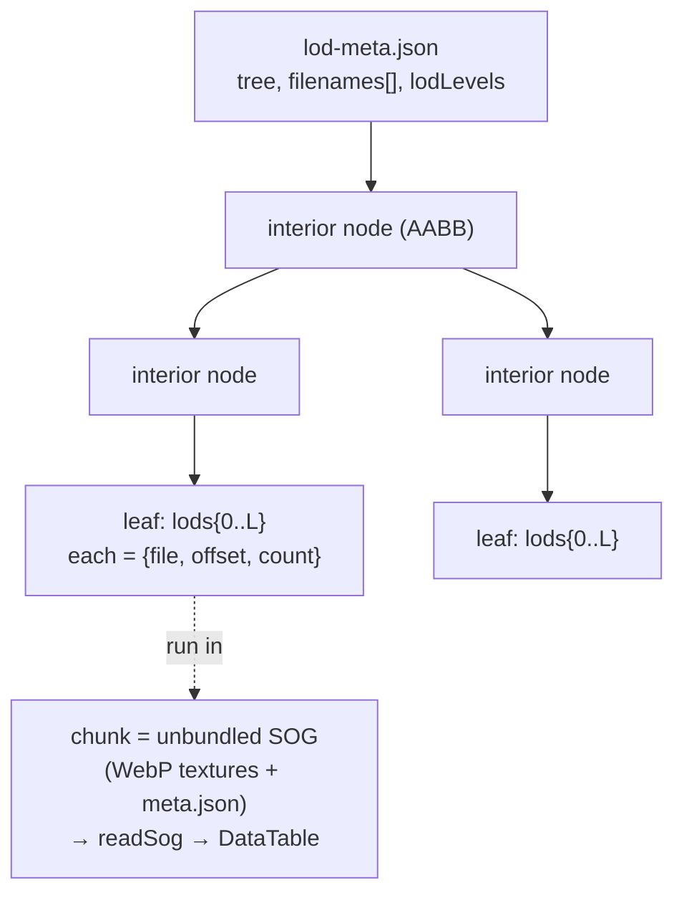
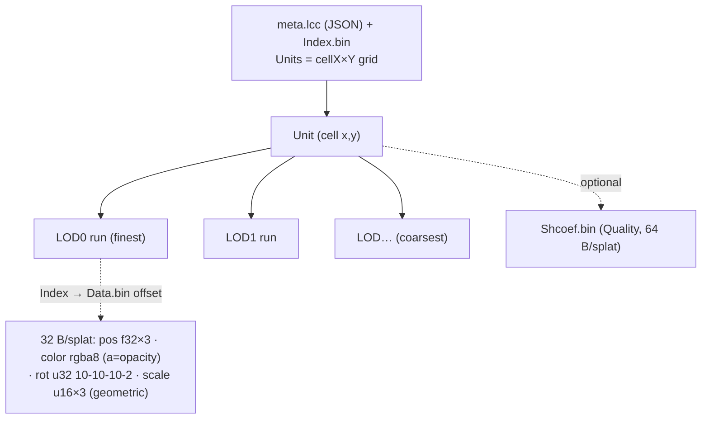
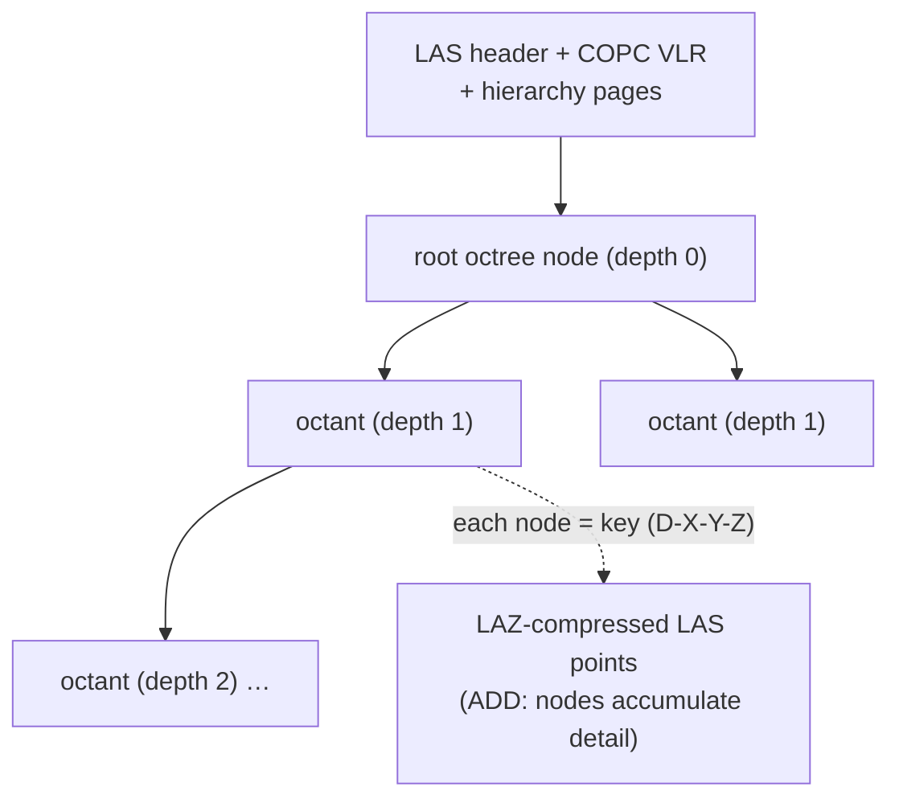

# 3dtiled-to-3dtiles

Node.js CLI tools that convert **tiled / LoD splat & point-cloud formats** → OGC **3D Tiles 1.1**
(Gaussian splats via `KHR_gaussian_splatting` + `KHR_gaussian_splatting_compression_spz_2` GLB
tiles), plus a self-contained CesiumJS + 3DTilesRendererJS viewer (`viewer.html`).

The unifying idea: every source format is some *spatial tree of pre-tiled, LoD'd splats* (or points)
— so each converter just maps that tree onto a 3D Tiles HLOD tree and re-encodes node content to
SPZ-v2 GLB (one shared encoder, `spzGlb.js`). The decode differs per format; the output is uniform.

## Format comparison

| Format | Status | Hierarchy / subdivision | Node (leaf) content | Refine | Intermediate nodes | Metadata location | HTTP range | Spec |
|--------|:------:|-------------------------|---------------------|:------:|--------------------|-------------------|:----------:|------|
| **RAD** (SparkJS) | 🟢 | LoD merge tree, variable fanout (BhattLod ~1.75 / TinyLod ~1.5) | RADC chunk: per-splat columns — `f16`/`oct88r8` **interleaved**, `ln_0r8`/`r8_delta` **planar**, `f32_lebytes` byte-transposed | REPLACE | downsampled **merged** splats | root `RAD0` JSON + per-chunk `RADC` JSON | ✅ chunked `.radc` | [sparkjs.dev](https://sparkjs.dev/docs/lod-getting-started/) |
| **SOG (streamed)** (PlayCanvas) | 🟢 | **binary** spatial tree (AABB split) | unbundled SOG chunk: WebP textures → `DataTable` (pos/quat-w-first/log-scale/SH-DC/logit-opacity) | REPLACE | empty grouping nodes | `lod-meta.json` + per-chunk `meta.json` | ✅ per-file | [playcanvas](https://developer.playcanvas.com/user-manual/gaussian-splatting/formats/streamed-sog/) |
| **LCC** (XGRIDS) | 🟢 | **grid of Units** (cellX×Y) × per-cell LODs | `Data.bin` fixed **32 B/splat**: pos `f32×3`, color `rgba8`, rot `10-10-10-2`, scale `u16×3` (+SH `Shcoef.bin` 64 B) | REPLACE | per-cell coarse LODs | `meta.lcc` JSON + `Index.bin` | ✅ `Index.bin` offsets into `Data.bin` | [developer.xgrids.com](https://developer.xgrids.com/#/document?titleId=en-1720509291851) |
| **COPC** (LiDAR) | 🟢 | **octree** (EPT-style) | LAZ-compressed LAS points | ADD | octree nodes (accumulate) | COPC VLR + hierarchy pages | ✅ designed for range reads | [copc.io](https://copc.io) |
| **Nexus** (CNR-ISTI) | 🟠 doc | multiresolution patch DAG / batched mesh | per-patch mesh (not splats) | — | — | header + patch index | ✅ | [github](https://github.com/cnr-isti-vclab/nexus) · [paper](https://vcg.isti.cnr.it/Publications/2016/PD16/FastDec_Ponchio.pdf) |
| **I3S** (Esri) | 🟠 doc | node tree, bounding-sphere LoD (SLPK) | nodes/geometry/textures (mesh/point) | REPLACE | node pages | `3dSceneLayer.json` + node docs | ✅ | [github](https://github.com/esri/i3s-spec) |
| **3D Tiles** (output) | 🟢 out | explicit or implicit; box/region/sphere volumes | glTF/GLB w/ `KHR_gaussian_splatting`+`_spz_2` | REPLACE/ADD | optional content | `tileset.json` (+ `.3tz`) | ✅ | [OGC](https://www.ogc.org/standard/3dtiles/) |

🟢 = operational converter · 🟠 doc = spec referenced in `docs-references/`, converter not built (lower-priority / niche).
See `docs-references/` for the full per-format reference notes.



### Per-format structure

<details><summary><b>RAD</b> (SparkJS) — LoD merge tree, REPLACE</summary>


</details>

<details><summary><b>Streamed SOG</b> (PlayCanvas) — binary spatial tree, REPLACE</summary>


</details>

<details><summary><b>LCC</b> (XGRIDS) — Unit grid × LODs, REPLACE</summary>


</details>

<details><summary><b>COPC</b> (LiDAR) — octree, ADD</summary>


</details>

---

## Converters

### Testing

Self-contained CesiumJS 1.116 viewer. Open via HTTP (not `file://`).

```sh
npx serve ./out-copc   # then open viewer.html, set URL: http://localhost:3000/tileset.json
npx serve ./out-rad    # same
```

Two tabs: point cloud (classification colors) and Gaussian splat (CesiumJS + three.js code).

Additional online viewers:
- **COPC**: [viewer.copc.io](https://viewer.copc.io), [lidar-viewer.gishub.org](https://lidar-viewer.gishub.org)
- **3D Tiles**: CesiumJS sandbox, [3D-Tiles-RendererJS](https://github.com/NASA-AMMOS/3DTilesRendererJS)

`viewer.html` includes a **3DTilesRendererJS mode** (toggle the `3DTRJS` button) backed by Three.js.
For Gaussian splat streaming, it uses [3D-Tiles-RendererJS-3DGS-Plugin](https://github.com/WilliamLiu-1997/3D-Tiles-RendererJS-3DGS-Plugin)
which streams `.rad`/SPZ content via `@sparkjsdev/spark`:

```sh
npm install 3d-tiles-rendererjs-3dgs-plugin three 3d-tiles-renderer @sparkjsdev/spark
```

```js
import { TilesRenderer } from '3d-tiles-renderer';
import { GaussianSplatPlugin } from '3d-tiles-rendererjs-3dgs-plugin';

const tiles = new TilesRenderer('http://localhost:3000/tileset.json');
tiles.registerPlugin(new GaussianSplatPlugin({
  renderer, scene,
  minRaycastOpacity: 0.1,
  sparkRendererOptions: { focalAdjustment: 2 },
}));
scene.add(tiles.group);
```

> The viewer loads the plugin from esm.sh at runtime (shared `three@0.180` via `?external=three`)
> — no local install needed for the viewer.

`viewer.html` consolidates all controls into a right **sidebar** (Renderer · Basemap · Tileset &
LoD · Navigation · Local frame · Ion · Snippet), including a **Max SSE (px)** input that drives
CesiumJS `maximumScreenSpaceError` and 3DTRJS `errorTarget`, and a **🪲 Debug tiles** toggle that
draws bounding volumes coloured by octree depth in both renderers. The preset bar includes the
**◈ GSplat 1/2** reference splat tilesets from the
[3DTilesRendererJS-3DGS-Plugin](https://github.com/WilliamLiu-1997/3DTilesRendererJS-3DGS-Plugin)
demo data (PLY→3D Tiles). For deeper tileset inspection (tree, bounds, per-tile stats) alongside
this viewer, see [3DTiles-Inspector](https://github.com/WilliamLiu-1997/3DTiles-Inspector).

---

### copc-to-3dtiles

Converts COPC `.copc.laz` LiDAR files to 3D Tiles 1.1 with implicit octree tiling.

```sh
cd copc-to-3dtiles
npm install
node src/index.js input.copc.laz ./out-copc
```

**Output:**
```
out-copc/
  tileset.json
  tiles/<level>/<x>/<y>/<z>.glb       POINTS, tile-local coords
  subtrees/<level>/<x>/<y>/<z>.subtree binary subtree files
```

**Design:**
- Implicit octree (`subdivisionScheme: "OCTREE"`) — COPC hierarchy maps directly, no re-tiling
- Subtree binary format (3D Tiles 1.1 §7.3): 24-byte header, Morton Z-order bitstreams, bufferView indices
- Refine: `ADD` — each level independently contributes points
- CRS handling: see note below

**On CRS and proj4:**
COPC files may carry a WKT CRS in their VLRs. Currently `georef.js` uses proj4 to convert the
dataset origin to WGS84 lon/lat, then builds an ENU→ECEF (EPSG:4978) root transform — which is
what most 3D Tiles viewers (CesiumJS) expect.

However, **3D Tiles 1.1 does not mandate ECEF**. The spec allows any CRS expressed via a
`transform` matrix and optional metadata. If the COPC's native CRS is known and the viewer
supports it, proj4 could be skipped entirely by passing the raw COPC transform hierarchy
root-to-leaf verbatim. Viewers like opengeos' lidar-viewer likely position COPC files correctly
by reading their internal spatial metadata directly rather than relying on the 3D Tiles CRS.
This is worth exploring to simplify the pipeline and eliminate the proj4 dependency for
native-CRS outputs.

---

### rad-to-3dtiles

Converts SparkJS `.RAD` Gaussian Splat LoD files to 3D Tiles 1.1 with `KHR_gaussian_splatting` GLB tiles.

```sh
cd rad-to-3dtiles
npm install
# Always inspect first:
node scripts/dump-rad-header.js coit.rad
# Convert (defaults: --scale=1, --ge-scale=1, --ge-layer=1):
node src/index.js coit.rad ./out-rad
# Noise filtering (OPT-IN, default OFF — SparkJS renders the RAD with no filtering, so we don't either):
#   --opacity-filter=0.05   drop faint splats (final opacity < N)
#   --max-scale-mult=30     drop giant "floating noise" splats (maxScale > per-chunk median×N)
node src/index.js coit.rad ./out-rad --opacity-filter=0.05 --max-scale-mult=30  # only for data with known noise
# Tune splat size and LoD (rarely needed — raw values match the reference):
node src/index.js coit.rad ./out-rad --scale=2         # σ×2 (larger splats)
node src/index.js coit.rad ./out-rad --ge-scale=2      # GE×2 (refine at greater distance)
node src/index.js coit.rad ./out-rad --ge-layer=2      # widen depth range
```

**Output:**
```
out-rad/
  tileset.json              explicit tiling, one tile per RAD chunk
  tiles/node_<index>.glb    KHR_gaussian_splatting GLB (POINTS)
```

> **Note:** `--3tz` / `--3dtiles` packaging requires
> [`@cesium/3d-tiles-tools`](https://github.com/CesiumGS/3d-tiles-tools) installed.
> `npm install @cesium/3d-tiles-tools` in the `rad-to-3dtiles` directory, then pass the flag.
> Plan to eventually promote this to a first-class dependency.

---

### sog-to-3dtiles

Converts a PlayCanvas **[Streamed SOG](docs-references/streamed-sog.md)** dataset (`lod-meta.json`
+ per-chunk unbundled [SOG](docs-references/sog.md) dirs) to 3D Tiles 1.1 with the same
`KHR_gaussian_splatting` + `_compression_spz_2` GLB tiles as the RAD path.

```sh
cd sog-to-3dtiles
npm install                                  # pulls @playcanvas/splat-transform
node src/index.js path/to/scene/ ./out-sog   # dir containing lod-meta.json, or the json itself
```

**How it works:** the streamed-SOG binary spatial tree maps almost 1:1 onto a 3D Tiles HLOD
tree — interior nodes become empty grouping tiles, and each leaf becomes a `REPLACE` chain of
tiles from coarsest LOD level down to level 0 (finest). Bounds are emitted in the Z-up tileset
frame (`RX+90°`), matching the RAD path.

**The per-chunk pipeline (intermediate format):**
1. [`@playcanvas/splat-transform`](https://github.com/playcanvas/splat-transform)'s `readSog`
   decodes each SOG chunk's WebP textures (CPU `webp.wasm` — **no GPU**) into a **`DataTable`** —
   that's the intermediate per-chunk format. Columns: `x,y,z`, `rot_0..3` (quaternion, **w-first**),
   `scale_0..2` (**log**), `f_dc_0..2` (SH DC), `opacity` (**logit**).
2. For each leaf's `lods[level]` run, we slice `[offset, offset+count)` of that DataTable, convert
   conventions (`exp` scale, `sigmoid` opacity, `0.5 + SH_C0·f_dc` → color, quaternion reorder
   w-first → xyzw), and re-encode to an **SPZ-v2 GLB** with our own encoder (the same one
   `rad-to-3dtiles` uses).

That this path renders cleanly is itself proof the **SPZ-v2/GLB encoder and tree builder are
correct** — so when the RAD path looked wrong, the bug had to be in the *RAD decode*, not the
shared encoder. (It was: see [RAD column layouts](#rad-column-byte-layouts-the-spiky-render-bug).)

**Output:**
```
out-sog/
  tileset.json           HLOD tree mirroring the SOG spatial tree
  tiles/node_<n>.glb      one per LOD run; tiles/env.glb if the scene has an environment
```

> **Status:** validated end-to-end on PlayCanvas's `example_skatepark_02` & `example_roman_parish_02`
> (see Sample Data below). Decoded tiles contain real splats — varied positions, valid scales,
> unit quaternions, proper opacity — confirming the WebP CPU decode + decode conventions
> (quaternion `rot_0=w`, log scales, logit opacity, SH0→color). geometricError halves cleanly
> root→leaf (e.g. skatepark `17.8 → 8.9 → … → 0.0`). Bundled `.sog` environments are skipped
> (best-effort) since the spec's chunks are unbundled.

---

### lcc-to-3dtiles

Converts an XGRIDS **[LCC](docs-references/lcc-format.md)** dataset (`meta.lcc` + `Index.bin` +
`Data.bin` [+ `Shcoef.bin`]) to 3D Tiles with the same `KHR_gaussian_splatting` + `_spz_2` GLB tiles.

```sh
cd lcc-to-3dtiles
node src/index.js path/to/lcc-dir ./out-lcc     # dir containing meta.lcc (name can vary)
```

**How it works:** LCC organises splats as a **grid of Units** (one per partition cell, x/y packed in
the index) × `totalLevel` LODs (LOD0 = finest). Each Unit → a `REPLACE` chain of tiles
coarsest→finest under a single root. `Data.bin` is **uncompressed, fixed 32 B/splat** (the meta
`"encoding": "COMPRESS"` refers to field quantization, not stream compression — verified
`LODSize / PointsCount == 32`). The 32-byte layout was reverse-engineered + validated against the
`Guan_Temple` sample: `pos f32×3 · color rgba8 (a = opacity) · rot uint32 (10-10-10-2 smallest-three) ·
scale uint16×3 (linear lerp) · 6 B pad`. Rotation decode follows the whitepaper `QLut`.

**Validated:** `Guan_Temple` → 154 tiles, **11,424,293 splats (= `meta.totalSplats` exactly)**,
0 bad quaternions. **SH (`Shcoef.bin`, Quality files) not yet emitted** (DC only, like the other
converters). LCC is XGRIDS' format — attribution required per its White Paper (see the doc).

> **License note:** the LCC White Paper requires displaying "Data Organization Format originated
> from XGRIDS" and publishing derivatives under terms no less open. This converter reads the format;
> downstream products must carry that attribution.

---

## Sample Data

### RAD (Gaussian Splat LoD)

```sh
# Coit Tower, San Francisco — SparkJS BhattLod, SH1, 50M splats (1.2 GB monolithic)
curl -L https://wlt-ai-cdn.art/spark-2.0/rad/coit-40m-sh1-lod.rad -o coit.rad

# Jin-Ai-Machi — streaming manifest only (88 KB header, ~1.1 GB data fetched on demand)
curl -L https://cdn.lilea.net/spark/jinaimachi/jinaimachi-lod.rad -o jinaimachi.rad

# Tastier RAD 500K splats
curl -L https://wlt-ai-cdn.art/tastier_rad_500/0524c1a1-abf2-4969-ae40-9981ee836536_500k-lod.rad -o tastier500k.rad
```

> **RAD format note**: A `.rad` file can be either **monolithic** (all chunk data embedded) or
> a **streaming manifest** (88 KB JSON header only; chunk data fetched on demand via HTTP range
> requests). The converter detects streaming manifests and exits with a clear error — download
> the full monolithic file to convert. Run `node scripts/dump-rad-header.js <file.rad>` to inspect.

### Streamed SOG (PlayCanvas LOD)

PlayCanvas example datasets (download the whole tree with `sog-to-3dtiles/scripts/fetch-sog.mjs`):

```sh
cd sog-to-3dtiles
# Skatepark — 20 chunks, 4 LOD levels (~160 files)
node scripts/fetch-sog.mjs https://code.playcanvas.com/examples_data/example_skatepark_02/ ../sample-data/input/sog/skatepark
# Roman Parish — 131 chunks, 7 LOD levels (~790 files)
node scripts/fetch-sog.mjs https://code.playcanvas.com/examples_data/example_roman_parish_02/ ../sample-data/input/sog/roman-parish
# then convert:
node src/index.js ../sample-data/input/sog/skatepark ../sample-data/output-sog/skatepark-3dtiles-from-sog
```

Both are wired into the viewer preset bar (**⬢ Skatepark / Roman Parish (SOG)**) and the inspector
(`cd tools-inspector && npm run inspect:skatepark` / `inspect:roman-parish`).

### COPC (LiDAR Point Cloud)

```sh
# Autzen Stadium, Oregon — classified, 10.6M pts (77 MB). Well-known test file.
curl -L "https://s3.amazonaws.com/hobu-lidar/autzen-classified.copc.laz" -o autzen.copc.laz

# USGS 3DEP Texas Coast 2018 — 50 cm density (154 MB)
curl -L "https://data.opengeos.org/USGS_LPC_TX_CoastalRegion_2018_A18_stratmap18-50cm-2995201a1.copc.laz" -o texas.copc.laz
# Online viewer: https://lidar-viewer.gishub.org/?url=https%3A%2F%2Fdata.opengeos.org%2FUSGS_LPC_TX_CoastalRegion_2018_A18_stratmap18-50cm-2995201a1.copc.laz

# IGN LiDAR HD — Tour Eiffel / Paris area, tile LHD_FXX_0648_6863 (France, 100 MB)
curl -L "https://data.geopf.fr/telechargement/download/LiDARHD-NUALID/NUALHD_1-0__LAZ_LAMB93_KE_2025-06-06/LHD_FXX_0648_6863_PTS_LAMB93_IGN69.copc.laz" -o eiffel.copc.laz

# USGS 3DEP — New Jersey tile (requires SAS token or STAC browser)
# https://usgslidareuwest.blob.core.windows.net/usgs-3dep-copc/usgs-copc/USGS_Lidar_Point_Cloud_NJ_SdL5_2014_LAS_2015/copc/18TWL805090.copc.laz
```

**Online COPC viewers** (inspect before converting):
- [viewer.copc.io](https://viewer.copc.io) — drag-drop or paste URL
- [lidar-viewer.gishub.org](https://lidar-viewer.gishub.org) — drag-drop or paste URL

**More COPC sources:**
- **IGN France** — https://cartes.gouv.fr/telechargement/IGNF_NUAGES-DE-POINTS-LIDAR-HD
  Full national LiDAR HD coverage at 10 pts/m². Search tile ID (e.g. `LHD_FXX_0648_6863`).
- **USGS 3DEP STAC** — https://planetarycomputer.microsoft.com/api/stac/v1/collections/3dep-lidar-copc
  Browser: https://radiantearth.github.io/stac-browser/#/external/planetarycomputer.microsoft.com/api/stac/v1/collections/3dep-lidar-copc

---

## Dependencies

| Package | Used by |
|---------|---------|
| `copc` | copc-to-3dtiles |
| `@gltf-transform/core` ^4 | both |
| `proj4` | copc-to-3dtiles |
| `@sparkjsdev/spark` | rad-to-3dtiles |
| `@cesium/3d-tiles-tools` (optional) | both — `.3tz`/`.3dtiles` packaging via `--3tz`/`--3dtiles` flag |

---

## Documentation

### Formats

**3D Tiles 1.1** — OGC standard for streaming massive 3D geospatial datasets. A tileset consists
of a `tileset.json` describing a spatial hierarchy of tiles, each referencing a GLB/B3DM/PNTS
payload. Version 1.1 adds implicit tiling (OCTREE/QUADTREE subdivision schemes with binary
subtree files), metadata schemas, and new glTF extensions including `KHR_gaussian_splatting`.
Tiles can carry a `transform` (column-major 4×4) to place them in any coordinate system —
ECEF (EPSG:4978) is conventional for globe viewers but not required.

**COPC (Cloud Optimized Point Cloud)** — A LAZ 1.4 file with a specific VLR/EVLR layout that
embeds an octree hierarchy. Each octree node is a contiguous chunk at a known offset, enabling
HTTP range requests without a separate index. Internally organized in the same way as 3D Tiles
implicit tiling — a direct 1:1 mapping. CRS is stored as WKT in a VLR (LASF_Projection record
2112). Not all files include it (e.g. the Autzen test file does not), in which case the output
is in local dataset coordinates.

**RAD (SparkJS Gaussian Splat LoD)** — SparkJS binary streaming format for BhattLod Gaussian
splat scenes. See structure in the rad-to-3dtiles section above.

### RAD: PackedSplats or ExtSplats?

The `.RAD` format is **receiver-agnostic**: the same `.rad` file can be decoded into either
`PackedSplats` (16 B/splat) or `ExtSplats` (32 B/splat, Spark 2.0 preview) depending on which
class you instantiate in JavaScript.

**BhattLod `.rad` files** (like `coit-40m-sh1-lod.rad`) use per-property encodings chosen for
compression quality. The actual in-memory format is chosen at runtime:

```js
// Decode into PackedSplats (16B/splat, float16 center)
const packed = new PackedSplats({ url: 'coit.rad', lod: true });

// Decode into ExtSplats (32B/splat, float32 center — Spark 2.0 preview)
const ext = new ExtSplats({ url: 'coit.rad', lod: true });
```

The RAD storage encodings for `coit.rad` are:
- `center: f32_lebytes` — byte-plane encoded float32 (higher precision than PackedSplats f16)
- `alpha: f16` — float16 opacity (matches ExtSplats)
- `scales: ln_0r8` — uint8 log scale (matches PackedSplats range)
- `rgb: r8_delta` — delta-encoded uint8 (matches PackedSplats)
- `orientation: oct88r8` — shared by both formats

See `docs-references/sparkjs-packed-splats.md` and `docs-references/sparkjs-ext-splats.md` for
full layout specs.

### REPLACE vs ADD refinement

3D Tiles tilesets declare how children relate to their parent via the `refine` field:

- **`REPLACE`** — when a child tile loads, the parent is discarded. Each level of detail fully
  replaces the previous. Used by photogrammetry meshes (b3dm), Gaussian splat LoDs (RAD), and
  most point cloud viewers. Visual quality improves as finer tiles load; no double-drawing.

- **`ADD`** — children are *added on top of* the parent; the parent is never hidden. Each level
  independently contributes content. Used by COPC point clouds because every node holds a
  disjoint subset of points — hiding the parent would lose points that are only in that node.
  The total visible point count grows as finer tiles load.

Viewers must implement both correctly. A REPLACE tileset rendered as ADD would show every LoD
layer simultaneously (ghosting / double-draw). An ADD tileset rendered as REPLACE would hide
coarser nodes that contain unique points.

### RAD LoD: geometric error, bounding volumes & coordinates

How `rad-to-3dtiles` builds a tile hierarchy that selects levels correctly in both
CesiumJS and 3DTilesRendererJS:

- **Geometric error = uniform per depth, anchored to a rendering-error proxy — then scaled to
  match renderer expectations.** Each tile records a feature size =
  `mean over splats of max(scaleₓ,scaleᵧ,scale_z) × 3` (≈ SparkJS BhattLod `featureSize`),
  then the builder collapses these to **one error per LoD level** (mean featureSize at each depth,
  forced strictly decreasing). This mirrors the
  [3DGS-PLY-3DTiles-Converter](https://github.com/WilliamLiu-1997/3DGS-PLY-3DTiles-Converter)
  model where all siblings at a level share one error so they **refine together**. Per-*node*
  errors vary within a level and make siblings pop in/out at different distances. Uniform per-depth
  fixes that.

  Two optional modifiers (both **default 1**, mirroring the
  [3DTiles-Inspector](https://github.com/WilliamLiu-1997/3DTiles-Inspector) sliders and the
  reference converter's `errorTargetLayerMultiplier`) can tune this:

  1. **Layer multiplier** (`--ge-layer`, default `1`): stretches the per-depth range —
     `GE(d) = leafGE + (GE(d) − leafGE) × geLayer`. `1` = natural halving, which is what the
     reference uses and what makes sibling levels refine together.
  2. **Global GE scale** (`--ge-scale`, default `1`): multiplies all GE values by a constant.

  **These default to 1** because the raw featureSize GE is already the right magnitude: Coit's root
  GE is ≈ 1.1, matching the [3DGS-PLY-3DTiles-Converter](https://github.com/WilliamLiu-1997/3DGS-PLY-3DTiles-Converter)
  reference's ≈ 2.07 for a comparable scene (verified by fetching its `tiling/geometric-error.js` and
  a rendered reference tileset). An earlier attempt set these to `16`/`8` — that over-inflated GE so
  every tile's SSE always exceeded the threshold, forcing **full-detail-everywhere refinement
  regardless of camera distance** (high-res tiles loading away from the camera focus, the whole scene
  rendering as dense spikes). That was a mis-calibration compensating for the half-opacity `lodOpacity`
  bug; with opacity fixed, raw GE is correct. If a scene under-refines, nudge `--ge-scale=2` (the
  reference sits ~2× our magnitude); values like `16` are far too high.
- **Bounding volumes are emitted in the Z-up tileset frame.** Bounds are computed from the glTF
  (Y-up) splat positions, but a 3D Tiles tile's `boundingVolume` lives in the tileset frame, which
  is Z-up — both CesiumJS and 3DTilesRendererJS rotate glTF content by `RX(+90°)` → `(x,y,z) →
  (x,−z,y)`. Emitting the box in the raw Y-up frame makes the boxes appear **rotated ~90° off the
  rendered splats** (the splats stand upright, the boxes lie down). The builder now rotates every
  box into Z-up (`yUpBoxToZUp`), so box centres coincide with the rendered splat centres. (The COPC
  writer already bakes this convention into its per-point swap; this brings the RAD path in line.)
- **Bounding volumes are nested bottom-up.** RAD's ~1.5-fanout octree plus the fact that splats
  are *shapes* (a merged parent splat can be smaller than a child covering spatial outliers)
  means per-node AABBs do **not** contain their children on their own. The builder expands each
  node's box to enclose all descendant boxes (`parent ⊇ children`), which both renderers require
  for correct frustum culling and screen-space-error refinement. (Before this fix, 56% of Coit
  parent→child pairs were non-nested, with children up to 14× larger than their parent.)
- **Root node RX(180°) transform corrects the inverted-up artifact.** After the glTF→tileset
  `RX(+90°)` that both renderers apply to GLB content, RAD splats appeared upside-down. A
  `root.transform = diag(1,−1,−1,1)` (column-major RX 180°) is written into the root tile only —
  children inherit it automatically per the 3D Tiles spec, so no intermediate or leaf nodes carry
  a transform. This is the correct place: intermediate/leaf transforms would fight the inherited
  value on each child's rendered position.
- **Native RAD coordinates, no global-centroid subtraction.** Splats keep their raw RAD frame —
  subtracting a float offset before int24 quantisation buys nothing (RAD scenes already sit near
  the origin) and only adds a lossy step. RAD has no per-node transforms, so all tiles share one
  frame; the single root transform above is sufficient to orient the content correctly.
- **`lodOpacity` must be applied — the cause of the "thin/spiky" artifact.** RAD stores its
  quantisation ranges and flags under `meta.splatEncoding` (per-chunk, mirrored from the root
  header), **not** `meta.encoding`. Reading the wrong key silently fell back to defaults, missing
  `lodOpacity: true`. SparkJS's `unpackSplat` does `opacity = stored/255; if (lodOpacity) opacity ×= 2`
  — i.e. RAD LoD files store **half** the real opacity. Without the ×2 every splat rendered at half
  opacity, so the large coarse splats could not blend and the sharp needle splats (scale anisotropy
  reaches 100–1000× on merged LoD representatives — legitimately needle-shaped) showed through as
  spikes. Sourcing `lnScaleMin/Max`/`lodOpacity` from `splatEncoding` fixes it (and is robust for RAD
  files whose ranges differ from the `−12…9` default). Note: the SPZ encoding itself was verified
  **byte-identical** to SparkJS's `SpzWriter` (positions int24/4096, alpha ×255, rgb via `SH_C0/0.15`,
  scales `(ln s + 10)×16`, v2 first-three rotations) — the bug was purely the missed opacity doubling
  in the RAD decode, not the SPZ storage.

Toggle **🪲 Debug tiles** in `viewer.html` to draw the tile bounding volumes coloured by octree
depth — CesiumJS via `debugShowBoundingVolume`/`debugColorizeTiles`, 3DTRJS via `DebugTilesPlugin`
(`displayBoxBounds` + `colorMode: DEPTH`). Useful for eyeballing nesting and LoD selection.

### Open 3D Tiles Datasets

Cesium and partner organizations publish open 3D Tiles datasets:

**CesiumGS open data (Ion)** — https://cesium.com/platform/cesium-ion/content/
- Assets marked "open data" are publicly accessible with any Ion account token.
- Examples: Google Photorealistic 3D Tiles (assetId 2275207), Bing Imagery basemap.

**Strasbourg Od@CiT** — 3D Tiles 1.0, explicit tiling, **REPLACE**, b3dm photogrammetry mesh
```
https://s3.eu-west-2.wasabisys.com/ems-sgct-photomaillage/ODACIT/EMS_PM2022/tileset.json
```

**Clermont-Ferrand (CRAIG)** — 3D Tiles 1.0, explicit, **REPLACE**, b3dm
```
https://3d.craig.fr/datasets/Clermont/3dtiles/tileset.json
```

**Lille Métropole** — 3D Tiles 1.0, explicit, **REPLACE**, b3dm
```
https://webimaging.lillemetropole.fr/externe/maillage/2016_mel_10cm/3dtiles/tileset.json
```

All three city mesh tilesets use RGF93/Lambert-93 or WGS84 coordinates and are served with CORS.
They work in `viewer.html` via the built-in city mesh presets.

### References

#### Local notes (in `docs-references/`)

| File | Description |
|------|-------------|
| `spark-2.0-blog-post.md` | Spark 2.0 technical deep dive (LoD, streaming, RAD format, PackedSplats vs ExtSplats) |
| `sparkjs-packed-splats.md` | SparkJS PackedSplats API + 16-byte layout |
| `sparkjs-ext-splats.md` | SparkJS ExtSplats API + 32-byte layout (Spark 2.0 preview) |
| `KHR_gaussian_splatting.md` | KHR_gaussian_splatting glTF extension spec (RC) |
| `KHR_gaussian_splatting_compression_spz_2.md` | SPZ compression extension spec (Draft) |
| `spz-format.md` | SPZ v2/v3 binary format — per-field encoding, pack/unpack formulas (source: github.com/nianticlabs/spz) |
| `sog.md` | SOG (Spatially Ordered Gaussians) chunk format — WebP textures + dequant (positions/quats/scales/SH); consumed by `sog-to-3dtiles` (source: developer.playcanvas.com) |
| `streamed-sog.md` | PlayCanvas Streamed SOG LOD format — `lod-meta.json` spatial tree + chunk references; the input to `sog-to-3dtiles` (source: developer.playcanvas.com) |
| `lcc-format.md` | XGRIDS LCC (Lixel CyberColor) — `meta.lcc`/`Index.bin`/`Data.bin` (32 B/splat, 10-10-10-2 rot, packed-11 SH); input to `lcc-to-3dtiles` (source: github.com/xgrids/LCCWhitepaper). Attribution required. |
| `nexus-format.md` | 🟠 CNR-ISTI Nexus multiresolution mesh (DAG of patches) — **doc-referenced, no converter** (mesh, not splats; niche). Refs: github.com/cnr-isti-vclab/nexus, FastDec paper |
| `i3s-spec.md` | 🟠 Esri I3S (Indexed 3D Scene Layer / SLPK) — **doc-referenced, no converter** (would be `i3s-to-3dtiles`). Ref: github.com/esri/i3s-spec |

#### Upstream specs & reference implementations

**glTF extensions (Khronos)**
- [`KHR_gaussian_splatting` — PR #2490](https://github.com/KhronosGroup/glTF/pull/2490) — the base extension; 555-comment thread documenting the design (attribute set, namespacing, shape/rendering hints, SH handling, the split from the original single extension). Merged Jan 2026.
- [`KHR_gaussian_splatting_compression_spz_2` — PR #2531](https://github.com/KhronosGroup/glTF/pull/2531) — the SPZ-compression child extension, pinned to SPZ v2.

**CesiumJS implementation**
- [Issue #12837](https://github.com/CesiumGS/cesium/issues/12837) — "Updating to latest 3D Gaussian Extensions and deprecating initial experimental version" (deprecation/removal timeline: deprecated Sep 2025, removed Nov 2025 / v1.135).
- [PR #12843](https://github.com/CesiumGS/cesium/pull/12843) — adds support for `KHR_gaussian_splatting` + `KHR_gaussian_splatting_compression_spz_2`, deprecates `KHR_spz_gaussian_splats_compression`. Confirms CesiumJS decodes via the Niantic `spz` library.

**SPZ format & tooling**
- [nianticlabs/spz](https://github.com/nianticlabs/spz) — reference C++ SPZ codec. The v2 vs v3 rotation split lives in `src/cc/load-spz.cc` (`packQuaternionFirstThree` = v2 / 3-byte, `packQuaternionSmallestThree` = v3 / 4-byte).
- [@sparkjsdev/spark](https://github.com/sparkjsdev/spark) — SparkJS; writes SPZ v3 by default but version-dispatches on read (handles v2 and v3).
- [javagl/JSplat](https://github.com/javagl/JSplat) — Java reference for writing splat glTFs that CesiumJS reads (`GltfSpzSplatWriter`); a useful cross-check when updating an SPZ writer.

**PlayCanvas SOG / Streamed SOG (used by `sog-to-3dtiles`)**
- [playcanvas/splat-transform](https://github.com/playcanvas/splat-transform) — SplatTransform: PlayCanvas's splat conversion library/CLI. `sog-to-3dtiles` uses its `readSog` (CPU `webp.wasm` decode) to turn each SOG chunk into a `DataTable`. Authors Streamed SOG datasets too.
- [SOG format spec](https://developer.playcanvas.com/user-manual/gaussian-splatting/formats/sog/) — local notes: [`docs-references/sog.md`](docs-references/sog.md).
- [Streamed SOG (LOD) spec](https://developer.playcanvas.com/user-manual/gaussian-splatting/formats/streamed-sog/) — local notes: [`docs-references/streamed-sog.md`](docs-references/streamed-sog.md).

**3DTilesRendererJS Gaussian-splat ecosystem (WilliamLiu-1997)** — closest reference implementations to this repo's RAD path; studied to improve tiling:
- [3DTilesRendererJS-3DGS-Plugin](https://github.com/WilliamLiu-1997/3DTilesRendererJS-3DGS-Plugin) — the `3d-tiles-rendererjs-3dgs-plugin` this viewer uses to render splats in 3DTRJS (parses `KHR_gaussian_splatting` + `_spz_2`, renders via SparkJS, one shared Spark renderer per scene/renderer, camera-relative rebasing, `sparkRendererOptions`, WebXR-aware). Its `data/gaussianSplat1` & `gaussianSplat2` are wired into this viewer's preset bar (**◈ GSplat 1/2**). Note its rendering tip: keep the globe in the **opaque** pass so it doesn't object-sort against transparent splats at the horizon.
- [3DGS-PLY-3DTiles-Converter](https://github.com/WilliamLiu-1997/3DGS-PLY-3DTiles-Converter) — PLY→3D Tiles converter (kd-tree tiling, AABB bounds, SPZ v3 + quantized SH). Its [`src/tiling/geometric-error.js`](https://github.com/WilliamLiu-1997/3DGS-PLY-3DTiles-Converter/blob/main/src/tiling/geometric-error.js) is the model our **uniform-per-depth geometric error** mirrors: `GE(depth) = leafReference × (1/samplingRate)^(maxDepth−depth)`, anchored to a deepest-leaf "sparsity + extent" estimate, all siblings at a level sharing one error. Each tileset also emits a `build_summary.json` exposing the full GE-by-depth and sampling schedule — handy for cross-checking. ([Issue #24](https://github.com/WilliamLiu-1997/3DGS-PLY-3DTiles-Converter/issues/24): auto-depth can overload the root node on >8M-splat scenes — a tree-balancing concern worth noting for very large RAD inputs.)
- [3DTiles-Inspector](https://github.com/WilliamLiu-1997/3DTiles-Inspector) — standalone web inspector for 3D Tiles / Gaussian-splat tilesets (root-transform edit, geometric-error & layer-multiplier scaling `1/16x–16x`, splat crop regions, `build_summary.json` round-trip). A good complement to this repo's `viewer.html` 🪲 Debug-tiles overlay.

  **The inspector is pre-installed** in `tools-inspector/` — run via npm scripts (no global install needed):
  ```bash
  cd tools-inspector
  npm run inspect:tastier    # tastier500k RAD tileset
  npm run inspect:coit       # coit RAD tileset (large, 778 tiles)
  npm run inspect:coit-s050  # coit σ×0.5 scale variant
  ```
  Or run directly from the repo root with `npx`:
  ```bash
  npx --prefix tools-inspector 3dtiles-inspector sample-data/output-rad/tastier500k-3dtiles-from-rad
  npx --prefix tools-inspector 3dtiles-inspector sample-data/output-rad/coit-3dtiles-from-rad
  ```
  Each command starts a localhost HTTP server and opens the inspector in your default browser. Its `Geometric Error` / `Layer Multiplier` sliders are the runtime analogue of this converter's uniform-per-depth error model — handy for confirming LoD behaviour without re-tiling.

---

## 3D Gaussian Splatting extension lineage

The glTF extensions for 3D Gaussian splatting went through several incarnations in 2025–2026.
Understanding the lineage is what pinned down the SPZ-version bug above, so it is documented here
in full.

**Timeline**

- **~June 2025** — a *single* experimental extension `KHR_spz_gaussian_splats_compression` shipped in
  CesiumJS. It bundled the SPZ blob and the splat semantics together.
- **Mid 2025** — Khronos **split** it into two:
  - `KHR_gaussian_splatting` — renderer-agnostic **base**: defines the splat attributes
    (`POSITION`, `COLOR_0`, and namespaced `KHR_gaussian_splatting:SCALE` / `:ROTATION` /
    `:SH_DEGREE_*`), the optional `shape` (ellipsoid/…) and `hints` (sorting method, projection),
    and allows uncompressed or meshopt-compressed data.
  - `KHR_gaussian_splatting_compression_spz_2` — a **child** extension nested *inside* the base on
    the primitive, carrying only the SPZ-compressed blob (a `bufferView`).
- **Sep 2025 (CesiumJS)** — the original single extension was **deprecated**; the tiler in Cesium ion
  switched to outputting the base + `_spz_2` pair.
- **Nov 2025 (CesiumJS v1.135)** — the original extension was **removed**; only the base + `_spz_2`
  pair is supported. Existing tilesets must be re-tiled.
- **Jan 2026** — `KHR_gaussian_splatting` (base) merged into the glTF repo as a release candidate.

**Why the `_2` matters (the bug).** The `_2` in `KHR_gaussian_splatting_compression_spz_2` is the
**SPZ format version (v2)**. As `lexaknyazev` notes in the PR, a KHR extension cannot float across
SPZ versions — for IP and portability reasons it is locked to a specific one. CesiumJS decodes via
the Niantic `spz` library against the **v2** layout. SPZ versions differ in the rotation block:

| SPZ version | Positions | Rotations | Bytes/splat | Niantic packer |
|-------------|-----------|-----------|-------------|----------------|
| v1 | 16-bit | — | — | — |
| **v2** ← what `_spz_2` requires | 24-bit (frac bits) | **3 bytes** (x,y,z; w≥0 recovered) | **19** | `packQuaternionFirstThree` |
| v3 | 24-bit | 4 bytes (smallest-three `uint32`) | 20 | `packQuaternionSmallestThree` |

`rad-to-3dtiles` had been emitting v3 (because SparkJS *writes* v3 by default). Under the `_spz_2`
extension, CesiumJS read that 4-byte rotation block at a 3-byte stride → corrupted rotations that
looked like global scale/falloff weirdness. **Fix:** emit SPZ v2 (see blocker #1 above). SparkJS's
reader version-dispatches, so v2 also renders in the 3DTRJS 3DGS plugin.

**A separate, related issue:** glTF #2509 reports splats rendering *upside-down* in Cesium — that is
a **coordinate-system** matter (SPZ's Left-Up-Front convention / SH handedness baked into the
Niantic `CoordinateConverter`), distinct from the rotation-stride bug. If, after re-tiling to v2,
orientation (not scale) still looks off, that conversion is the next thing to check.

**Primary sources**

- glTF base extension — [KhronosGroup/glTF#2490](https://github.com/KhronosGroup/glTF/pull/2490)
- glTF SPZ compression child — [KhronosGroup/glTF#2531](https://github.com/KhronosGroup/glTF/pull/2531)
- CesiumJS migration issue — [CesiumGS/cesium#12837](https://github.com/CesiumGS/cesium/issues/12837)
- CesiumJS implementation PR — [CesiumGS/cesium#12843](https://github.com/CesiumGS/cesium/pull/12843)
- "upside-down in Cesium" coordinate issue — [KhronosGroup/glTF#2509](https://github.com/KhronosGroup/glTF/issues/2509)
- Niantic SPZ reference codec — [nianticlabs/spz](https://github.com/nianticlabs/spz) (`src/cc/load-spz.cc`)
- Java reference writer — [javagl/JSplat](https://github.com/javagl/JSplat) (`GltfSpzSplatWriter`)

---

## Known blockers & how to overcome them

These are issues localized during a deep cross-check of the converter against the SPZ/SparkJS
reference and the viewer against both CesiumJS and 3DTilesRendererJS. Each lists the symptom,
the root cause as far as it could be isolated, and the concrete path to resolve it.

### 1. RAD splats rendered wrong after conversion — RESOLVED: emit SPZ **v2**, not v3

**Symptom.** The same `.rad` file rendered perfectly in SparkJS directly, but once converted to a
3D-Tiles GLB with an embedded SPZ payload it looked wrong (off scale / falloff / orientation) in
*both* CesiumJS and 3DTilesRendererJS (whose 3DGS plugin decodes via SparkJS).

**What was verified correct.** Every SPZ field encoder was checked byte-for-byte against SparkJS's
own `SpzWriter` and the Niantic SPZ reference:
- **Scale** — `byte = (ln(s) + 10) × 16`; decode yields `ln(s)`, renderer applies `exp` once → `s`. Single exp, correct.
- **Colour** — SH-DC basis `byte = sh_dc·0.15·255 + 128`. (The "factor 2" you sensed was a *documentation typo* in `spz-format.md`, where the decode divisor read `0.15·128` instead of `0.15·255`; the code was always correct. Now fixed.)
- **Opacity** — `byte = round(opacity·255)`; the SPZ/KHR sigmoid/inv-sigmoid pair is a net no-op. Correct.
- **Header / block order** — magic, version, numPoints, shDegree, fractionalBits; planar blocks positions→alpha→rgb→scales→rotations. All correct.

**Root cause — SPZ version. The extension is locked to SPZ v2; we were emitting v3.** Tracing the
extension's [inception](#3d-gaussian-splatting-extension-lineage) shows
`KHR_gaussian_splatting_compression_spz_2` is **pinned to SPZ v2** (the `_2` is the SPZ format
version — a KHR extension cannot float across SPZ versions for IP/portability reasons, so it is
deliberately fixed). The two SPZ versions differ in the **rotation block**:

| | SPZ v2 (`packQuaternionFirstThree`) | SPZ v3 (`packQuaternionSmallestThree`) |
|---|---|---|
| Rotation bytes/splat | **3** — store x,y,z (w≥0 recovered) | 4 — smallest-three packed `uint32` |
| Per-splat total | 19 bytes | 20 bytes |

We had been writing v3 (4-byte rotations, `version = 3` header) — what SparkJS *writes* by default
— under the v2 extension. CesiumJS's bundled Niantic decoder reads the v2 layout, so it consumed a
**4-byte rotation block at a 3-byte stride**, corrupting every rotation (and looking like global
scale/falloff weirdness). The 3DGS plugin showed the same because the GLB itself was non-conformant.

**The fix (applied).** `rad-to-3dtiles` now emits SPZ **v2**: `SPZ_VERSION = 2`, `encodeQuat` writes
3 bytes via the first-three scheme (`byte = round(comp·127.5 + 127.5)`, w canonicalised ≥ 0 and
recovered on decode), and `buildSpzBuffer` uses a 19-byte/splat layout. Verified against the Niantic
`load-spz.cc` v2 path **and** SparkJS's reader, which version-dispatches and reads the 3-byte branch
(`comp = byte/127.5 − 1`) — so the same GLB now decodes correctly in CesiumJS *and* the 3DTRJS 3DGS
plugin. Re-run the converter on your `.rad` files to regenerate v2 tilesets.

> If a future tiler/decoder targets SPZ v3, restore the 4-byte `packQuaternionSmallestThree`
> encoder (in this file's git history) and set `SPZ_VERSION = 3` — but only under a v3-capable
> extension, never under `_spz_2`. See the dedicated
> [3D Gaussian Splatting extension lineage](#3d-gaussian-splatting-extension-lineage) section for
> the full history and links.

### 2. COPC point clouds look "upside down" in 3DTRJS *Env* controls (fine in *Globe*)

**Symptom.** A georeferenced COPC tileset displays correctly in Globe controls but appears
rotated/upside-down under EnvironmentControls.

**Root cause — not a converter bug.** `glbWriter.js` stores points as `(East, Up, −North)` so
that after the renderer's standard glTF→3D-Tiles `RX(+90°)` correction they become the
right-handed `(East, North, Up)` frame — correct, and confirmed by the flawless Globe render.
The problem is purely viewer-side: after that correction the data is **Z-up**, but
`EnvironmentControls` assumes a **Y-up** local ground plane, so a georeferenced tileset viewed
in Env mode looks tipped over.

**How to overcome it:** use the new **Local orbit** control mode (added to the 3DTRJS toolbar),
which runs `ReorientationPlugin` to recenter the tileset at the origin with `up = +Y` and then a
plain Three.js `OrbitControls`. That presents any tileset — ECEF or local — in a clean upright
orbit, independent of the ECEF root transform, and was also added to verify that the
world→local matrix concatenation is not what limits fine-detail streaming.

---

## TODO

### copc-to-3dtiles

- [ ] `--explicit` flag: output explicit tiling (one tile per COPC node, `tileset.json` with
  `children` arrays) instead of 3D Tiles 1.1 implicit tiling. Useful for viewers that support
  3D Tiles 1.0 but not the implicit tiling extension (e.g. some versions of Unreal Engine,
  older CesiumJS builds). The COPC hierarchy maps directly — walk the node tree and emit
  explicit `content` + `children` instead of generating subtree files.

---

## Vision: towards a TiTiler for 3D

This project seeds what could become a **TiTiler equivalent for 3D formats**: middleware that reads
cloud-native, internally tiled 3D formats (COPC, RAD, SPZ, Potree, EPT, i3s…) and streams
OGC 3D Tiles 1.1 on demand — transcribing the source hierarchy verbatim into implicit/explicit
tiling, converting raw tile geometry to glTF/GLB with appropriate extensions
(KHR_gaussian_splatting, EXT_mesh_features, CESIUM_primitive_outline…), serving with HTTP Range
requests so no data is re-encoded or re-sorted.

Like TiTiler for Cloud Optimized GeoTIFF: zero re-tiling, zero copy, internally-tiled-to-internally-tiled.

Formats in scope: COPC (LiDAR), RAD/SPZ (3DGS), EPT/Entwine (LiDAR), Potree (LiDAR), 3DTILES (passthrough).

---

## Test Results (run Jun 17 2026)

### COPC — Autzen Stadium, Oregon (10.6M pts)

```
Input:  autzen-classified.copc.laz  (77 MB)
        https://s3.amazonaws.com/hobu-lidar/autzen-classified.copc.laz

Output: 278 GLBs + 49 subtrees + tileset.json  (369 MB)
        6 octree levels, max level 5
        Attributes per GLB: POSITION (VEC3 f32), COLOR_0 (VEC4 f32),
                            _CLASSIFICATION (uint8), _RETURN_NUMBER (uint8)
        No WKT CRS in file → local coordinate output (no ECEF root transform)

Status: PASS ✓
```

> **Note:** The Autzen file has no WKT CRS VLR, so output is in local dataset coordinates.
> IGN LiDAR HD files include proper WKT → ECEF transform applied. Many COPC viewers (e.g.
> viewer.copc.io, lidar-viewer.gishub.org) position all files correctly because they read the
> internal spatial metadata directly — they do not rely on the 3D Tiles CRS transform.

> **Viewer note:** Open `viewer.html` via HTTP (`npx serve .`) — not `file://`, and not via
> Cesium Sandcastle (HTTPS). Sandcastle cannot reach HTTP localhost due to browser mixed-content
> policy even with `--cors`.

### RAD — Tastier 500K splats

```
Input:  tastier500k-lod.rad  (12 MB, BhattLod base=1.75, SH0, 702K splats in 11 chunks)
        https://wlt-ai-cdn.art/tastier_rad_500/0524c1a1-abf2-4969-ae40-9981ee836536_500k-lod.rad

Output: 11 GLBs + tileset.json  (~12 MB)
        Bounding box: centre=(-0.25, 0.43, -2.27), half-extents=(2.86, 3.03, 8.32)
        Attributes per GLB: POSITION (VEC3 f32), _ALPHA (uint16 f16)
        extensionsUsed: ["KHR_gaussian_splatting"]
        Hierarchical REPLACE tileset

Status: PASS ✓  (0.57s for 11 chunks)
```

> **Bug fixed during testing:** Bounding boxes were defaulting to a unit cube at origin.
> Now computed from actual decoded splat positions (f32_lebytes decode → AABB).
