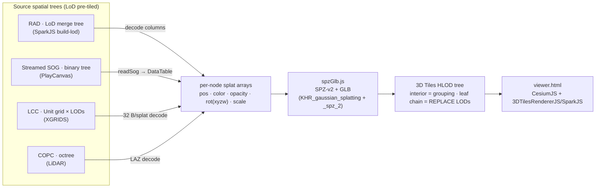
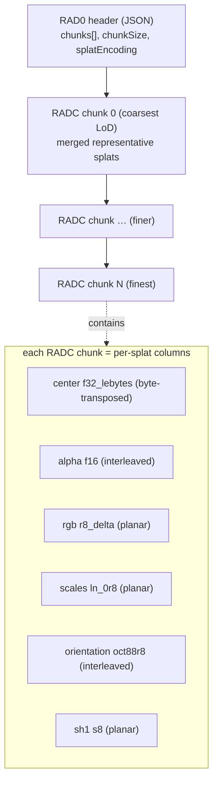
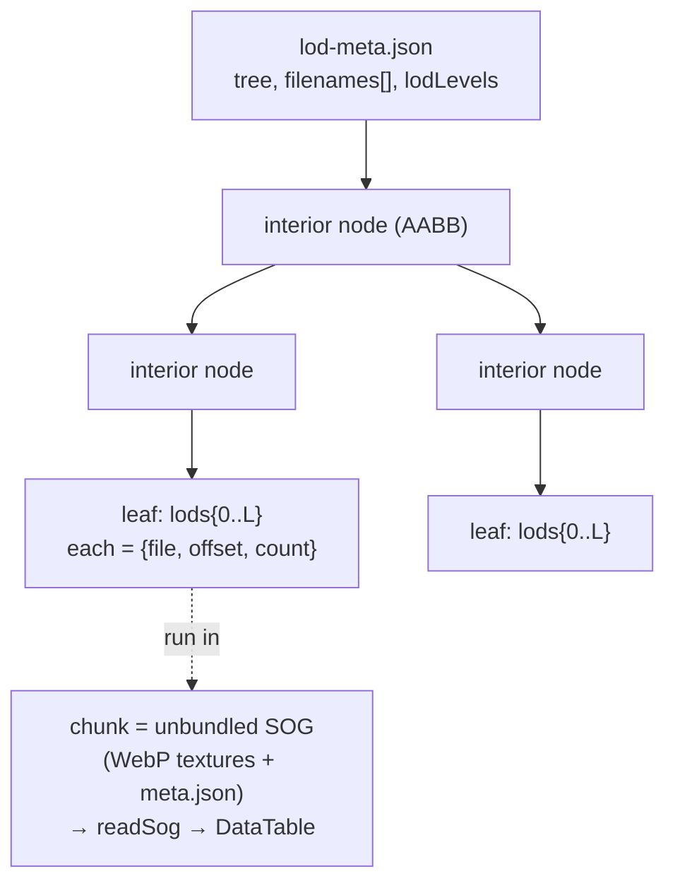
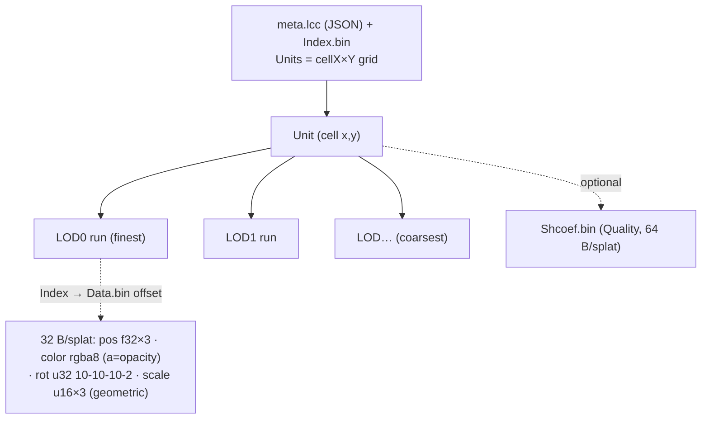
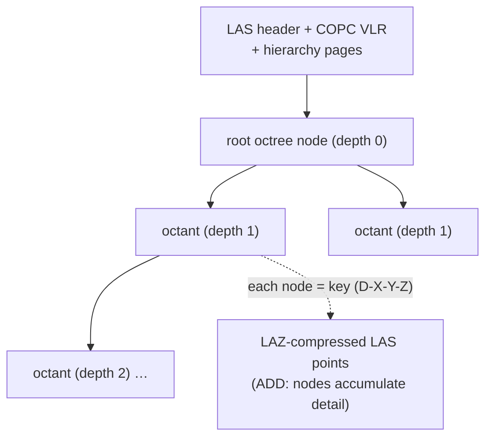

# 3dtiled-to-3dtiles

Node.js CLI tools that convert **tiled / LoD splat & point-cloud formats** → OGC **3D Tiles 1.1**
(Gaussian splats via `KHR_gaussian_splatting` + `KHR_gaussian_splatting_compression_spz_2` GLB
tiles), plus a self-contained CesiumJS + 3DTilesRendererJS viewer (`viewer.html`).

The unifying idea: every source format is some *spatial tree of pre-tiled, LoD'd splats* (or points)
— so each converter just maps that tree onto a 3D Tiles HLOD tree and re-encodes node content to
SPZ-v2 GLB (one shared encoder, `spzGlb.js`). The decode differs per format; the output is uniform.

## Format comparison

🟢 = operational · 🟡 draft = scaffold built, partially/un-validated · 🟠 doc = spec referenced in
`docs-references/`, converter not built (lower-priority / niche). See `docs-references/` for full notes.

### Output — 3D Tiles

| Format | Status | Hierarchy / subdivision | Node (leaf) content | Refine | Intermediate nodes | Metadata location | HTTP range | Spec |
|--------|:------:|-------------------------|---------------------|:------:|--------------------|-------------------|:----------:|------|
| **3D Tiles** (output) | 🟢 out | explicit or implicit; box/region/sphere volumes | glTF/GLB w/ `KHR_gaussian_splatting`+`_spz_2` (splats) or POINTS/TRIANGLES | REPLACE/ADD | optional content | `tileset.json` (+ `.3tz`) | ✅ | [OGC](https://www.ogc.org/standard/3dtiles/) |

### Tiled point-cloud & mesh sources → 3D Tiles

| Format | Status | Hierarchy / subdivision | Node (leaf) content | Refine | Intermediate nodes | Metadata location | HTTP range | Spec |
|--------|:------:|-------------------------|---------------------|:------:|--------------------|-------------------|:----------:|------|
| **COPC** (LiDAR) | 🟢 | **octree** (EPT-style) | LAZ-compressed LAS points | ADD | octree nodes (accumulate) | COPC VLR + hierarchy pages | ✅ designed for range reads | [copc.io](https://copc.io) |
| **Potree** (point cloud) | 🟢 | **octree** (named `r`/`r0`..`r7`) | points: position int32×3·scale+offset + rgb (2.0 `octree.bin` / 1.x per-node `.bin`) | ADD | octree nodes (accumulate) | 2.0 `metadata.json`+`hierarchy.bin` (22 B/node) · 1.x `cloud.js`+`.hrc` | ✅ (2.0 single octree.bin; 1.x per-node files) | [Potree](https://github.com/potree/PotreeConverter) |
| **LAS / LAZ** (plain) | 🟡 | none (flat / chunked — no native LoD) | LAS points (LAZ via `laz-perf`) | ADD | — | LAS header + VLRs | ⚠️ whole-file (not cloud-optimized) | [ASPRS LAS](https://www.ogc.org/standard/las/) |
| **I3S** (Esri) | 🟡 draft | node tree (**always explicit** — no implicit/template scheme), OBB/MBS LoD (SLPK or REST) | nodes/geometry/textures; `DefaultGeometrySchema` = **PerAttributeArray** (pos `f32×3` · normal `f32×3` · uv0 `f32×2` · color `u8×4`, sequential) or Draco | REPLACE | node pages (`nodepages/*.json`) | `3dSceneLayer.json` + node pages | ✅ REST/range | [github](https://github.com/esri/i3s-spec) |
| **Nexus** (CNR-ISTI) | 🟠 doc | multiresolution patch DAG / batched mesh | per-patch mesh (not splats) | — | — | header + patch index | ✅ | [github](https://github.com/cnr-isti-vclab/nexus) · [paper](https://vcg.isti.cnr.it/Publications/2016/PD16/FastDec_Ponchio.pdf) |

### Tiled Gaussian-splat sources → 3D Tiles

| Format | Status | Hierarchy / subdivision | Node (leaf) content | Refine | Intermediate nodes | Metadata location | HTTP range | Spec |
|--------|:------:|-------------------------|---------------------|:------:|--------------------|-------------------|:----------:|------|
| **RAD** (SparkJS) | 🟢 | LoD merge tree, variable fanout (BhattLod ~1.75 / TinyLod ~1.5) | RADC chunk: per-splat columns — `f16`/`oct88r8` **interleaved**, `ln_0r8`/`r8_delta` **planar**, `f32_lebytes` byte-transposed | REPLACE | downsampled **merged** splats | root `RAD0` JSON + per-chunk `RADC` JSON | ✅ chunked `.radc` | [sparkjs.dev](https://sparkjs.dev/docs/lod-getting-started/) |
| **SOG (streamed)** (PlayCanvas) | 🟢 | **binary** spatial tree (AABB split) | unbundled SOG chunk: WebP textures → `DataTable` (pos/quat-w-first/log-scale/SH-DC/logit-opacity) | REPLACE | empty grouping nodes | `lod-meta.json` + per-chunk `meta.json` | ✅ per-file | [playcanvas](https://developer.playcanvas.com/user-manual/gaussian-splatting/formats/streamed-sog/) |
| **LCC** (XGRIDS) | 🟢 | **grid of Units** (cellX×Y) × per-cell LODs | `Data.bin` fixed **32 B/splat**: pos `f32×3`, color `rgba8`, scale `u16×3`, rot `10-10-10-2` (+SH `Shcoef.bin` 64 B) | REPLACE | per-cell coarse LODs | `meta.lcc` JSON + `Index.bin` | ✅ `Index.bin` offsets into `Data.bin` | [developer.xgrids.com](https://developer.xgrids.com/#/document?titleId=en-1720509291851) |

### Format specifications (canonical sources + local mirrors)

Each source format's authoritative spec, with a distilled local copy under [`docs-references/`](docs-references/):

| Format | Canonical spec(s) | Local mirror |
|--------|-------------------|--------------|
| **COPC** | [copc.io](https://copc.io) · [spec repo](https://github.com/copcio/copcio.github.io) | — |
| **Potree** | [PotreeConverter](https://github.com/potree/PotreeConverter) · [2.0 format (potree-converter)](https://github.com/potree/potree/blob/develop/docs/) · ref impl [potree23dtiles](https://github.com/yeyan00/potree23dtiles) | [`potree-format.md`](docs-references/potree-format.md) |
| **streamed-SOG** | [PlayCanvas streamed-SOG](https://developer.playcanvas.com/user-manual/gaussian-splatting/formats/streamed-sog/) · [SOG](https://developer.playcanvas.com/user-manual/gaussian-splatting/formats/sog/) · [splat-transform](https://github.com/playcanvas/splat-transform) | [`streamed-sog.md`](docs-references/streamed-sog.md) · [`sog.md`](docs-references/sog.md) |
| **LCC** (XGRIDS) | [developer.xgrids.com](https://developer.xgrids.com/#/document?titleId=en-1720509291851) · [LCC whitepaper](https://github.com/xgrids/LCCWhitepaper) · [LCC-Web-SDK](https://github.com/xgrids/LCC-Web-SDK) | [`lcc-format.md`](docs-references/lcc-format.md) |
| **RAD** (SparkJS) | **spec:** [LoD getting started](https://sparkjs.dev/docs/lod-getting-started/) · **blog:** [Spark 2.0 — spatially partitioned LoD](https://www.worldlabs.ai/blog/spark-2.0) · [ext-splats](https://sparkjs.dev/docs/ext-splats/) | [`rad-format-notes.md`](docs-references/rad-format-notes.md) · [`spark-2.0-blog-post.md`](docs-references/spark-2.0-blog-post.md) |
| **I3S** (Esri) | [esri/i3s-spec](https://github.com/esri/i3s-spec) (OGC Community Standard) | [`i3s-spec.md`](docs-references/i3s-spec.md) |
| **SPZ / glTF splat exts** | [SPZ](https://github.com/nianticlabs/spz) · [KHR_gaussian_splatting](https://github.com/CesiumGS/glTF/tree/proposal-KHR_gaussian_splatting) | [`spz-format.md`](docs-references/spz-format.md) · [`KHR_gaussian_splatting.md`](docs-references/KHR_gaussian_splatting.md) |
| **3D Tiles packages** | [`.3tz` spec](https://github.com/erikdahlstrom/3tz-specification) · [`.3dtiles` proposal (#727)](https://github.com/CesiumGS/3d-tiles/issues/727) | [`3tz-3dtiles-packages.md`](docs-references/3tz-3dtiles-packages.md) |
| **USD splats (ParticleField)** | [OpenUSD v26.03](https://aousd.org/blog/openusd-v26-03/) · [ParticleField3DGaussianSplat](https://openusd.org/release/user_guides/schemas/usdVol/ParticleField3DGaussianSplat.html) | [`usd-gaussian-splats.md`](docs-references/usd-gaussian-splats.md) |

**Producing the tiled inputs (offline tilers):** point-cloud tilers (PotreeConverter, py3dtiles,
gocesiumtiler, PDAL→COPC), splat LoD builders (SparkJS `build-lod`, PlayCanvas `splat-transform`,
XGRIDS LCC), and a note on **why PotreeConverter 2.0 is so fast** — see [`offline-tilers.md`](docs-references/offline-tilers.md).

(Several spec sites block automated fetching — the `docs-references/` mirrors are hand-distilled from
the canonical sources above and kept in sync as the converters evolve.)

### Parallelism (per converter)

Per-tile work — decode → SPZ/GLB encode → gzip → write — is **independent per tile**, so it is
embarrassingly parallel. The shared `core` (`packages/core`) provides the two tiers: **async gzip**
(`zlib.gzip` on the libuv threadpool) + `parallelMap` (bounded-concurrency = cores−1, no workers), and
a `WorkerPool` (`worker_threads`) for decode-heavy formats. **All five operational converters now use
tier 1** (`parallelMap` + async gzip/`buildPointsGlb`), each verified to produce output equivalent to
its prior serial version. The `WorkerPool` tier (true multicore decode) is not yet wired — it's the
remaining headroom for the WASM/CPU-bound decoders.

| Converter | Decode cost (per tile) | Parallel **today**? | Main-thread-bound part | Worker-extractable? |
|-----------|------------------------|:-------------------:|------------------------|---------------------|
| **rad** | pure-JS column unpack (interleaved/planar) — CPU-bound | ✅ `parallelMap` + async gzip (byte-identical) | JS decode | ✅ decode per chunk → `WorkerPool` (true multicore) |
| **sog** | **WebP WASM** decode per chunk | ✅ `parallelMap` + async gzip (content-identical) | WebP decode | ✅ **biggest win** (thousands of tiles); WASM runs in workers as-is |
| **lcc** | pure-JS `DataView` unpack — fast | ✅ `parallelMap` + async gzip | one ~3 M-splat tile is a serial tail | ✅ worker decode would split that giant tile |
| **copc** | **LAZ WASM** (`laz-perf`) decode — CPU-bound | ✅ `parallelMap` (byte-identical; ~27% faster) | LAZ decode | ✅ per-node decode → worker pool |
| **potree** | pure-JS slice (+ **brotli** for 2.0) — many small nodes | ✅ `parallelMap` (byte-identical) | per-node decode + brotli | ✅ many small nodes → ideal worker-pool fan-out |
| **i3s** (draft) | pure-JS geometry decode | ❌ (draft; serial) | — | ✅ later |

Measured (cores−1 lanes): copc autzen 23.0→16.9 s, potree lion 6.2→5.0 s — modest now (gzip/decode
still on the main thread via the libuv pool); the `WorkerPool` tier is where multicore decode lands.

**Short answer to "can main-thread work move to workers?"** Yes — for *every* converter. The pure-JS
decoders (rad, lcc, potree) gain the most (they're single-core-bound today → true multicore via
`WorkerPool`); the WASM decoders (sog, copc) are already fast per-op but still serialized on the main
thread, so a worker pool parallelizes them across cores. `core.WorkerPool` is the shared mechanism;
each converter just needs its tile loop ported (lcc is the worked example).

### Runtime (Node today / browser-capable?)

All converters run on **Node today** (`fs` for I/O, Node `zlib` for SPZ gzip). The *decoders* are
mostly portable; the Node-only parts are I/O + compression + workers, which `core` abstracts.

| Converter | Decoder portability | Node-only gate(s) → browser path |
|-----------|---------------------|----------------------------------|
| **rad** | pure JS (Buffer math) | `fs` → fetch/File; SPZ `zlib.gzip` → `CompressionStream('gzip')`. Browser-capable. |
| **sog** | **WASM** (`webp.wasm` via splat-transform — a web SDK) | `fs`/`MemoryReadFileSystem` → its `UrlReadFileSystem` already works in-browser. Browser-capable. |
| **lcc** | pure JS (DataView) | `fs` → fetch. Browser-capable. |
| **copc** | **WASM** (`laz-perf`) | `fs` → fetch; `proj4` is browser-ok. Browser-capable. |
| **potree** | pure JS | `fs` → fetch; **2.0 BROTLI needs a WASM brotli** (no standard browser API — DEFAULT encoding is fine). Mostly browser-capable. |
| **i3s** | JS + zip | `fs`/zip → fetch + a browser zip lib. Browser-capable (draft). |
| **output GLB** | `@gltf-transform/core` | works in Node and browser. |

Common gates: **gzip** (SPZ) → browser `CompressionStream`; **brotli** (Potree 2.0) → needs WASM;
**parallelism** `worker_threads` → Web Workers (same task shape); WebP/LAZ decoders are *already* WASM.



### Per-format structure

<details><summary><b>RAD</b> (SparkJS) — LoD merge tree, REPLACE</summary>


</details>

<details><summary><b>Streamed SOG</b> (PlayCanvas) — binary spatial tree, REPLACE</summary>


</details>

<details><summary><b>LCC</b> (XGRIDS) — Unit grid × LODs, REPLACE</summary>


</details>

<details><summary><b>COPC</b> (LiDAR) — octree, ADD</summary>


</details>

---

## Monorepo & usage

npm-workspaces monorepo. Each input format is an **independent converter** with its own deps
(install just the one you need); a shared **core** holds the common machinery; a **meta-converter**
detects any input and dispatches.

```
packages/
  core/      3dtiles-convert-core   — shared: SPZ-v2 GLB + POINTS GLB encoders (async gzip),
                                      parallelMap + WorkerPool, format detection
  convert/   3dtiles-convert        — meta-converter; exposes the `3dtiled` CLI + a JS/TS API
  rad-to-3dtiles/  sog-to-3dtiles/  lcc-to-3dtiles/  copc-to-3dtiles/  potree-to-3dtiles/  i3s-to-3dtiles/
                                    — the per-format converters (each its own package + deps)
```

All packages live under `packages/` (npm-workspaces members). Run `npm install` once at the repo root
to link the `3dtiles-convert-core` workspace symlink and each converter's deps.

*Naming:* per-format converters keep the descriptive **`<fmt>-to-3dtiles`** convention (not scoped
`@scope/<fmt>`); the two shared packages are the unscoped `3dtiles-convert-core` / `3dtiles-convert`.

### Meta-converter — convert anything

```sh
npm install                                  # wire up the workspaces
# CLI (auto-detects format):
npm run convert -- <input> <outDir> [--format rad|sog|lcc|copc|potree|i3s] \
                                    [--scale N] [--ge-scale N] [--ge-layer N] [-- <extra converter args>]
# or directly:
node packages/convert/cli.js sample-data/input/RAD/coit.rad sample-data/output/rad/coit-3dtiles-from-rad
```

```js
// JS/TS API — same detection + dispatch
import { convert, detectFormat, supportedFormats } from '3dtiles-convert';
await convert('path/to/input', 'out/dir', { geScale: 2, onLog: s => process.stdout.write(s) });
```

> Today the meta-converter dispatches to each `<fmt>-to-3dtiles/src/index.js` as a child process
> (non-breaking during migration); as converters move into `packages/<fmt>` and export the uniform
> `convert()`, the registry flips that entry to an in-process module import — the public API is
> unchanged. See [ARCHITECTURE.md](ARCHITECTURE.md).

### Individual converter (à la carte)

Each converter also runs standalone (only its own deps):

```sh
node packages/rad-to-3dtiles/src/index.js    <coit.rad>            sample-data/output/rad/<name>-3dtiles-from-rad
node packages/sog-to-3dtiles/src/index.js    <scene-dir>           sample-data/output/sog/<name>-3dtiles-from-sog
node packages/lcc-to-3dtiles/src/index.js    <lcc-dir>             sample-data/output/lcc/<name>-3dtiles-from-lcc
node packages/copc-to-3dtiles/src/index.js   <input.copc.laz>      sample-data/output/copc/<name>-3dtiles-from-copc
node packages/potree-to-3dtiles/src/index.js <potree-dir>          sample-data/output/potree/<name>
node packages/i3s-to-3dtiles/src/index.js    <extracted-slpk-dir>  sample-data/output/i3s/<name>   # draft
```

> Output convention: regenerate into **`sample-data/output/<fmt>/…`** (the viewer presets and
> `tools-inspector` scripts point there).

---

## Converters

### Viewer (`viewer.html`) — offline, self-contained via Vite

All viewer deps (Cesium, three, 3d-tiles-renderer, @sparkjsdev/spark, the 3DGS plugin) are **npm
dependencies bundled by Vite — no CDN, works fully offline**:

```sh
pnpm install         # (or npm install) — installs cesium/three/3d-tiles-renderer/spark/vite
pnpm run dev         # vite dev server → http://localhost:3000/ (redirects to viewer.html; serves sample-data/)
# pnpm run build     # static offline bundle in dist/
```

pnpm uses `pnpm-workspace.yaml` + `.npmrc` (`node-linker=hoisted`, so the meta-converter's
`import('rad-to-3dtiles')` resolves like npm's flat layout); npm uses the `workspaces` field. Either works.

`vite-plugin-cesium` copies Cesium's Workers/Assets/Widgets and sets `CESIUM_BASE_URL`; `three` is
de-duplicated (`resolve.dedupe`) so SparkJS + the 3DGS plugin share one instance (replacing the old
esm.sh `?external=three` trick). Verified: **0 CDN requests** — Cesium, the 3DTRJS globe, and Gaussian
splat streaming all load from `node_modules`. The dev server serves `sample-data/output/**` too, so the
built-in presets (which point at `http://localhost:3000/sample-data/...`) resolve against the same origin.

Additional online viewers:
- **COPC**: [viewer.copc.io](https://viewer.copc.io), [lidar-viewer.gishub.org](https://lidar-viewer.gishub.org)
- **3D Tiles**: CesiumJS sandbox, [3D-Tiles-RendererJS](https://github.com/NASA-AMMOS/3DTilesRendererJS)

`viewer.html` includes a **3DTilesRendererJS mode** (toggle the `3DTRJS` button) backed by Three.js.
For Gaussian splat streaming, it uses [3D-Tiles-RendererJS-3DGS-Plugin](https://github.com/WilliamLiu-1997/3D-Tiles-RendererJS-3DGS-Plugin)
which streams `.rad`/SPZ content via `@sparkjsdev/spark`:

```sh
npm install 3d-tiles-rendererjs-3dgs-plugin three 3d-tiles-renderer @sparkjsdev/spark
```

```js
import { TilesRenderer } from '3d-tiles-renderer';
import { GaussianSplatPlugin } from '3d-tiles-rendererjs-3dgs-plugin';

const tiles = new TilesRenderer('http://localhost:3000/tileset.json');
tiles.registerPlugin(new GaussianSplatPlugin({
  renderer, scene,
  minRaycastOpacity: 0.1,
  sparkRendererOptions: { focalAdjustment: 2 },
}));
scene.add(tiles.group);
```

> The viewer bundles this plugin (and SparkJS) as local npm deps via Vite — shared `three@0.180`
> through `resolve.dedupe`, no CDN. `npm run dev` serves it offline.

`viewer.html` consolidates all controls into a right **sidebar** (Renderer · Basemap · Tileset &
LoD · Navigation · Local frame · Ion · Snippet), including a **Max SSE (px)** input that drives
CesiumJS `maximumScreenSpaceError` and 3DTRJS `errorTarget`, and a **🪲 Debug tiles** toggle that
draws bounding volumes coloured by octree depth in both renderers. The preset bar includes the
**◈ GSplat 1/2** reference splat tilesets from the
[3DTilesRendererJS-3DGS-Plugin](https://github.com/WilliamLiu-1997/3DTilesRendererJS-3DGS-Plugin)
demo data (PLY→3D Tiles). For deeper tileset inspection (tree, bounds, per-tile stats) alongside
this viewer, see [3DTiles-Inspector](https://github.com/WilliamLiu-1997/3DTiles-Inspector).

---

### copc-to-3dtiles

Converts COPC `.copc.laz` LiDAR files to 3D Tiles 1.1 with implicit octree tiling.

```sh
cd packages/copc-to-3dtiles
npm install
node src/index.js input.copc.laz ./out-copc
```

**Output:**
```
out-copc/
  tileset.json
  tiles/<level>/<x>/<y>/<z>.glb       POINTS, tile-local coords
  subtrees/<level>/<x>/<y>/<z>.subtree binary subtree files
```

**Design:**
- Implicit octree (`subdivisionScheme: "OCTREE"`) — COPC hierarchy maps directly, no re-tiling
- Subtree binary format (3D Tiles 1.1 §7.3): 24-byte header, Morton Z-order bitstreams, bufferView indices
- Refine: `ADD` — each level independently contributes points
- CRS handling: see note below

**On CRS and proj4:**
COPC files may carry a WKT CRS in their VLRs. Currently `georef.js` uses proj4 to convert the
dataset origin to WGS84 lon/lat, then builds an ENU→ECEF (EPSG:4978) root transform — which is
what most 3D Tiles viewers (CesiumJS) expect.

However, **3D Tiles 1.1 does not mandate ECEF**. The spec allows any CRS expressed via a
`transform` matrix and optional metadata. If the COPC's native CRS is known and the viewer
supports it, proj4 could be skipped entirely by passing the raw COPC transform hierarchy
root-to-leaf verbatim. Viewers like opengeos' lidar-viewer likely position COPC files correctly
by reading their internal spatial metadata directly rather than relying on the 3D Tiles CRS.
This is worth exploring to simplify the pipeline and eliminate the proj4 dependency for
native-CRS outputs.

---

### rad-to-3dtiles

Converts SparkJS `.RAD` Gaussian Splat LoD files to 3D Tiles 1.1 with `KHR_gaussian_splatting` GLB tiles.

```sh
cd packages/rad-to-3dtiles
npm install
# Always inspect first:
node scripts/dump-rad-header.js coit.rad
# Convert (defaults: --scale=1, --ge-scale=1, --ge-layer=1):
node src/index.js coit.rad ./out-rad
# Noise filtering (OPT-IN, default OFF — SparkJS renders the RAD with no filtering, so we don't either):
#   --opacity-filter=0.05   drop faint splats (final opacity < N)
#   --max-scale-mult=30     drop giant "floating noise" splats (maxScale > per-chunk median×N)
node src/index.js coit.rad ./out-rad --opacity-filter=0.05 --max-scale-mult=30  # only for data with known noise
# Tune splat size and LoD (rarely needed — raw values match the reference):
node src/index.js coit.rad ./out-rad --scale=2         # σ×2 (larger splats)
node src/index.js coit.rad ./out-rad --ge-scale=2      # GE×2 (refine at greater distance)
node src/index.js coit.rad ./out-rad --ge-layer=2      # widen depth range
```

**Output:**
```
out-rad/
  tileset.json              explicit tiling, one tile per RAD chunk
  tiles/node_<index>.glb    KHR_gaussian_splatting GLB (POINTS)
```

> **Note:** `--3tz` / `--3dtiles` packaging requires
> [`@cesium/3d-tiles-tools`](https://github.com/CesiumGS/3d-tiles-tools) installed.
> `npm install @cesium/3d-tiles-tools` in the `rad-to-3dtiles` directory, then pass the flag.
> Plan to eventually promote this to a first-class dependency.

**Live `/stream` (no pre-conversion)** — `packages/tile-server/rad-live.js`, served at
`GET /stream/tileset.json?url=<.rad>&format=rad` (or the dedicated `/rad/tileset.json?url=<.rad>`):

- **tileset.json** — fetch the `.rad` once (cached in memory), build the node table, and decode
  **only the `center` column** per chunk for bounds — no SPZ encode, no gzip. Reuses the shared
  `buildTileset`. This is the cheap pass that makes the first paint fast.
- **tile/`<i>`.glb** — full-decode + SPZ-v2 encode that **one** chunk on demand (~200 ms / 65k-splat
  chunk), via the shared `encodeChunkGlb`.

This defers the expensive per-tile decode+encode+gzip (which `/convert` runs for the *whole* dataset
up front) to on-demand, so tiles stream as the camera requests them. Only **monolithic** `.rad` files
stream (a streaming-manifest `.rad` has no embedded chunk data); `/convert` produces identical tiles.

---

### sog-to-3dtiles

Converts a PlayCanvas **[Streamed SOG](docs-references/streamed-sog.md)** dataset (`lod-meta.json`
+ per-chunk unbundled [SOG](docs-references/sog.md) dirs) to 3D Tiles 1.1 with the same
`KHR_gaussian_splatting` + `_compression_spz_2` GLB tiles as the RAD path.

```sh
cd packages/sog-to-3dtiles
npm install                                  # pulls @playcanvas/splat-transform
node src/index.js path/to/scene/ ./out-sog   # dir containing lod-meta.json, or the json itself
```

**How it works:** the streamed-SOG binary spatial tree maps almost 1:1 onto a 3D Tiles HLOD
tree — interior nodes become empty grouping tiles, and each leaf becomes a `REPLACE` chain of
tiles from coarsest LOD level down to level 0 (finest). Bounds are emitted in the Z-up tileset
frame (`RX+90°`), matching the RAD path.

**The per-chunk pipeline (intermediate format):**
1. [`@playcanvas/splat-transform`](https://github.com/playcanvas/splat-transform)'s `readSog`
   decodes each SOG chunk's WebP textures (CPU `webp.wasm` — **no GPU**) into a **`DataTable`** —
   that's the intermediate per-chunk format. Columns: `x,y,z`, `rot_0..3` (quaternion, **w-first**),
   `scale_0..2` (**log**), `f_dc_0..2` (SH DC), `opacity` (**logit**).
2. For each leaf's `lods[level]` run, we slice `[offset, offset+count)` of that DataTable, convert
   conventions (`exp` scale, `sigmoid` opacity, `0.5 + SH_C0·f_dc` → color, quaternion reorder
   w-first → xyzw), and re-encode to an **SPZ-v2 GLB** with our own encoder (the same one
   `rad-to-3dtiles` uses).

That this path renders cleanly is itself proof the **SPZ-v2/GLB encoder and tree builder are
correct** — so when the RAD path looked wrong, the bug had to be in the *RAD decode*, not the
shared encoder. (It was: see [RAD column layouts](#rad-column-byte-layouts-the-spiky-render-bug).)

**Output:**
```
out-sog/
  tileset.json           HLOD tree mirroring the SOG spatial tree
  tiles/node_<n>.glb      one per LOD run; tiles/env.glb if the scene has an environment
```

> **Status:** validated end-to-end on PlayCanvas's `example_skatepark_02` & `example_roman_parish_02`
> (see Sample Data below). Decoded tiles contain real splats — varied positions, valid scales,
> unit quaternions, proper opacity — confirming the WebP CPU decode + decode conventions
> (quaternion `rot_0=w`, log scales, logit opacity, SH0→color). geometricError halves cleanly
> root→leaf (e.g. skatepark `17.8 → 8.9 → … → 0.0`). Bundled `.sog` environments are skipped
> (best-effort) since the spec's chunks are unbundled.

---

### lcc-to-3dtiles

Converts an XGRIDS **[LCC](docs-references/lcc-format.md)** dataset (`meta.lcc` + `Index.bin` +
`Data.bin` [+ `Shcoef.bin`]) to 3D Tiles with the same `KHR_gaussian_splatting` + `_spz_2` GLB tiles.

```sh
cd packages/lcc-to-3dtiles
node src/index.js path/to/lcc-dir ./out-lcc     # dir containing meta.lcc (name can vary)
```

**How it works:** LCC organises splats as a **grid of Units** (one per partition cell, x/y packed in
the index) × `totalLevel` LODs (LOD0 = finest). Each Unit → a `REPLACE` chain of tiles
coarsest→finest under a single root. `Data.bin` is **uncompressed, fixed 32 B/splat** (the meta
`"encoding": "COMPRESS"` refers to field quantization, not stream compression — verified
`LODSize / PointsCount == 32`). The 32-byte layout is taken **directly from the official
[xgrids/LCC-Web-SDK](https://github.com/xgrids/LCC-Web-SDK) vertex shader** (the non-`LCC_COMPRESSED`
`decodeCov` path), not guessed: `0–11 pos f32×3 · 12–15 color rgba8 (a = opacity) ·
16–21 scale uint16×3 · 22–25 rot uint32 (10-10-10-2 smallest-three) · 26–27 semantic · 28–31 pad`.
**Scale = linear `mix(scale.min, scale.max, u/65535)`** (the SDK's `compressedScaleMin/Max` uniforms =
meta `attributes.scale.min/max`); rotation decode = the SDK's `QUAT_TAB`.

> ⚠️ **LCC partitions in X/Y only (a 2-D grid, not an octree).** `Index.bin` packs each Unit's cell as
> `x(low16)/y(high16)` with `cellLengthX/Y`; there is **no Z partition** — each Unit spans the full
> scene height, refined by LOD detail rather than by vertical tiling. For a **tall scan** (e.g. an
> XGRIDS L2 sweep of a tower) the live/stream tile boxes therefore use the cell's X/Y extent + the full
> scene Z, so vertical frustum culling is coarse (everything in a column shares one Z span). Not a bug —
> it's how LCC organizes data; tighter per-Unit Z would require decoding the splats.

**Validated:** `Guan_Temple` → 154 tiles, **11,424,293 splats (= `meta.totalSplats` exactly)**,
0 bad quaternions, scale p50 ≈ 3 cm (sane for a 325 m-diagonal temple). **SH (`Shcoef.bin`, Quality
files) not yet emitted** (DC only, like the other converters). LCC is XGRIDS' format — attribution
required per its White Paper (see the doc).

> **License note:** the LCC White Paper requires displaying "Data Organization Format originated
> from XGRIDS" and publishing derivatives under terms no less open. This converter reads the format;
> downstream products must carry that attribution.

---

### i3s-to-3dtiles  🟡 **DRAFT — mesh validated on real data**

Converts the **supported subset** of Esri **[I3S](docs-references/i3s-spec.md)** (Indexed 3D Scene
Layer) → 3D Tiles 1.1. Validated on `Buildings_NewYork_v18.slpk` → **5882 glTF TRIANGLES tiles** that
place correctly in NYC: I3S geographic-layer vertices are `(Δlon°, Δlat°, Δheight_m)` relative to the
node OBB centre, converted per-vertex to ECEF (stored relative to the centre for float32 precision,
tile `transform` translates back). Still a draft: **projected/vertical CRS** placement is not handled,
normals stay in the source frame, and Draco/LEPCC/textures/attributes are gated out.

```sh
unzip your-layer.slpk -d your-layer/        # an SLPK is a plain zip
cd packages/i3s-to-3dtiles
node src/index.js ../your-layer ./out-i3s
```

**Scope (deliberately gated — warns/skips everything else):**

| Supported ✓ | Not supported ✗ (detected → warn/skip/exit) |
|---|---|
| Explicit `nodepages/*.json` trees | Legacy per-node `3dNodeIndexDocument` index (pre-1.7) |
| `IntegratedMesh` / `3DObject` → glTF **TRIANGLES** | **Draco**-compressed geometry (no decoder) |
| `PointCloud` → glTF **POINTS** | `Point` (symbol/instance) & `Building` (composite) layers |
| Uncompressed `DefaultGeometrySchema` (PerAttributeArray) | Textures / PBR materials (dropped — geometry only) |
| OBB → 3D Tiles `box`; node tree → REPLACE tileset | Per-feature attributes (dropped); non-WGS84 vertical CRS |

**Investigation notes** (answering "is it complex? meshes/points/instances/mix? implicit?"):
I3S **does** cover meshes (`IntegratedMesh`, `3DObject`), point clouds (`PointCloud`), and
symbol/model **instances** (`Point` layers); a **Building Scene Layer** is the "mix" — a composite of
sublayers. Tiling is **always explicit** (a node tree addressed via paged indices); I3S has **no
implicit/template scheme** like 3D Tiles subtrees, so the user's "explicit tiling only" constraint is
automatic. The node-tree → tileset mapping is **direct** (OBB↔box, children↔children, REPLACE). The
genuinely hard parts — and why this stays a draft — are **Draco** geometry, **textures/materials**,
**per-feature attributes** (→ `EXT_mesh_features`/metadata), and the **CRS/ECEF vertex placement**
nuances. A mesh-or-points-only, uncompressed, explicit-tree converter (this draft) is **moderate**;
full-fidelity I3S is **high** effort and overlaps mature tools (loaders.gl, Cesium ion).

> **Reference — bidirectional I3S ⇄ 3D Tiles converter:** loaders.gl's
> **[`@loaders.gl/tile-converter`](https://github.com/visgl/loaders.gl/tree/master/modules/tile-converter)**
> ([docs](https://loaders.gl/docs/modules/tile-converter/cli-reference/tile-converter)) converts
> **3D Tiles → I3S and I3S → 3D Tiles** (Draco, textures, attributes, gzip), and is the mature
> baseline this draft is measured against. Use it for full-fidelity I3S; `i3s-to-3dtiles` here stays a
> minimal, dependency-light subset (uncompressed, explicit tree, mesh/points only).

> **Reference — 3D Tiles ⇄ 3D Tiles tooling:** CesiumGS's
> **[`3d-tiles-tools`](https://github.com/CesiumGS/3d-tiles-tools)** is the canonical toolbox for
> tileset-level operations, several of which overlap our "3D Tiles → 3D Tiles" plans:
> - **`upgrade`** — legacy → 3D Tiles 1.0/1.1 (`asset.version`, `url`→`uri`, `refine` upper-case, glTF
>   1.0→2.0, and with `--targetVersion 1.1` converts PNTS/B3DM/I3DM/CMPT content to glTF; drops
>   `3DTILES_content_gltf`).
> - **`merge` / `mergeJson`** — combine tilesets as external tilesets (mergeJson writes only the
>   referencing JSON, using relative paths to the inputs).
> - **`b3dmToGlb` / `i3dmToGlb` / `cmptToGlb` / `convertB3dmToGlb` / `convertPntsToGlb` /
>   `convertI3dmToGlb` / `splitCmpt`** — extract or convert legacy tile content to glTF.
>
> Our [`3D Tiles → 3D Tiles`](#3d-tiles--3d-tiles-transcodes) transcodes are the live/streaming-flavored
> counterparts (implicit→explicit, legacy upgrade); use `3d-tiles-tools` for full offline pipelines.

---

### potree-to-3dtiles

Converts a **Potree** octree point cloud → 3D Tiles (glTF **POINTS** tiles). Auto-detects
**2.0** (`metadata.json` + `hierarchy.bin` + `octree.bin`) and **1.x** (`cloud.js` + `.hrc` +
per-node `.bin`).

```sh
cd packages/potree-to-3dtiles && npm install
node src/index.js path/to/potree-dir ./out-potree
```

**How it works:** the Potree octree (`r`, `r0`..`r7`, …) maps 1:1 to a 3D Tiles tree with
**`refine: ADD`** (children add denser detail in sub-octants, like COPC); `geometricError` = point
spacing per depth (`rootSpacing / 2^depth`). 2.0 decode is authoritative (`hierarchy.bin` 22 B/node:
`type u8, childMask u8, numPoints u32, byteOffset u64, byteSize u64`; positions `int32×3·scale+offset`;
DEFAULT + BROTLI via Node's `zlib`). Points are emitted relative to the dataset centre (float32-safe).

**Validated on real datasets** (2026-06-22):

| Sample | Potree | Result |
|--------|--------|--------|
| iTowns `lion` | 2.0 (**BROTLI**) | ✅ 1624 tiles / **3,954,696 pts = `metadata.points` exactly** (Morton-decoded position+rgb) |
| `lion_takanawa` | 1.x **v1.7** (`.hrc` + chunked `data/r/…`) | ✅ 167 tiles / 272,768 pts (per-node origin) |
| `vol_total` | 1.x **v1.4** (inline `hierarchy`, flat `data/<name>.bin`) | ✅ 42 tiles |
| `lion_takanawa_laz` | 1.x **v1.4 + LAZ** (`pointAttributes:"LAZ"`, flat `data/<name>.laz`) | ✅ 200 tiles — **tiled LAZ** octree (one .laz per node, laz-perf) |

> **Status:** 🟢 **operational for Potree 2.0 (DEFAULT + BROTLI) and 1.x (v1.7 `.hrc` + v1.4 inline),
> with `.bin` and tiled-`.laz` nodes.** 2.0 BROTLI positions/rgb are Morton-decoded; 1.x points are
> quantised per-node-origin; LAZ nodes are decoded with laz-perf (via `copc`). Output is **not
> geo-referenced** (local origin; add a root transform downstream). Samples in
> `sample-data/input/POTREE/`. Reference: [yeyan00/potree23dtiles](https://github.com/yeyan00/potree23dtiles) + Potree `DecoderWorker_brotli.js`.

**Implicit vs explicit tiling — available on all four surfaces:**

| Surface | Default | Option |
|---------|---------|--------|
| Dedicated CLI (`node src/index.js … --tiling=explicit`) | implicit | `--tiling=explicit` |
| Meta CLI (`node packages/convert/cli.js … --tiling=explicit`) | implicit | `--tiling=explicit` |
| `/convert` middleware | implicit | `&tiling=explicit` |
| `/stream` middleware | implicit | `&tiling=explicit` |

Both COPC and Potree are octree hierarchies, so **implicit** is the natural default (smaller
tileset JSON, subtrees served on demand). Pass `explicit` only when the client doesn't support
3D Tiles 1.1 implicit tiling (e.g. legacy CesiumJS < 1.96 or simple tile fetchers).

### `/stream` lazy-loading status (geometry vs hierarchy)

Two independent questions for a streaming adapter: is **geometry** fetched per-tile on demand (vs.
converting everything up front), and is the **hierarchy/tree itself** built on demand (vs. reading the
whole index/hierarchy at cold load)? Geometry-on-demand is universal here; hierarchy-on-demand is the
hard part, and matters for **huge clouds** where reading the entire hierarchy before the first tile is
the bottleneck.

**Tiles vs hierarchy** — (1) **tile geometry** is fetched on demand for *every* format (universal).
(2) the **hierarchy** is the hard part. Each live converter exposes the `cache` axis (`none`=lazy,
`hierarchy`=eager-drain, `full`=`/convert`). The columns below: how tile geometry is fetched, the
lazy hierarchy strategy, whether the **hierarchy build is parallel** (bounded HTTP range/page fetches —
the lever for *massive multi-page* datasets), whether **tile fetches are parallel range**, and the
measured cold start.

| `/stream` source | Tile geometry | Lazy hierarchy | Parallel hierarchy build | Parallel tile fetch | `cache=hierarchy` (eager) | Cold start |
|---|:---:|:---:|:---:|:---:|:---:|---|
| **Potree 2.0** (`metadata.json`) | ✅ range `octree.bin` | ✅ lazy implicit | ✅ bounded (`ensureBlock2`/drain `Promise.all`) | ✅ per-tile | ✅ drain all chunks | instant (lazy==eager byte-identical, 1624 nodes) |
| **COPC** (`.copc.laz`) | ✅ range node block | ✅ lazy implicit | ✅ bounded (`ensureForSubtree`/`drainAll`) | ✅ per-tile | ✅ drain all pages (shared ctx) | instant (+bg prefetch) |
| **Potree 1.x `.hrc`** (`cloud.js`) | ✅ per-node fetch | ✅ lazy implicit | ✅ **bounded parallel** (`loadChunkRoots`, was sequential) | per-node | ✅ `drainAll` whole `.hrc` | ~0.2 s (302 M-pt; was ~80 s) |
| **RAD** (`.rad`) | ✅ range chunk | ✅ lazy explicit (4-lvl frags) | ✅ **bounded parallel** per BFS level (was sequential) | ✅ per-chunk | ✅ full explicit tree (1 parallel pass) | **0.015 s** (50 M; was 9.6 s) |
| **I3S** (`3dSceneLayer`/`.slpk`) | ✅ per-node geometry | ✅ lazy explicit (4-lvl frags) | ✅ **bounded parallel** page-load per level (was recursive-serial) | per-node | ✅ all node-pages (parallel batches) | ~0.2 s (lazy & eager both 5882/5882) |
| **Potree 1.4 inline** (`cloud.js`) | ✅ per-node | ➖ tree inline in `cloud.js` | n/a (one file) | per-node | ➖ no-op (single file) | instant |
| **streamed-SOG** (`lod-meta.json`) | ✅ per-chunk WebP | ➖ full tree in one JSON | n/a (one file) | per-tile | ➖ no-op (`none`≡`hierarchy`) | fast — nothing to defer |
| **LCC** (`meta.lcc`) | ✅ range `data.bin` | ➖ flat grid (`index.bin`) | n/a (one file) | ✅ per-tile | ➖ no-op (`none`≡`hierarchy`) | fast — flat grid |
| **Packages** (`.3tz`/`.3dtiles`) | ✅ range / sql.js | ➖ passthrough | n/a | ✅ / ➖ | ➖ as authored | instant |

Legend: ✅ done · ➖ not applicable / single-index (nothing to parallelize or defer) · "lazy implicit" =
tiny implicit root, each `.subtree` built on demand from only the chunk(s) it needs · "lazy explicit" =
root fragment of N levels, boundary children are external-tileset refs fetched as the camera refines in.

**Parallel hierarchy build** (the massive-multi-page lever): the eager/drain paths always used
`Promise.all`; the **lazy fragment builders are now bounded-parallel too** — RAD loads each BFS level
concurrently, I3S loads each node-page level concurrently (then builds the fragment synchronously, no
`seen` race), and Potree 1.x loads each `.hrc` band concurrently (`loadChunkRoots`). All capped at
`min(cpus−1, 16)` via `core/parallel.js` `parallelMap` so a deep multi-page fragment can't burst
hundreds of simultaneous range requests. **Parallel tile fetch** is inherent — the renderer requests
many tiles at once and Node serves them concurrently; a single tile is one range read + decode.

All lazy paths verified to reach the **same node set as eager** after parallelization: Potree 2.0
byte-identical (1624 nodes), RAD 765/765 reachable, I3S 5882/5882 content tiles.

### Multi-page hierarchies: the native chunking unit per format (and why we prefetch)

Lazy hierarchy is only possible when the **format itself chunks its hierarchy** into independently
fetchable pieces. This is the same idea everywhere, with different names — and 3D Tiles has *both* output
forms of it: **`.subtree` files** (implicit) and **external `tileset.json` references** (explicit). The
job of each adapter is to map the *source* format's chunking unit onto one of those two 3D Tiles forms.

| Format | Native hierarchy chunking unit (per spec) | Maps to 3D Tiles | Lazy? |
|---|---|:--:|:--:|
| **3D Tiles** | `.subtree` (implicit, `subtreeLevels` deep) · external `tileset.json` (explicit) | — (native) | ✅ |
| **COPC** | **hierarchy pages** — EPT-style; root page in the COPC info, child pages referenced by offset/size (COPC is "COG for point clouds"; pages are its analog of COG overviews) | implicit `.subtree` | ✅ |
| **Potree 2.0** | **hierarchy chunks** in `hierarchy.bin` — `firstChunkSize` + type-2 **proxy** nodes pointing to child chunks | implicit `.subtree` | ✅ |
| **Potree 1.x** | **`.hrc` files** — one per `hierarchyStepSize` band; boundary nodes reference the next `.hrc` | implicit `.subtree` | ✅ |
| **I3S** | **node pages** — `nodepages/{n}.json`, fixed `nodesPerPage` (default 64); contiguous node-index ranges | explicit external tileset (`/i3s/node/`) | ✅ |
| **RAD** | **no separate index** — topology is *distributed in the chunks* (each chunk's `child_count`/`child_start`); the `.rad` JSON header only lists chunk byte-ranges | explicit external tileset (`/rad/subtree/`) | ✅ (defer chunk reads; header lists all chunks) |
| **streamed-SOG** | **none** — `lod-meta.json` carries the **whole** spatial tree in one file | (whole tree at once) | ➖ monolithic |
| **LCC** | **none** — `Index.bin` is a flat per-Unit array (`Total Units = fileSize / indexDataSize`), no page structure | (whole grid at once) | ➖ monolithic |

So **yes** — COPC pages, I3S node pages, Potree chunks/`.hrc` are all the same multi-page concept as
3D Tiles subtrees/external-tilesets, which is exactly why those formats support true lazy hierarchy.
**SOG and LCC do not** (rechecked against the specs): their index is a single monolithic file with no
sub-pages, so there is no portion to defer — `cache=hierarchy ≡ cache=none` for them (both fetch+parse
the one index; "no-op" means the eager knob has nothing extra to do). For a *very large* SOG/LCC that
single index is genuinely not free to parse — but the **format provides no paging to exploit**, so the
honest answer is "out of our hands until the format chunks its index." (RAD is the in-between case: its
header lists every chunk, which is O(chunks) and unavoidable, but the expensive topology+bounds are read
lazily per 4-level fragment.)

**Why prefetch.** With a chunked hierarchy, `cache=none` reads only the page(s) a request needs, so the
*first* request into a new region pays a fetch. `prefetch=N` warms the next N levels in the background so
the renderer usually finds them already resident — combining a lazy cold start with eager-like
refinement. It is meaningful only where there *are* pages to warm: **COPC, Potree 2.0, Potree 1.x**
(octree-lazy). For RAD/I3S the 4-level fragment is itself a prefetch unit. SOG/LCC have no pages → n/a.

> **Can we avoid reading availability/`getCtx` up front *and* not pay it lazily either?**
> Largely yes. For the **octree/quadtree implicit** formats (Potree 2.0, COPC, Potree 1.x) `getCtx` no
> longer reads the whole hierarchy — only the root chunk/page — and each `.subtree` is generated from
> just the chunk(s) that block needs, so the up-front cost is gone and the per-subtree cost is bounded
> (a few range reads, not the whole index). For the **explicit** formats (RAD, I3S) we emit N-level
> fragments whose boundary children are external-tileset refs, so the same bound applies. The only
> remaining strictly-eager cases are SOG/LCC, where the entire index is a single small file you must
> read anyway — there is no sub-index to defer, so laziness buys nothing.

> **Why lazy cold-starts but slightly slower *subsequent* tiles — and how to get both.**
> Eager fills all availability in RAM once, so every later `.subtree`/child lookup is a pure in-memory
> hit. Lazy defers that, so the *first* request into a new region pays a chunk/page fetch. Two mitigations,
> both kept in the middleware so you get fast cold start **and** warm refinement:
> 1. **Background prefetch** — after the root tileset is served, COPC fires a fire-and-forget
>    `ensureForSubtree(0,0,0,0)`; the first levels are usually warm before the renderer asks.
> 2. **Per-URL `getCtx` cache** — once a chunk/page is loaded it stays resident, so a region is fetched
>    at most once; repeat passes are in-memory.
>
> Both eager and lazy implementations are retained rather than replaced: implicit formats keep the eager
> full-hierarchy reader behind the scenes for the offline converter, and **I3S exposes `&lazy=1`** (lazy
> explicit fragments) vs. its default parallel-eager full tree — so you can pick minimal cold start or
> a complete in-RAM tree per request.

> **Note — huge clouds need lazy hierarchy, not just lazy geometry.** Building the full tree up front
> doesn't scale: a 100 M-splat RAD or a 302 M-point Potree 1.7 cloud otherwise reads its entire
> hierarchy/index before showing anything (measured ~80 s for the latter, 9.6 s for a 50 M-splat RAD).
> Lazy hierarchy collapses both to well under a second.

**Octree key convention:**
The implicit `level-x-y-z` tile coordinates are derived from each node's **bounding-box
position** relative to the root box — not from the node-name bit-decomposition. Potree's
own naming uses bit0→Z, bit1→Y, bit2→X (opposite of the 3D Tiles OCTREE convention of
bit0→X, bit1→Y, bit2→Z). Using the box position is convention-agnostic and self-validating
(verified: 0 box mismatches on all tested datasets). The same `coordsOfBox()` derivation is
used in both the offline converters and the live stream adapters.

---

## Architecture: the materialization continuum (`cache = none · hierarchy · full`)

> This section captures a design discussion that defines how the whole project is organised. It is
> deliberately verbatim — the conceptual model below drives the converter/endpoint design.

### There's really only one idea here

Every converter — offline or live — is the *same mapping*:

```
input format                          3D Tiles
─────────────                         ─────────
hierarchy (octree pages / nodepages)  ↔  tile tree (implicit subtrees / explicit children)
node data (points / mesh / splats)    ↔  tile content (glTF + KHR_gaussian_splatting)
CRS + bounds                          ↔  root transform + bounding volumes
```

The *only* thing that differs across everything we've built is **when that mapping is evaluated, and
how much of it is persisted**:

| | evaluate | persist | that's our… |
|---|---|---|---|
| ahead of time, all of it | once, offline | to disk | CLI / SDK output, `.3tz`/`.3dtiles` packages |
| on first request, all of it | once, on hit | to cache | `/convert` |
| per request, only what's asked | every request | nothing | `/stream` + adapters |

### One axis: what the middleware caches

An earlier draft modelled this as two axes (`mode` × `hierarchy`). That was over-complicated. A
"prebuilt" tileset (built offline by the CLI/SDK or shipped as a `.3tz`/`.3dtiles` package) is **not a
middleware mode at all** — you point the viewer straight at its output `tileset.json`; the middleware
isn't involved and can't (and shouldn't) know the input→output link. Drop that, and the rest collapses
to a **single ordered axis: how much the middleware caches.**

```
cache = none | hierarchy | full          # default: none
prefetch = <N levels>                    # background-warm N levels below root (cache=none) — default: 1
tiling   = implicit | explicit           # octree/quadtree only — default: implicit
```

| `cache` | hierarchy read up front? | tile contents persisted? | first request | later / restart | = today's |
|---|---|---|---|---|---|
| **none** | no — root only, chunks on demand (lazy) | no | fast | re-derived; ephemeral | `/stream` lazy |
| **hierarchy** | yes — whole tree in RAM | no (per-request) | slower cold start, warm after | tree warm in RAM (per process) | `/stream` eager |
| **full** | yes | **yes — tree + all tile GLBs to disk** | **slow** (convert all) | served static; survives restart | `/convert` |

`?cache=hierarchy` reads literally as "cache the hierarchy, not the tiles." `cache=none` = fully
dynamic; `cache=full` = convert-and-store. The parameter name carries the concept, so nobody has to
memorise what "live" vs "cached" means.

The same spectrum has three well-known names elsewhere, if it helps: **DB** materialized-table →
materialized-view → view; **Next.js** SSG → ISR → SSR; **GIS/TiTiler** pre-rendered tile cache →
cache-on-demand → dynamic tiling.

> **There is no "prebuilt" mode.** For an offline-built tileset, point the viewer directly at the output
> `tileset.json` (static file serving). The continuum above is only about what the *converter middleware*
> does when it's the one producing 3D Tiles from a non-3D-Tiles source.

### Push vs pull (why offline converters stay as they are)

Offline conversion **pushes**: it walks the input format's hierarchy top-down, building the tree along
the way and emitting every tile. The live stream adapters **pull**: they expose the tileset root, then
respond to each 3D Tiles request by extracting from the input format exactly the hierarchy/tile content
needed for that response — working the format the other way around. Same mapping, opposite direction.

The offline converters are **conserved as-is**: they work and walk the format hierarchy correctly. The
harmonization below targets the *live* path.

> **`bake(driver)` is possible but deferred.** Because push and pull are the same mapping in opposite
> directions, a single `bake(driver)` could in principle drive *offline* conversion from the very same
> per-format drivers the live path uses (walk root → children → content, write every tile + the tree to
> disk) — collapsing the two codebases into one. We are **not** doing this yet: the offline converters
> are battle-tested and have format-specific niceties (centroids, merging, per-format GE tuning) that a
> premature unification would risk. It's noted here as the natural endgame, to be taken per-format only
> when there's a concrete reason.

### Harmonization plan (live path) — chosen scope: shared services + unified live

Per-format `*-live.js` files currently duplicate cross-cutting code: georef math (`llhToEcef` +
`enuMatrix` in copc/potree/lcc/i3s — 4 copies), CORS/fetch/`rangeGet`, near-identical octree tileset
builders (copc & potree), `serveTileGlb` origin-shift+swizzle, and `handle<Fmt>` routing boilerplate.

Target — a **`FormatDriver`** capturing only format-specific knowledge, with generic machinery around it:

```
FormatDriver (per format — the ONLY thing that varies)
  open(source)            → { rootBox, transform, scheme: octree|quadtree|explicit, caps }
  availability(coordBlock)→ which (L,x,y,z) exist        (octree/quadtree; loads chunks lazily)
  children(nodeId)        → [{ id, box, geometricError, hasContent }]   (explicit)
  content(nodeId)         → { positions|mesh|splat buffers }   → shared GLB encoder

Generic services (core/):
  core/geo.js        ENU/ECEF + proj4 georef            (kills the 4× duplication)
  core/source.js     Source: .range / .ranges(parallel) / .full, probe 206 once
  core/octree.js     implicit tileset + subtree builder, coord↔box   (copc+potree share)
  core/explicit.js   N-level fragment builder + external refs        (rad+i3s share)
  core/glb.js        origin-shift + swizzle + points/mesh/splat encode
  core/serve.js      LiveServer(driver): root + subtree + tile + fragment + prefetch
  core/materialize.js  wraps a driver by cache scope: none | hierarchy | full
  core/http.js       one route matcher for every format
```

`prefetch=N` generalizes COPC's fire-and-forget warmup to *every* lazy format and makes it a dial —
this is the answer to "combine the benefits of lazy and eager."

### Endpoint rework

One primary endpoint; old paths kept as thin aliases for back-compat:

```
GET /tiles/tileset.json?url=<SRC>&format=<auto|copc|potree|sog|lcc|rad|i3s|package>
                         &cache=<none|hierarchy|full>   &prefetch=<N>   &tiling=<implicit|explicit>

cache=none|hierarchy → /stream (hierarchy=lazy|eager)   cache=full → /convert
/copc /potree … → format-pinned aliases    /3dtiles-tools → stays (a transform, not a converter)
```

Routed via a 307 redirect so child URIs resolve under the real handler's prefix (no rewriting).
`tiling=explicit` routes **through** the existing `implicit-to-explicit` tool rather than a separate
code path — implicit-default + explicit-on-request is one composable pipeline.

### Factory / composability ideas (future)

Several one-shot transforms are natural **`/3dtiles-tools` commands** that chain together rather than
being baked into each converter:
- `implicit-to-explicit` (exists), `upgrade` (b3dm/pnts→glb, glTF 1.0→2.0, `CESIUM_RTC` bake — exists),
- **`centroids`** — **now a streaming option** (`&centroids=1`): for tiled-splat formats (SOG, LCC, RAD)
  each tile is emitted as a glTF **POINTS** GLB of splat centres instead of full gaussians (cheap
  preview), and the tileset drops the `KHR_gaussian_splatting` requirement. Also available as the
  `--centroids-only` flag on the offline CLI / `/convert`. (A post-process form that takes an *arbitrary*
  finished splat tileset would need SPZ decode — future, same shape as `bake`.)
- **`gltf` — a generic per-tile glTF-Transform pipeline tool** — **decompress half IMPLEMENTED**
  (`/gltf/tileset.json?url=…&ops=decompress` proxies an explicit tileset; `/gltf/tile.glb?url=…&ops=…`
  transforms one tile). `ops` = `decompress` | `draco` | `meshopt` | `ktx`. Decodes **Draco** +
  **EXT_meshopt** geometry and **KTX2→PNG** textures via [`core/gltf-decompress.js`](packages/core/gltf-decompress.js)
  (gltf-transform + draco3dgltf + Basis WASM from `three` + pure-JS `pngjs` — **no `sharp`**). Verified
  on a real Bing `3dv4` tile (Draco+KTX2 → plain GLB, both extensions stripped). Encode ops below are next.
  Rather than one hard-coded texture step, this exposes **glTF-Transform**
  ([gltf-transform.dev](https://gltf-transform.dev)) ops as a chainable `/3dtiles-tools?tool=gltf&ops=…`
  that runs on **each mesh tile's GLB** on the fly (same streaming model as `upgrade`/`implicit-to-explicit`:
  tileset JSON cached once, tiles transformed on demand). Per tile: `upgradeGlb`→2.0 (gltf-transform needs
  2.0) → `io.readBinary` → `document.transform(...ops)` → `io.writeBinary`. This is the
  [gltf-pipeline #665](https://github.com/CesiumGS/gltf-pipeline/issues/665) /
  [glTF-Transform #591](https://github.com/donmccurdy/glTF-Transform/issues/591) /
  [#1622](https://github.com/donmccurdy/glTF-Transform/pull/1622) "apply a transform to every tile" pattern.
  - **Decompress first** (DONE): **Draco decode** + **EXT_meshopt decode** + **KTX2/Basis→PNG**. Note
    glTF-Transform does **not** decode these for you: Draco/meshopt require registering the
    `draco3dgltf` / `meshoptimizer` decoder deps (documented, intended — it deliberately keeps the WASM
    out of its tree), and **KTX2 decode has no library function at all** — gltf-transform's
    `ktxdecompress` ([#1622](https://github.com/donmccurdy/glTF-Transform/pull/1622), v4.1+) is **CLI-only
    and shells out to the native KTX-Software `ktx` binary**. So our in-process path (Basis WASM from
    `three` + pure-JS `pngjs`) is the correct **self-contained, no-native-binary** choice, **avoiding
    `sharp`** (libvips packaging pain + 16383²/13k AVIF/WebP size bugs).
  - **Compress later** (eventual): `draco`, `meshopt`, `quantize`, `ktx2` (etc1s/uastc), `webp`/`avif`,
    plus geometry ops `simplify`/`weld`/`dedup`/`flatten`/`join`/`instance`/`palette`/`prune` — all are
    glTF-Transform functions. For encode, prefer a **WASM encoder** (e.g. `@jsquash/webp`, libktx) over
    `sharp`; glTF-Transform's `textureCompress({encoder})` already accepts a pluggable encoder.

Composability goal: `source → convert → [centroids] → [gltf: draco/ktx2 decode|encode, simplify…] →
[implicit-to-explicit] → [upgrade] → 3D Tiles`, each stage a tool you can chain.

#### Live tools & endpoints — how to call (current)

| Endpoint | What | Ops / params (current) |
|---|---|---|
| `/3dtiles-tools/tileset.json?tool=<t>&dir=<path>\|url=<tileset>` | per-tile tileset transforms | `tool=implicit-to-explicit` · `tool=upgrade` (b3dm/pnts→glb, glTF 1.0→2.0, `CESIUM_RTC` bake) |
| `/gltf/tileset.json?url=<tileset>&ops=<ops>` (+ `/gltf/tile.glb?url=<glb>&ops=`) | generic per-tile **glTF-Transform** pipeline (proxies an explicit tileset, recurses external refs) | `ops=decompress` (= `draco,meshopt,ktx`) · or any of `draco` · `meshopt` · `ktx` (all **decode** today; encode/simplify next) |
| `/bing/tileset.json?root=<quadkey>&g=<genid>&maxLevel=<L>[&decompress=1]` | Bing Maps 3D (`tf=3dv4`) → 3D Tiles | `root` quadkey, `g` genid (default 15340), `maxLevel`, `decompress` |
| `/threemx/tileset.json?url=<Scene.3mx\|root.3mxb>` | Bentley 3MX → 3D Tiles | (georef from SRS+SRSOrigin when present) |

> The `/gltf` pipeline runs per-tile **only on explicit tilesets** (concrete tile URIs — 3MX/Bing/RAD/I3S
> outputs and external mesh 3D Tiles); it recurses external-tileset refs. **Implicit** COPC/Potree octree
> templates (`{level}-{x}-{y}`) can't be URL-rewritten per tile, so they pass through — chain
> `implicit-to-explicit` first, or (future) apply the op inside the `/stream` tile path. Note: in practice
> **decompress** is mainly for *ingesting existing remote 3D Tiles* into consumers that can't read
> Draco/KTX2/`CESIUM_RTC` (e.g. blender BLOSM); the more common need going forward is the **encode**
> direction (Draco/KTX2 compress), which is **not yet implemented**.
>
> **Why no built-in KTX decode dep / do we vendor the `ktx` CLI?** No — we do **not** use (or vendor)
> glTF-Transform's `ktxdecompress`, which is **CLI-only and shells out to the native KTX-Software `ktx`
> binary**. Our decode is **in-process** (Basis WASM from `three` + pure-JS `pngjs`), so the server needs
> no native binary. Draco/meshopt decode use the **documented** `draco3dgltf` / `meshoptimizer` dependency
> registration (glTF-Transform deliberately doesn't bundle those WASM decoders).

#### Future work (noted, not yet built)

- **Encode ops** for `/gltf` — Draco / KTX2(etc1s,uastc) / WebP / `simplify` / `weld` / `quantize`, per
  tile. The decompress direction is done; **compress is the bigger future need**.
- **`rtc_center` / decompress for ingestion** — apply per-tile to *existing remote 3D Tiles* so consumers
  that can't read Draco/KTX2/`CESIUM_RTC` (e.g. blender **BLOSM**) can load them.
- **Browser-native bbox crop / subsample extract** — pull a cropped/decimated copy of a tiled asset
  (point cloud, mesh, or splat) by an OBB defined in the viewer — BLOSM-style but JS/browser-native.
  See [[dump-tiles-feature-idea]] (memory): dump → **hand-written LAS** (streamable, O(1) RAM even for
  500 GB via header back-patch) → shell out to **`pdal writers.copc` / untwine** (out-of-core) for LAZ/COPC.
  No JS/WASM LAS *writer* exists (node-las is archived; entwine/untwine are C++-only), and `laz-perf` WASM
  is decode-only — so hand-write LAS + native CLI is the path.
- **Fastest JS point-cloud tiler** — a Potree-2.0-architecture out-of-core tiler (counting-sort on Morton
  codes → pre-allocated layout → scatter+spill) in JS, emitting COPC/Potree/3D Tiles.
- **Speed**: the per-tile Draco+KTX2 decode (~250 ms/tile) can be cut by (1) **passing KTX2 through
  untouched** when the consumer reads it, (2) emitting **WebP** (WASM encoder) instead of `pngjs` PNG,
  (3) reusing decoder/transcoder instances across tiles, (4) a worker-thread pool. pngjs PNG-encode of the
  ~1.4 MB RGBA is the main avoidable cost.

> **`centroids` per format** — works for **SOG / LCC / RAD** (the tiled-splat formats). Verified: the
> tileset omits the splat extension and each tile is a POINTS GLB (SOG 724 B vs 1160 B splat for the same
> run; LCC, RAD likewise). For RAD the flag rides on the absolute `/rad/subtree/` + `/rad/tile/` URIs the
> lazy fragments emit (so `handleRad` parses `centroids` directly). COPC/Potree are point clouds already.

### Phasing (chosen: Phases 1–3; Phase 4 deferred) — **Phases 1–3 IMPLEMENTED**

1. ✅ **Shared services, no behavior change** — `core/geo.js` (ENU/ECEF + proj4 georef, was duplicated
   4×), `core/source.js` (`Source`: range / parallel `ranges` / full / probe-once), `core/http.js`
   (CORS + `sendJson`/`sendGlb`/…). Wired into copc/potree/lcc/i3s/rad/sog. Verified: COPC still
   georeferenced, tiles byte-identical, RAD 765/765 after the `Source` rewire.
2. ✅ **Unify the octree builder** — `core/octree.js` `buildImplicitTileset()` shared by COPC + Potree
   (was near-identical in both). Verified byte-identical output (COPC availableLevels 9, Potree 2.0 25,
   424 B subtrees). *(The explicit-fragment unification for RAD+I3S was left in-place — both verified
   working — to avoid churn; it folds naturally into the driver model when Phase 4 happens.)*
3. ✅ **Single `cache=none|hierarchy|full` axis + `/tiles` endpoint.** `/tiles/tileset.json?cache=`
   routes (307): `none`/`hierarchy`→`/stream` (with `hierarchy=lazy`/`eager`), `full`→`/convert`. No
   `prebuilt` mode (point the viewer directly at an offline-built tileset). `hierarchy=eager` (a real
   eager-drain into the shared ctx, so warm subtrees reuse it) is wired for **all** live converters with
   a hierarchy — **COPC, Potree 2.0, RAD, I3S** (SOG/LCC are single-index, always-eager; Potree 1.x
   always lazy). `prefetch=N` warms N levels (COPC). Verified: routing, eager/lazy per format, RAD eager
   = full 765-tile explicit tree vs lazy fragments, and all coverage harnesses (RAD 765, Potree2 1624,
   I3S 5882) still pass.
4. *(deferred)* `bake(driver)` to power offline from the same drivers — offline converters stay as-is.

> **Note — offline converters conserved.** Per the push/pull split above, the offline `*-to-3dtiles`
> packages (which walk the format hierarchy top-down and emit the full tree) are deliberately left
> untouched: they work and are correct. Only the live (pull) path was harmonised.

---

## Sample Data

### RAD (Gaussian Splat LoD)

```sh
# Coit Tower, San Francisco — SparkJS BhattLod, SH1, 50M splats (1.2 GB monolithic)
curl -L https://wlt-ai-cdn.art/spark-2.0/rad/coit-40m-sh1-lod.rad -o coit.rad

# Jin-Ai-Machi — streaming manifest only (88 KB header, ~1.1 GB data fetched on demand)
curl -L https://cdn.lilea.net/spark/jinaimachi/jinaimachi-lod.rad -o jinaimachi.rad

# Tastier RAD 500K splats
curl -L https://wlt-ai-cdn.art/tastier_rad_500/0524c1a1-abf2-4969-ae40-9981ee836536_500k-lod.rad -o tastier500k.rad
```

> **RAD format note**: A `.rad` file can be either **monolithic** (all chunk data embedded) or
> a **streaming manifest** (88 KB JSON header only; chunk data fetched on demand via HTTP range
> requests). The converter detects streaming manifests and exits with a clear error — download
> the full monolithic file to convert. Run `node scripts/dump-rad-header.js <file.rad>` to inspect.

### Streamed SOG (PlayCanvas LOD)

PlayCanvas example datasets (download the whole tree with `sog-to-3dtiles/scripts/fetch-sog.mjs`):

```sh
cd packages/sog-to-3dtiles
# Skatepark — 20 chunks, 4 LOD levels (~160 files)
node scripts/fetch-sog.mjs https://code.playcanvas.com/examples_data/example_skatepark_02/ ../sample-data/input/sog/skatepark
# Roman Parish — 131 chunks, 7 LOD levels (~790 files)
node scripts/fetch-sog.mjs https://code.playcanvas.com/examples_data/example_roman_parish_02/ ../sample-data/input/sog/roman-parish
# then convert:
node src/index.js ../sample-data/input/sog/skatepark ../sample-data/output/sog/skatepark-3dtiles-from-sog
```

Both are wired into the viewer preset bar (**⬢ Skatepark / Roman Parish (SOG)**) and the inspector
(`cd tools-inspector && npm run inspect:skatepark` / `inspect:roman-parish`).

### COPC (LiDAR Point Cloud)

```sh
# Autzen Stadium, Oregon — classified, 10.6M pts (77 MB). Well-known test file.
curl -L "https://s3.amazonaws.com/hobu-lidar/autzen-classified.copc.laz" -o autzen.copc.laz

# USGS 3DEP Texas Coast 2018 — 50 cm density (154 MB)
curl -L "https://data.opengeos.org/USGS_LPC_TX_CoastalRegion_2018_A18_stratmap18-50cm-2995201a1.copc.laz" -o texas.copc.laz
# Online viewer: https://lidar-viewer.gishub.org/?url=https%3A%2F%2Fdata.opengeos.org%2FUSGS_LPC_TX_CoastalRegion_2018_A18_stratmap18-50cm-2995201a1.copc.laz

# IGN LiDAR HD — Tour Eiffel / Paris area, tile LHD_FXX_0648_6863 (France, 100 MB)
curl -L "https://data.geopf.fr/telechargement/download/LiDARHD-NUALID/NUALHD_1-0__LAZ_LAMB93_KE_2025-06-06/LHD_FXX_0648_6863_PTS_LAMB93_IGN69.copc.laz" -o eiffel.copc.laz

# USGS 3DEP — New Jersey tile (requires SAS token or STAC browser)
# https://usgslidareuwest.blob.core.windows.net/usgs-3dep-copc/usgs-copc/USGS_Lidar_Point_Cloud_NJ_SdL5_2014_LAS_2015/copc/18TWL805090.copc.laz
```

**Online COPC viewers** (inspect before converting):
- [viewer.copc.io](https://viewer.copc.io) — drag-drop or paste URL
- [lidar-viewer.gishub.org](https://lidar-viewer.gishub.org) — drag-drop or paste URL

**More COPC sources:**
- **IGN France** — https://cartes.gouv.fr/telechargement/IGNF_NUAGES-DE-POINTS-LIDAR-HD
  Full national LiDAR HD coverage at 10 pts/m². Search tile ID (e.g. `LHD_FXX_0648_6863`).
- **USGS 3DEP STAC** — https://planetarycomputer.microsoft.com/api/stac/v1/collections/3dep-lidar-copc
  Browser: https://radiantearth.github.io/stac-browser/#/external/planetarycomputer.microsoft.com/api/stac/v1/collections/3dep-lidar-copc

---

## Dependencies

| Package | Used by |
|---------|---------|
| `copc` | copc-to-3dtiles |
| `@gltf-transform/core` ^4 | both |
| `proj4` | copc-to-3dtiles |
| `@sparkjsdev/spark` | rad-to-3dtiles |
| `@cesium/3d-tiles-tools` (optional) | both — `.3tz`/`.3dtiles` packaging via `--3tz`/`--3dtiles` flag |

---

## Performance & parallelism

Tile **conversion is currently single-threaded and sequential** — each converter walks its node
list in a `for … await` loop, doing decode → SPZ/GLB encode (gzip) → `fs.writeFile` one tile at a
time on the main thread. The tree walk is cheap; the cost is per-tile encoding (gzip, WebP decode
for SOG, point packing). That work is **embarrassingly parallel and independent per tile**, so the
clear next optimization is a **`worker_threads` pool** (or `Promise.all` with bounded concurrency)
fanning tiles across cores — near-linear speedup on multi-core, since tiles don't depend on each
other. Memory is already bounded per-chunk (esp. SOG/LCC: decode one chunk → write its tiles →
release). Not yet done; tracked as the headline perf TODO.

---

## Candidate source formats — roadmap (not yet supported)

A crawl of the GIS / CAD-AEC / VFX / cultural-heritage communities for **tiled / streamable** formats we
don't yet ingest. Ranked by value × feasibility for a *live → 3D Tiles* adapter. (Already supported:
COPC, Potree 1.x/2.0, EPT, I3S/SLPK, streamed-SOG, LCC, RAD, 3D Tiles packages.)

**Tier 1 — open enough + cleanly tiled + remotely consumable:**
| Format | Origin / community | Content | Hierarchy | Remote/range | Reader | Note |
|---|---|---|---|---|---|---|
| **Nexus** `.nxs/.nxz` | CNR-ISTI (3DHOP) · heritage/academic | mesh (+pts) | error-tagged **DAG of patches** | ✅ **HTTP Range by design** | `nexus3d`/`nexus.js` + Corto (MIT) | best heritage fit; DAG→tileset maps cleanly |
| **OSGB** `.osgb` | OpenSceneGraph + Acute3D/Smart3D · GIS oblique (huge in China) | textured mesh | `metadata.xml` + PagedLOD child files | ➖ file paging (no byte-range) | `flywave/go-osg`, OSG C++, WASM; offline [fanvanzh/3dtiles](https://github.com/fanvanzh/3dtiles) (reads OSGB/SHP/FBX/OBJ) | main work = georef (CGCS2000) + synth GE/bbox |
| **Bentley 3MX** `.3mx/.3mxb` | Acute3D/Bentley · AEC reality capture | textured mesh LOD | master JSON → `3MXBO` node tree | ➖ per-file GET | OpenCTM JS decoder; itowns (verify) | ~1:1 to tileset.json; transcode OpenCTM→glTF |
| **SuperMap S3M** `.s3mb+.scp` | SuperMap · China GIS (open spec T/CAGIS) | mesh (+WebP/KTX2) | LOD pyramid under `.scp` | ✅ HTTP per LOD/tile | [s3m-spec](https://github.com/SuperMap/s3m-spec) + **official S3M↔3D Tiles tool** | low risk; converter already exists |

**Tier 2 — feasible, caveated:**
- **Cesium quantized-mesh `.terrain`** + **Terrarium** / **Mapbox Terrain-RGB** raster-DEM tiles → TIN via
  **martini**/**delatin** (JS) — the whole **2.5D terrain** track (see below).
- **OpenUSD / USDZ** — strong VFX/heritage *source* (not spatially tiled); **TinyUSDZ** gives a Node/WASM
  reader. Walk the stage → emit tileset; not a streaming passthrough. (Nanite = no open format → dead end.)
- **Skyline o3DML v2** — only the new variant (3D Tiles internals in a SQLite container); skip classic 3DML/MPT.

**Tier 3 — integrate, don't build:** **Bentley iModel/iTwin** (use the [Mesh Export API](https://developer.bentley.com/apis/mesh-export/overview/) → already 3D Tiles) · **Cesium ion** & **Google Photorealistic 3D Tiles** (already 3D Tiles — consume/target; Google ToS forbids re-serving/caching).

**Tier 4 — blocked / low ROI:** **Autodesk ReCap `.rcp/.rcs`** — confirmed **no open reader OR writer** (PDAL/CloudCompare/PCL/Open3D none; FME writer-only); can't ingest remote `.rcp`; **and Autodesk can't consume 3D Tiles natively** (Cesium is *Bentley's* now → native import is in MicroStation/iTwin; Autodesk only has a Revit→3D Tiles *exporter*). Realistic bridge is a future **→ E57/LAS export** (formats ReCap ingests), not an `.rcp` writer. · **Bentley 3SM** (closed, no spec).

**Implemented adapters (plans: [streaming-adapter-plans.md](docs-references/streaming-adapter-plans.md)):**
- ✅ **Bentley 3MX** — `GET /threemx/tileset.json?url=<Scene.3mx | root.3mxb>`. Parses `3MXBO` node trees,
  serves lazy external-tileset fragments per `.3mxb`, decodes **OpenCTM (MG1/LZMA)** geometry via vendored
  js-openctm → glTF + JPEG baseColor. Verified live against the colorwlof/Unity-3mxb fixture (textured GLB
  tiles render; decoded bbox matches node bbMin/bbMax). Georef via SRS+SRSOrigin when present.
- ✅ **Bing Maps 3D** — `GET /bing/tileset.json?root=<quadkey>&g=<genid>&maxLevel=<L>[&decompress=1]`.
  `tf=3dv4` GLB (Draco + KTX2, ECEF in node matrix) served as-is; quadtree of quadkeys as lazy fragments,
  availability by HTTP probe, geographic `region` bounding volumes. Verified live (Berlin, keyless `g=15340`).
- **Nexus** `.nxs/.nxz` — *moderate, postponed*: header parse + Corto decode exist in JS but are WebGL/Worker-coupled (port needed), Corto not on npm, DAG→tree mapping is the thorny bit.

### 2.5D terrain (separate track, future)
Deliberately out of scope so far, but worth showing: **DEM raster tiles → TIN → 3D Tiles/quantized-mesh.**
- **Cesium quantized-mesh** ([spec](https://github.com/CesiumGS/quantized-mesh)) — TIN, quadtree-in-TMS + `layer.json`; an output target as well as input.
- **Terrarium** (`(R*256+G+B/256)-32768`, token-free on AWS) and **Mapbox Terrain-RGB/DEM** (token-gated) — raster-DEM XYZ tiles.
- Bridge libs (Node-native): **[martini](https://github.com/mapbox/martini)** (RTIN), **[delatin](https://github.com/mapbox/delatin)** (Delaunay), **[pydelatin/pymartini](https://github.com/kylebarron/pydelatin)** (incl. `decode_ele` for Terrarium/Terrain-RGB) → feed **[quantized-mesh-encoder](https://github.com/kylebarron/quantized-mesh-encoder)** or a glTF terrain tileset.

> Verify-before-relying caveats from the crawl: itowns' current 3MX support is unconfirmed against master;
> Google 3D Tiles byte-range behavior is observed, not published; OSGB GE/bounding-volume metadata must be
> *synthesized* (the format only implies it via PagedLOD ranges).

## Related tilers (prior art / reference implementations)

Tools that tile point clouds, meshes, or splats to 3D Tiles / streaming formats — studied for
format handling, tree/geometric-error strategy, and parallelism:

**Point clouds**
- [PDAL](https://pdal.io/en/latest/) for building COPC
- [Potree / PotreeConverter](https://github.com/potree/PotreeConverter) — the octree format + converter we read.
- [gocesiumtiler](https://github.com/mfbonfigli/gocesiumtiler) — Go LAS → Cesium 3D Tiles point tiler.
- [py3dtiles](https://gitlab.com/py3dtiles/py3dtiles) — Python LAS/XYZ → 3D Tiles `pnts` tiler.
- [yeyan00/potree23dtiles](https://github.com/yeyan00/potree23dtiles) — Potree → 3D Tiles (the
  closest analogue to our `potree-to-3dtiles`; cross-checked our 2.0 decode against it).
- [igd-geo/schwarzwald](https://github.com/igd-geo/schwarzwald) — high-throughput point-cloud tiler (3D Tiles).

**Meshes / CAD / GIS**
- [Gaia3D/mago-3d-tiler](https://github.com/Gaia3D/mago-3d-tiler) — Java OBJ/IFC/GIS → 3D Tiles.
- [fanvanzh/3dtiles](https://github.com/fanvanzh/3dtiles)
- [kitware vtk 3d-tiles-generation](https://www.kitware.com/3d-tiles-generation-using-vtk/)
- [obj2tiles](https://github.com/OpenDroneMap/Obj2Tiles) — OBJ → 3D Tiles (b3dm) with LoD.

**Gaussian splats**
- [@sparkjsdev/spark `build-lod`](https://sparkjs.dev/docs/lod-getting-started/) — PLY/SPZ → RAD LoD (we consume `.rad`).
- [playcanvas/splat-transform](https://github.com/playcanvas/splat-transform) — SOG/PLY/SPZ conversion (we use `readSog`).
- [WilliamLiu-1997/3DGS-PLY-3DTiles-Converter](https://github.com/WilliamLiu-1997/3DGS-PLY-3DTiles-Converter) — PLY → SPZ-GLB 3D Tiles (our cross-validation reference).

---

## Documentation

### Formats

**3D Tiles 1.1** — OGC standard for streaming massive 3D geospatial datasets. A tileset consists
of a `tileset.json` describing a spatial hierarchy of tiles, each referencing a GLB/B3DM/PNTS
payload. Version 1.1 adds implicit tiling (OCTREE/QUADTREE subdivision schemes with binary
subtree files), metadata schemas, and new glTF extensions including `KHR_gaussian_splatting`.
Tiles can carry a `transform` (column-major 4×4) to place them in any coordinate system —
ECEF (EPSG:4978) is conventional for globe viewers but not required.

**COPC (Cloud Optimized Point Cloud)** — A LAZ 1.4 file with a specific VLR/EVLR layout that
embeds an octree hierarchy. Each octree node is a contiguous chunk at a known offset, enabling
HTTP range requests without a separate index. Internally organized in the same way as 3D Tiles
implicit tiling — a direct 1:1 mapping. CRS is stored as WKT in a VLR (LASF_Projection record
2112). Not all files include it (e.g. the Autzen test file does not), in which case the output
is in local dataset coordinates.

**RAD (SparkJS Gaussian Splat LoD)** — SparkJS binary streaming format for BhattLod Gaussian
splat scenes. See structure in the rad-to-3dtiles section above.

### RAD: PackedSplats or ExtSplats?

The `.RAD` format is **receiver-agnostic**: the same `.rad` file can be decoded into either
`PackedSplats` (16 B/splat) or `ExtSplats` (32 B/splat, Spark 2.0 preview) depending on which
class you instantiate in JavaScript.

**BhattLod `.rad` files** (like `coit-40m-sh1-lod.rad`) use per-property encodings chosen for
compression quality. The actual in-memory format is chosen at runtime:

```js
// Decode into PackedSplats (16B/splat, float16 center)
const packed = new PackedSplats({ url: 'coit.rad', lod: true });

// Decode into ExtSplats (32B/splat, float32 center — Spark 2.0 preview)
const ext = new ExtSplats({ url: 'coit.rad', lod: true });
```

The RAD storage encodings for `coit.rad` are:
- `center: f32_lebytes` — byte-plane encoded float32 (higher precision than PackedSplats f16)
- `alpha: f16` — float16 opacity (matches ExtSplats)
- `scales: ln_0r8` — uint8 log scale (matches PackedSplats range)
- `rgb: r8_delta` — delta-encoded uint8 (matches PackedSplats)
- `orientation: oct88r8` — shared by both formats

See `docs-references/sparkjs-packed-splats.md` and `docs-references/sparkjs-ext-splats.md` for
full layout specs.

### REPLACE vs ADD refinement

3D Tiles tilesets declare how children relate to their parent via the `refine` field:

- **`REPLACE`** — when a child tile loads, the parent is discarded. Each level of detail fully
  replaces the previous. Used by photogrammetry meshes (b3dm), Gaussian splat LoDs (RAD), and
  most point cloud viewers. Visual quality improves as finer tiles load; no double-drawing.

- **`ADD`** — children are *added on top of* the parent; the parent is never hidden. Each level
  independently contributes content. Used by COPC point clouds because every node holds a
  disjoint subset of points — hiding the parent would lose points that are only in that node.
  The total visible point count grows as finer tiles load.

Viewers must implement both correctly. A REPLACE tileset rendered as ADD would show every LoD
layer simultaneously (ghosting / double-draw). An ADD tileset rendered as REPLACE would hide
coarser nodes that contain unique points.

### RAD LoD: geometric error, bounding volumes & coordinates

How `rad-to-3dtiles` builds a tile hierarchy that selects levels correctly in both
CesiumJS and 3DTilesRendererJS:

- **Geometric error = uniform per depth, anchored to a rendering-error proxy — then scaled to
  match renderer expectations.** Each tile records a feature size =
  `mean over splats of max(scaleₓ,scaleᵧ,scale_z) × 3` (≈ SparkJS BhattLod `featureSize`),
  then the builder collapses these to **one error per LoD level** (mean featureSize at each depth,
  forced strictly decreasing). This mirrors the
  [3DGS-PLY-3DTiles-Converter](https://github.com/WilliamLiu-1997/3DGS-PLY-3DTiles-Converter)
  model where all siblings at a level share one error so they **refine together**. Per-*node*
  errors vary within a level and make siblings pop in/out at different distances. Uniform per-depth
  fixes that.

  Two optional modifiers (both **default 1**, mirroring the
  [3DTiles-Inspector](https://github.com/WilliamLiu-1997/3DTiles-Inspector) sliders and the
  reference converter's `errorTargetLayerMultiplier`) can tune this:

  1. **Layer multiplier** (`--ge-layer`, default `1`): stretches the per-depth range —
     `GE(d) = leafGE + (GE(d) − leafGE) × geLayer`. `1` = natural halving, which is what the
     reference uses and what makes sibling levels refine together.
  2. **Global GE scale** (`--ge-scale`, default `1`): multiplies all GE values by a constant.

  **These default to 1** because the raw featureSize GE is already the right magnitude: Coit's root
  GE is ≈ 1.1, matching the [3DGS-PLY-3DTiles-Converter](https://github.com/WilliamLiu-1997/3DGS-PLY-3DTiles-Converter)
  reference's ≈ 2.07 for a comparable scene (verified by fetching its `tiling/geometric-error.js` and
  a rendered reference tileset). An earlier attempt set these to `16`/`8` — that over-inflated GE so
  every tile's SSE always exceeded the threshold, forcing **full-detail-everywhere refinement
  regardless of camera distance** (high-res tiles loading away from the camera focus, the whole scene
  rendering as dense spikes). That was a mis-calibration compensating for the half-opacity `lodOpacity`
  bug; with opacity fixed, raw GE is correct. If a scene under-refines, nudge `--ge-scale=2` (the
  reference sits ~2× our magnitude); values like `16` are far too high.
- **Bounding volumes are emitted in the Z-up tileset frame.** Bounds are computed from the glTF
  (Y-up) splat positions, but a 3D Tiles tile's `boundingVolume` lives in the tileset frame, which
  is Z-up — both CesiumJS and 3DTilesRendererJS rotate glTF content by `RX(+90°)` → `(x,y,z) →
  (x,−z,y)`. Emitting the box in the raw Y-up frame makes the boxes appear **rotated ~90° off the
  rendered splats** (the splats stand upright, the boxes lie down). The builder now rotates every
  box into Z-up (`yUpBoxToZUp`), so box centres coincide with the rendered splat centres. (The COPC
  writer already bakes this convention into its per-point swap; this brings the RAD path in line.)
- **Bounding volumes are nested bottom-up.** RAD's ~1.5-fanout octree plus the fact that splats
  are *shapes* (a merged parent splat can be smaller than a child covering spatial outliers)
  means per-node AABBs do **not** contain their children on their own. The builder expands each
  node's box to enclose all descendant boxes (`parent ⊇ children`), which both renderers require
  for correct frustum culling and screen-space-error refinement. (Before this fix, 56% of Coit
  parent→child pairs were non-nested, with children up to 14× larger than their parent.)
- **Root node RX(180°) transform corrects the inverted-up artifact.** After the glTF→tileset
  `RX(+90°)` that both renderers apply to GLB content, RAD splats appeared upside-down. A
  `root.transform = diag(1,−1,−1,1)` (column-major RX 180°) is written into the root tile only —
  children inherit it automatically per the 3D Tiles spec, so no intermediate or leaf nodes carry
  a transform. This is the correct place: intermediate/leaf transforms would fight the inherited
  value on each child's rendered position.
- **Native RAD coordinates, no global-centroid subtraction.** Splats keep their raw RAD frame —
  subtracting a float offset before int24 quantisation buys nothing (RAD scenes already sit near
  the origin) and only adds a lossy step. RAD has no per-node transforms, so all tiles share one
  frame; the single root transform above is sufficient to orient the content correctly.
- **`lodOpacity` must be applied — the cause of the "thin/spiky" artifact.** RAD stores its
  quantisation ranges and flags under `meta.splatEncoding` (per-chunk, mirrored from the root
  header), **not** `meta.encoding`. Reading the wrong key silently fell back to defaults, missing
  `lodOpacity: true`. SparkJS's `unpackSplat` does `opacity = stored/255; if (lodOpacity) opacity ×= 2`
  — i.e. RAD LoD files store **half** the real opacity. Without the ×2 every splat rendered at half
  opacity, so the large coarse splats could not blend and the sharp needle splats (scale anisotropy
  reaches 100–1000× on merged LoD representatives — legitimately needle-shaped) showed through as
  spikes. Sourcing `lnScaleMin/Max`/`lodOpacity` from `splatEncoding` fixes it (and is robust for RAD
  files whose ranges differ from the `−12…9` default). Note: the SPZ encoding itself was verified
  **byte-identical** to SparkJS's `SpzWriter` (positions int24/4096, alpha ×255, rgb via `SH_C0/0.15`,
  scales `(ln s + 10)×16`, v2 first-three rotations) — the bug was purely the missed opacity doubling
  in the RAD decode, not the SPZ storage.

Toggle **🪲 Debug tiles** in `viewer.html` to draw the tile bounding volumes coloured by octree
depth — CesiumJS via `debugShowBoundingVolume`/`debugColorizeTiles`, 3DTRJS via `DebugTilesPlugin`
(`displayBoxBounds` + `colorMode: DEPTH`). Useful for eyeballing nesting and LoD selection.

### Open 3D Tiles Datasets

Cesium and partner organizations publish open 3D Tiles datasets:

**CesiumGS open data (Ion)** — https://cesium.com/platform/cesium-ion/content/
- Assets marked "open data" are publicly accessible with any Ion account token.
- Examples: Google Photorealistic 3D Tiles (assetId 2275207), Bing Imagery basemap.

**Strasbourg Od@CiT** — 3D Tiles 1.0, explicit tiling, **REPLACE**, b3dm photogrammetry mesh
```
https://s3.eu-west-2.wasabisys.com/ems-sgct-photomaillage/ODACIT/EMS_PM2022/tileset.json
```

**Clermont-Ferrand (CRAIG)** — 3D Tiles 1.0, explicit, **REPLACE**, b3dm
```
https://3d.craig.fr/datasets/Clermont/3dtiles/tileset.json
```

**Lille Métropole** — 3D Tiles 1.0, explicit, **REPLACE**, b3dm
```
https://webimaging.lillemetropole.fr/externe/maillage/2016_mel_10cm/3dtiles/tileset.json
```

All three city mesh tilesets use RGF93/Lambert-93 or WGS84 coordinates and are served with CORS.
They work in `viewer.html` via the built-in city mesh presets.

**Esri I3S samples (for `i3s-to-3dtiles`)** — [loaders.gl I3S test data](https://github.com/visgl/loaders.gl/tree/master/modules/i3s/test/data)
has both `.slpk` packages and **raw REST/file-server layouts** (`3dSceneLayer.json` + `nodepages/` + `nodes/`
trees on disk — the converter reads those directly, no unzip). Mix of `3DObject`/`IntegratedMesh` (mesh),
`PointCloud`, and Draco-compressed layers (Draco/LEPCC are gated out). Local samples live in
`sample-data/input/I3S-SLPK/` (NYC buildings mesh ✓, Autzen point cloud → LEPCC, gated).

### References

#### Local notes (in `docs-references/`)

| File | Description |
|------|-------------|
| `spark-2.0-blog-post.md` | Spark 2.0 technical deep dive (LoD, streaming, RAD format, PackedSplats vs ExtSplats) |
| `sparkjs-packed-splats.md` | SparkJS PackedSplats API + 16-byte layout |
| `sparkjs-ext-splats.md` | SparkJS ExtSplats API + 32-byte layout (Spark 2.0 preview) |
| `KHR_gaussian_splatting.md` | KHR_gaussian_splatting glTF extension spec (RC) |
| `KHR_gaussian_splatting_compression_spz_2.md` | SPZ compression extension spec (Draft) |
| `spz-format.md` | SPZ v2/v3 binary format — per-field encoding, pack/unpack formulas (source: github.com/nianticlabs/spz) |
| `sog.md` | SOG (Spatially Ordered Gaussians) chunk format — WebP textures + dequant (positions/quats/scales/SH); consumed by `sog-to-3dtiles` (source: developer.playcanvas.com) |
| `streamed-sog.md` | PlayCanvas Streamed SOG LOD format — `lod-meta.json` spatial tree + chunk references; the input to `sog-to-3dtiles` (source: developer.playcanvas.com) |
| `lcc-format.md` | XGRIDS LCC (Lixel CyberColor) — `meta.lcc`/`Index.bin`/`Data.bin` (32 B/splat, 10-10-10-2 rot, packed-11 SH); input to `lcc-to-3dtiles` (source: github.com/xgrids/LCCWhitepaper). Attribution required. |
| `potree-format.md` | Potree 1.x (`cloud.js` + `.hrc`/`.bin`/`.laz`) and 2.0 (binary octree) — input to `potree-to-3dtiles`. Key: 1.x decode is `POSITION·scale + the NODE's box.min` (node-relative), with the `createChildAABB` octant convention bit0→Z/bit1→Y/bit2→X. cloud.js can carry a proj4 CRS. Sources: potree repo `docs/` (pinned commits). |
| `nexus-format.md` | 🟠 CNR-ISTI Nexus multiresolution mesh (DAG of patches) — **doc-referenced, no converter** (mesh, not splats; niche). Refs: github.com/cnr-isti-vclab/nexus, FastDec paper |
| `i3s-spec.md` | 🟡 Esri I3S (Indexed 3D Scene Layer / SLPK) — **draft converter `i3s-to-3dtiles/` (UNTESTED)**: explicit nodepages + uncompressed `DefaultGeometrySchema` mesh / point cloud only. Ref: github.com/esri/i3s-spec |
| `streaming-architecture-design-log.md` | Design log for the live-streaming harmonization — lazy hierarchy, the `cache = none/hierarchy/full` continuum, push/pull, per-format wiring + parallel hierarchy build. Companion to the README "materialization continuum" section. |
| `streaming-adapter-plans.md` | Implementation plans for candidate adapters — **Bentley 3MX** (`3MXBO`/OpenCTM) and **Bing Maps 3D** (`tf=3dv4` GLB+Draco+KTX2, quadtree) — plus feasibility verdicts for **Nexus** (moderate, postponed) and **Autodesk ReCap** (blocked). Research-backed. |

#### Upstream specs & reference implementations

**glTF extensions (Khronos)**
- [`KHR_gaussian_splatting` — PR #2490](https://github.com/KhronosGroup/glTF/pull/2490) — the base extension; 555-comment thread documenting the design (attribute set, namespacing, shape/rendering hints, SH handling, the split from the original single extension). Merged Jan 2026.
- [`KHR_gaussian_splatting_compression_spz_2` — PR #2531](https://github.com/KhronosGroup/glTF/pull/2531) — the SPZ-compression child extension, pinned to SPZ v2.

**CesiumJS implementation**
- [Issue #12837](https://github.com/CesiumGS/cesium/issues/12837) — "Updating to latest 3D Gaussian Extensions and deprecating initial experimental version" (deprecation/removal timeline: deprecated Sep 2025, removed Nov 2025 / v1.135).
- [PR #12843](https://github.com/CesiumGS/cesium/pull/12843) — adds support for `KHR_gaussian_splatting` + `KHR_gaussian_splatting_compression_spz_2`, deprecates `KHR_spz_gaussian_splats_compression`. Confirms CesiumJS decodes via the Niantic `spz` library.

**SPZ format & tooling**
- [nianticlabs/spz](https://github.com/nianticlabs/spz) — reference C++ SPZ codec. The v2 vs v3 rotation split lives in `src/cc/load-spz.cc` (`packQuaternionFirstThree` = v2 / 3-byte, `packQuaternionSmallestThree` = v3 / 4-byte).
- [@sparkjsdev/spark](https://github.com/sparkjsdev/spark) — SparkJS; writes SPZ v3 by default but version-dispatches on read (handles v2 and v3).
- [javagl/JSplat](https://github.com/javagl/JSplat) — Java reference for writing splat glTFs that CesiumJS reads (`GltfSpzSplatWriter`); a useful cross-check when updating an SPZ writer.

**PlayCanvas SOG / Streamed SOG (used by `sog-to-3dtiles`)**
- [playcanvas/splat-transform](https://github.com/playcanvas/splat-transform) — SplatTransform: PlayCanvas's splat conversion library/CLI. `sog-to-3dtiles` uses its `readSog` (CPU `webp.wasm` decode) to turn each SOG chunk into a `DataTable`. Authors Streamed SOG datasets too.
- [SOG format spec](https://developer.playcanvas.com/user-manual/gaussian-splatting/formats/sog/) — local notes: [`docs-references/sog.md`](docs-references/sog.md).
- [Streamed SOG (LOD) spec](https://developer.playcanvas.com/user-manual/gaussian-splatting/formats/streamed-sog/) — local notes: [`docs-references/streamed-sog.md`](docs-references/streamed-sog.md).

**3DTilesRendererJS Gaussian-splat ecosystem (WilliamLiu-1997)** — closest reference implementations to this repo's RAD path; studied to improve tiling:
- [3DTilesRendererJS-3DGS-Plugin](https://github.com/WilliamLiu-1997/3DTilesRendererJS-3DGS-Plugin) — the `3d-tiles-rendererjs-3dgs-plugin` this viewer uses to render splats in 3DTRJS (parses `KHR_gaussian_splatting` + `_spz_2`, renders via SparkJS, one shared Spark renderer per scene/renderer, camera-relative rebasing, `sparkRendererOptions`, WebXR-aware). Its `data/gaussianSplat1` & `gaussianSplat2` are wired into this viewer's preset bar (**◈ GSplat 1/2**). Note its rendering tip: keep the globe in the **opaque** pass so it doesn't object-sort against transparent splats at the horizon.
- [3DGS-PLY-3DTiles-Converter](https://github.com/WilliamLiu-1997/3DGS-PLY-3DTiles-Converter) — PLY→3D Tiles converter (kd-tree tiling, AABB bounds, SPZ v3 + quantized SH). Its [`src/tiling/geometric-error.js`](https://github.com/WilliamLiu-1997/3DGS-PLY-3DTiles-Converter/blob/main/src/tiling/geometric-error.js) is the model our **uniform-per-depth geometric error** mirrors: `GE(depth) = leafReference × (1/samplingRate)^(maxDepth−depth)`, anchored to a deepest-leaf "sparsity + extent" estimate, all siblings at a level sharing one error. Each tileset also emits a `build_summary.json` exposing the full GE-by-depth and sampling schedule — handy for cross-checking. ([Issue #24](https://github.com/WilliamLiu-1997/3DGS-PLY-3DTiles-Converter/issues/24): auto-depth can overload the root node on >8M-splat scenes — a tree-balancing concern worth noting for very large RAD inputs.)
- [3DTiles-Inspector](https://github.com/WilliamLiu-1997/3DTiles-Inspector) — standalone web inspector for 3D Tiles / Gaussian-splat tilesets (root-transform edit, geometric-error & layer-multiplier scaling `1/16x–16x`, splat crop regions, `build_summary.json` round-trip). A good complement to this repo's `viewer.html` 🪲 Debug-tiles overlay.

  **The inspector is pre-installed** in `tools-inspector/` — run via npm scripts (no global install needed):
  ```bash
  cd tools-inspector
  npm run inspect:tastier    # tastier500k RAD tileset
  npm run inspect:coit       # coit RAD tileset (large, 778 tiles)
  npm run inspect:coit-s050  # coit σ×0.5 scale variant
  ```
  Or run directly from the repo root with `npx`:
  ```bash
  npx --prefix tools-inspector 3dtiles-inspector sample-data/output/rad/tastier500k-3dtiles-from-rad
  npx --prefix tools-inspector 3dtiles-inspector sample-data/output/rad/coit-3dtiles-from-rad
  ```
  Each command starts a localhost HTTP server and opens the inspector in your default browser. Its `Geometric Error` / `Layer Multiplier` sliders are the runtime analogue of this converter's uniform-per-depth error model — handy for confirming LoD behaviour without re-tiling.

---

## 3D Gaussian Splatting extension lineage

The glTF extensions for 3D Gaussian splatting went through several incarnations in 2025–2026.
Understanding the lineage is what pinned down the SPZ-version bug above, so it is documented here
in full.

**Timeline**

- **~June 2025** — a *single* experimental extension `KHR_spz_gaussian_splats_compression` shipped in
  CesiumJS. It bundled the SPZ blob and the splat semantics together.
- **Mid 2025** — Khronos **split** it into two:
  - `KHR_gaussian_splatting` — renderer-agnostic **base**: defines the splat attributes
    (`POSITION`, `COLOR_0`, and namespaced `KHR_gaussian_splatting:SCALE` / `:ROTATION` /
    `:SH_DEGREE_*`), the optional `shape` (ellipsoid/…) and `hints` (sorting method, projection),
    and allows uncompressed or meshopt-compressed data.
  - `KHR_gaussian_splatting_compression_spz_2` — a **child** extension nested *inside* the base on
    the primitive, carrying only the SPZ-compressed blob (a `bufferView`).
- **Sep 2025 (CesiumJS)** — the original single extension was **deprecated**; the tiler in Cesium ion
  switched to outputting the base + `_spz_2` pair.
- **Nov 2025 (CesiumJS v1.135)** — the original extension was **removed**; only the base + `_spz_2`
  pair is supported. Existing tilesets must be re-tiled.
- **Jan 2026** — `KHR_gaussian_splatting` (base) merged into the glTF repo as a release candidate.

**Why the `_2` matters (the bug).** The `_2` in `KHR_gaussian_splatting_compression_spz_2` is the
**SPZ format version (v2)**. As `lexaknyazev` notes in the PR, a KHR extension cannot float across
SPZ versions — for IP and portability reasons it is locked to a specific one. CesiumJS decodes via
the Niantic `spz` library against the **v2** layout. SPZ versions differ in the rotation block:

| SPZ version | Positions | Rotations | Bytes/splat | Niantic packer |
|-------------|-----------|-----------|-------------|----------------|
| v1 | 16-bit | — | — | — |
| **v2** ← what `_spz_2` requires | 24-bit (frac bits) | **3 bytes** (x,y,z; w≥0 recovered) | **19** | `packQuaternionFirstThree` |
| v3 | 24-bit | 4 bytes (smallest-three `uint32`) | 20 | `packQuaternionSmallestThree` |

`rad-to-3dtiles` had been emitting v3 (because SparkJS *writes* v3 by default). Under the `_spz_2`
extension, CesiumJS read that 4-byte rotation block at a 3-byte stride → corrupted rotations that
looked like global scale/falloff weirdness. **Fix:** emit SPZ v2 (see blocker #1 above). SparkJS's
reader version-dispatches, so v2 also renders in the 3DTRJS 3DGS plugin.

**A separate, related issue:** glTF #2509 reports splats rendering *upside-down* in Cesium — that is
a **coordinate-system** matter (SPZ's Left-Up-Front convention / SH handedness baked into the
Niantic `CoordinateConverter`), distinct from the rotation-stride bug. If, after re-tiling to v2,
orientation (not scale) still looks off, that conversion is the next thing to check.

**Primary sources**

- glTF base extension — [KhronosGroup/glTF#2490](https://github.com/KhronosGroup/glTF/pull/2490)
- glTF SPZ compression child — [KhronosGroup/glTF#2531](https://github.com/KhronosGroup/glTF/pull/2531)
- CesiumJS migration issue — [CesiumGS/cesium#12837](https://github.com/CesiumGS/cesium/issues/12837)
- CesiumJS implementation PR — [CesiumGS/cesium#12843](https://github.com/CesiumGS/cesium/pull/12843)
- "upside-down in Cesium" coordinate issue — [KhronosGroup/glTF#2509](https://github.com/KhronosGroup/glTF/issues/2509)
- Niantic SPZ reference codec — [nianticlabs/spz](https://github.com/nianticlabs/spz) (`src/cc/load-spz.cc`)
- Java reference writer — [javagl/JSplat](https://github.com/javagl/JSplat) (`GltfSpzSplatWriter`)

---

## Known blockers & how to overcome them

These are issues localized during a deep cross-check of the converter against the SPZ/SparkJS
reference and the viewer against both CesiumJS and 3DTilesRendererJS. Each lists the symptom,
the root cause as far as it could be isolated, and the concrete path to resolve it.

### 1. RAD splats rendered wrong after conversion — RESOLVED: emit SPZ **v2**, not v3

**Symptom.** The same `.rad` file rendered perfectly in SparkJS directly, but once converted to a
3D-Tiles GLB with an embedded SPZ payload it looked wrong (off scale / falloff / orientation) in
*both* CesiumJS and 3DTilesRendererJS (whose 3DGS plugin decodes via SparkJS).

**What was verified correct.** Every SPZ field encoder was checked byte-for-byte against SparkJS's
own `SpzWriter` and the Niantic SPZ reference:
- **Scale** — `byte = (ln(s) + 10) × 16`; decode yields `ln(s)`, renderer applies `exp` once → `s`. Single exp, correct.
- **Colour** — SH-DC basis `byte = sh_dc·0.15·255 + 128`. (The "factor 2" you sensed was a *documentation typo* in `spz-format.md`, where the decode divisor read `0.15·128` instead of `0.15·255`; the code was always correct. Now fixed.)
- **Opacity** — `byte = round(opacity·255)`; the SPZ/KHR sigmoid/inv-sigmoid pair is a net no-op. Correct.
- **Header / block order** — magic, version, numPoints, shDegree, fractionalBits; planar blocks positions→alpha→rgb→scales→rotations. All correct.

**Root cause — SPZ version. The extension is locked to SPZ v2; we were emitting v3.** Tracing the
extension's [inception](#3d-gaussian-splatting-extension-lineage) shows
`KHR_gaussian_splatting_compression_spz_2` is **pinned to SPZ v2** (the `_2` is the SPZ format
version — a KHR extension cannot float across SPZ versions for IP/portability reasons, so it is
deliberately fixed). The two SPZ versions differ in the **rotation block**:

| | SPZ v2 (`packQuaternionFirstThree`) | SPZ v3 (`packQuaternionSmallestThree`) |
|---|---|---|
| Rotation bytes/splat | **3** — store x,y,z (w≥0 recovered) | 4 — smallest-three packed `uint32` |
| Per-splat total | 19 bytes | 20 bytes |

We had been writing v3 (4-byte rotations, `version = 3` header) — what SparkJS *writes* by default
— under the v2 extension. CesiumJS's bundled Niantic decoder reads the v2 layout, so it consumed a
**4-byte rotation block at a 3-byte stride**, corrupting every rotation (and looking like global
scale/falloff weirdness). The 3DGS plugin showed the same because the GLB itself was non-conformant.

**The fix (applied).** `rad-to-3dtiles` now emits SPZ **v2**: `SPZ_VERSION = 2`, `encodeQuat` writes
3 bytes via the first-three scheme (`byte = round(comp·127.5 + 127.5)`, w canonicalised ≥ 0 and
recovered on decode), and `buildSpzBuffer` uses a 19-byte/splat layout. Verified against the Niantic
`load-spz.cc` v2 path **and** SparkJS's reader, which version-dispatches and reads the 3-byte branch
(`comp = byte/127.5 − 1`) — so the same GLB now decodes correctly in CesiumJS *and* the 3DTRJS 3DGS
plugin. Re-run the converter on your `.rad` files to regenerate v2 tilesets.

> If a future tiler/decoder targets SPZ v3, restore the 4-byte `packQuaternionSmallestThree`
> encoder (in this file's git history) and set `SPZ_VERSION = 3` — but only under a v3-capable
> extension, never under `_spz_2`. See the dedicated
> [3D Gaussian Splatting extension lineage](#3d-gaussian-splatting-extension-lineage) section for
> the full history and links.

### 2. COPC point clouds look "upside down" in 3DTRJS *Env* controls (fine in *Globe*)

**Symptom.** A georeferenced COPC tileset displays correctly in Globe controls but appears
rotated/upside-down under EnvironmentControls.

**Root cause — not a converter bug.** `glbWriter.js` stores points as `(East, Up, −North)` so
that after the renderer's standard glTF→3D-Tiles `RX(+90°)` correction they become the
right-handed `(East, North, Up)` frame — correct, and confirmed by the flawless Globe render.
The problem is purely viewer-side: after that correction the data is **Z-up**, but
`EnvironmentControls` assumes a **Y-up** local ground plane, so a georeferenced tileset viewed
in Env mode looks tipped over.

**How to overcome it:** use the new **Local orbit** control mode (added to the 3DTRJS toolbar),
which runs `ReorientationPlugin` to recenter the tileset at the origin with `up = +Y` and then a
plain Three.js `OrbitControls`. That presents any tileset — ECEF or local — in a clean upright
orbit, independent of the ECEF root transform, and was also added to verify that the
world→local matrix concatenation is not what limits fine-detail streaming.

---

## Missing features & unsupported code-paths

A consolidated, honest list of what is **not** handled (and where it would go). Items marked
**fast-fail** error out with a clear message rather than producing bad output.

### Format decode coverage
- **Spherical harmonics (SH)** — every splat converter emits **DC only**. Sources carry more: RAD `sh1`,
  LCC `Shcoef.bin` (64 B/splat, packed-11, degree-3), SOG higher SH bands. View-dependent color is dropped.
- **Plain LAS/LAZ** (copc converter, *untiled*) — **flat tiling only** (no native LoD); single-tile path
  tested, **multi-tile chunking + a genuine non-COPC `.laz` end-to-end are UNTESTED**; whole-file LAZ decode
  holds the full buffer in RAM (~filesize); only LAS **1.2 / 1.4** headers (the `copc` lib's limit). (For a
  *tiled* LAZ point cloud, use a Potree LAZ octree — supported, see below.)
- **I3S** (draft): **Draco-only** geometry (gated), **LEPCC/PCSL** point clouds (gated — Autzen sample hits
  this), textures/materials (dropped — geometry only), per-feature attributes (dropped), legacy per-node
  `3dNodeIndexDocument` index (unsupported), **Point** (instance) & **Building** (composite) layers
  (unsupported), **projected/vertical CRS** (only WGS84-geographic vertex placement is implemented), and
  per-vertex **normals are left in the source frame** (not re-oriented to ECEF — affects lit shading only).
- **Nexus** — no converter (doc-referenced only; mesh, niche).
- *(Resolved this round: Potree 2.0 BROTLI Morton decode, Potree 1.x per-node origin, Potree 1.4
  inline-hierarchy + tiled LAZ, RAD spatial geometricError, I3S geographic vertex placement.)*

### Parallelism & performance
- **`WorkerPool` (worker_threads) tier not wired** — all converters use only the async-gzip + `parallelMap`
  tier (main-thread decode on the libuv pool). True multicore decode (the WASM/CPU-bound decoders) is unused headroom.
- **RAD `geometricError` undershoots** — featureSize-based GE is ~4× lower than a spatial (tile-diagonal)
  basis (Elevator: ours 1.22 vs William's 4.66), so renderers under-refine → coarse/"missing" tiles at
  distance. Workaround `--ge-scale ~4`; no spatial-GE option yet.

### Architecture & runtime
- **Browser runtime not built** — `fs` / `zlib` / `worker_threads` are Node-only; core's planned `fs-io`
  abstraction + `CompressionStream`/WASM-brotli paths don't exist yet (decoders are mostly portable; see Runtime table).
- **Converters not yet moved under `packages/<fmt>/`** — they remain top-level `*-to-3dtiles/` dirs; the
  meta-converter dispatches via **child process**, not an in-process module import (migration pending).
- **Meta-converter needs `npm install` first** (to link the `3dtiles-convert-core` workspace symlink); without
  it the bare import fails with `ERR_MODULE_NOT_FOUND`.
- **Output not geo-referenced** for Potree & plain-LAS/COPC-without-CRS (local origin; needs a root ENU transform).
- **`.3tz` packaging / tileset upgrades** are not built in. Use Cesium's
  [3d-tiles-tools](https://github.com/CesiumGS/3d-tiles-tools) (CLI + JS API) — `npx 3d-tiles-tools createTileset`,
  `… combine`, `… upgrade` (1.0→1.1), and `… convert tileset.json output.3tz` — which handle `.3tz` zip
  packaging and tileset upgrades cleanly. (One COPC `.zip` exists in `sample-data/` as an ad-hoc example.)

## TODO

### copc-to-3dtiles

- [ ] `--explicit` flag: output explicit tiling (one tile per COPC node, `tileset.json` with
  `children` arrays) instead of 3D Tiles 1.1 implicit tiling. Useful for viewers that support
  3D Tiles 1.0 but not the implicit tiling extension (e.g. some versions of Unreal Engine,
  older CesiumJS builds). The COPC hierarchy maps directly — walk the node tree and emit
  explicit `content` + `children` instead of generating subtree files.

---

## Vision: towards a TiTiler for 3D — **now live for COPC**

A **TiTiler equivalent for 3D formats**: middleware that reads cloud-native, internally tiled 3D
formats and streams OGC 3D Tiles 1.1 **on demand** — transcribing the source octree/hierarchy into a
3D Tiles tree and converting raw node geometry to glTF/GLB, served over HTTP Range so nothing is
re-encoded or re-sorted. Like TiTiler for COG: zero re-tiling, zero copy.

### Two modes (`packages/tile-server`, one HTTP server, CORS open)

| Mode | Endpoint | What it does | Formats |
|---|---|---|---|
| **Stream** (true online) | **`/stream`** (+ `/copc`, `/potree`) | Range-read the hierarchy → tileset; **one byte range per tile** → GLB. Nothing pre-converted or fully downloaded. | per-format range adapters: **copc, potree, sog, lcc** |
| **Preprocess** (cached) | **`/convert`** | Convert the **whole** dataset once on first hit (cached on disk), then serve static. | **every** format the meta-converter supports |
| **Package serve** | **`/3dtiles-self-contained`** | Serve `.3tz` (ZIP) or `.3dtiles` (SQLite) packages in-place with random access. Supports local paths and remote URLs. | `.3tz` local only; `.3dtiles` local + remote via sql.js (pure WASM) |

```sh
npm run serve:tiles            # alias: npm run serve:live  → http://localhost:3001
#   GET /stream/tileset.json?url=<SRC>[&format=copc|potree|sog|lcc]  ← unified streaming dispatcher
#   GET /convert/tileset.json?url=<SRC>[&format=<fmt>][&centroids=1] ← preprocess+cache, any format
#   GET /package/tileset.json?url=<local/path.3tz>                   ← serve .3tz/.3dtiles in-place
```

`/stream` is the single front-door the user envisioned: it detects the format and delegates to that
format's range adapter (the range logic is necessarily format-specific — a COPC LAZ chunk vs a Potree
octree-node byte range — but the entry point is one URL). For a format without an adapter yet it
returns **501** pointing you at `/convert`. `/copc` and `/potree` remain as the direct adapters.

### `tile-server` — live COPC → 3D Tiles (implemented ✅)

`packages/tile-server` is a working middleware (the TiTiler `/cog/tiles/...` analogue):

```sh
npm run serve:tiles      # → http://localhost:3001  (CORS open)
# then, in viewer.html, the pill "🛰 COPC→3DT (live middleware)" loads:
#   http://localhost:3001/copc/tileset.json?url=<any COPC url>
```

- `GET /copc/tileset.json?url=<COPC>` — range-reads the COPC header + hierarchy, returns a 3D Tiles 1.1
  tileset (explicit tree, `ADD` refine, one ENU→ECEF root transform from the COPC WKT CRS via proj4).
- `GET /copc/tile/<D-X-Y-Z>.glb?url=<COPC>` — range-reads **just that octree node**, decodes its points,
  returns a POINTS GLB on the fly (`core.buildPointsGlb`).

The COPC octree maps ~1:1 onto the 3D Tiles tree, so no re-tiling. Verified end-to-end: a browser
viewer (CesiumJS) renders Autzen geo-referenced over Oregon, streamed live from a COPC URL — the
viewer never sees the COPC, only 3D Tiles. Works with any 3D-Tiles client (CesiumJS, 3DTilesRendererJS,
cesium-for-unreal). Other formats (RAD/SPZ, Potree, EPT) can be added behind the same endpoint shape.

Formats in scope: **COPC (live ✅)**, RAD/SPZ (3DGS), EPT/Entwine (LiDAR), Potree (LiDAR), 3DTILES (passthrough).

### `/potree` — live **Potree 2.0** → 3D Tiles (true range-streaming ✅)

The second format with a real **range adapter** (the COPC model generalised). Nothing is pre-converted
or fully downloaded: `metadata.json` (tiny) + `hierarchy.bin` are fetched once to emit the tileset
tree; each tile request HTTP-**range**-reads just that node's contiguous block from `octree.bin`,
decodes it (DEFAULT or BROTLI), and returns a glTF POINTS GLB. Potree's octree → 3D Tiles tree ~1:1.

```sh
#   GET /potree/tileset.json?url=<metadata.json URL>     → 3D Tiles 1.1 tileset (explicit, ADD refine)
#   GET /potree/tile/<name>.glb?url=<metadata.json URL>  → that node's points (one octree.bin range read)
```

- `url` points at the dataset's `metadata.json`; `hierarchy.bin` / `octree.bin` resolve as siblings.
- The source host must serve **HTTP 206** range responses (potree.org, S3, most static hosts do).
- Geo-referenced if `metadata.json` carries a CRS (`projection`/`crs`/WKT, via proj4); else local origin.
- Potree **1.x** (cloud.js + per-node files) isn't range-served — use `/convert?format=potree`.
- Verified end-to-end against **potree.org** (remote, internet) and local data. The decode is the same
  authoritative code the offline `potree-to-3dtiles` converter uses (shared `potree2.js`).

viewer.html pills: **⚡ Potree→3DT (stream, local)** and **⚡ Potree→3DT (stream, potree.org)**.

#### Streaming roadmap — per-format range adapters

A format can be **streamed** only if it persists **per-tile spatial bounds** (so the tileset tree is
emitted without decoding any geometry). That's the dividing line:

| Format | Persists tile bounds? | Status |
|---|---|---|
| **COPC** | ✅ octree cube → derived boxes; node = LAZ chunk byte range | **live `/copc` + `/stream`** ✅ |
| **Potree 2.0** | ✅ octree boxes; node = `octree.bin` byte range | **live `/potree` + `/stream`** ✅ |
| **Potree 1.x** | ✅ octree boxes (.hrc / inline); node = one `.bin`/`.laz` file fetch | **live `/potree` + `/stream`** ✅ |
| **streamed-SOG** | ✅ `lod-meta.json` tree carries per-node bounds + leaf `[file,offset,count]` runs | **live `/sog` + `/stream`** ✅ (fetch+decode the chunk WebP per leaf) |
| **LCC** | ✅ grid persisted (`cellLengthX/Y` + index cell x16/y16) → X/Y boxes, Z from scene bounds; unit LOD = `data.bin` byte range | **live `/lcc` + `/stream`** ✅ |
| **RAD** | ❌ chunk bounds NOT persisted, and **chunks aren't spatial tiles** (a chunk mixes LoD-tree levels — confirmed by the Spark team, see RAD notes) | **not streamed** — use `/convert` |
| **I3S (REST)** | 🟡 REST node-page tree; multi-resource | larger effort — `/convert` for `.slpk` |

Why RAD is excluded: building a 3D-Tiles tree needs spatial tile bounds, but RAD persists neither
tile bounds nor a spatial tile partition — its "chunks" are 64K-splat **streaming** groups ordered by
featureSize, spanning multiple LoD-tree levels. So there's nothing to range into as a "tile" without a
decode pass. `/convert` (preprocess+cache) already serves RAD live; see
[`docs-references/rad-format-notes.md`](docs-references/rad-format-notes.md) for the full rationale.

Everything not on a range adapter is still fully renderable today via `/convert` (below).

### `/convert` — live **any-format** → 3D Tiles (implemented ✅)

The same server also exposes a generic endpoint that works for **every format the meta-converter
supports** (potree, sog/streamed-SOG, rad, lcc, copc, i3s).

#### The intent (online, range-streamed — word for word)

> Could it not be fully online, fetching only the required portions of the underlying format
> hierarchy to build the 3dtiles json hierarchy, and then when glb tiles are requested, fetch (via
> range requests) the corresponding {copc, stream-sog, lcc, potree, etc} contiguous memory block
> just to build the requested tile?

This is exactly what **`/copc` already does** for one format: it range-reads only the COPC header +
hierarchy to emit the tileset JSON, and on each `tile/<key>.glb` request range-reads **just that
octree node's** contiguous point block to build the tile. Nothing is fully downloaded; nothing is
pre-converted. The end state is the same model generalised to every internally-tiled format
(streamed-SOG chunk runs, LCC unit LOD runs, Potree octree-node byte ranges, …): a per-format
"range adapter" mapping a requested 3D-Tiles key → the source byte range to fetch and transcode.

#### The current implementation (offline conversion, cached, served live)

`/convert` is a pragmatic stand-in that gets **every** format renderable today, before each
per-format range adapter exists (so far `/copc` and `/potree` do; LCC/RAD are next — see the roadmap
above). Where `/copc` and `/potree` are *per-tile*, `/convert` is *per-dataset*: on the
**first** request it resolves the source to a local dataset (downloading remote inputs), runs the
in-process `convert()` **once** (output cached on disk under the OS temp dir, keyed by
`sha1(format|src)`), then serves the static 3D Tiles output. So it converts the **whole** hierarchy
and **all** tile content up front, then streams from that cache — not range-streamed, but genuinely
on-demand and format-agnostic. Subsequent requests (and restarts) hit the warm cache instantly.

```sh
npm run serve:tiles
#   GET /convert/tileset.json?url=<SRC>[&format=<fmt>]   → tileset (content URIs rewritten absolute)
#   GET /convert/<key>/<path>                            → static tile / subtree / sub-tileset file
```

- `<SRC>` may be a **remote URL** *or* a **local path** (file or dataset dir). Remote directory
  formats are mirrored with the sibling files each converter reads — Potree 2.0 (`metadata.json` +
  `hierarchy.bin` + `octree.bin`), LCC (`meta.lcc` + `index.bin`/`data.bin`), SOG (`lod-meta.json` +
  every chunk `meta.json` + its WebP textures). Single-file formats (COPC/RAD/SLPK) download the one file.
- `&format=` is optional — auto-detected from the path/extension (pass it for remote directory
  formats where the index filename isn't decisive, or to override).
- `&tiling=implicit|explicit` (COPC & Potree) chooses the tree encoding — implicit (subtree files) or
  an explicit nested tree. CLI: `--tiling=…`; API: `opts.tiling`. Defaults: COPC implicit, Potree
  explicit. Same flag works for the offline converters.
- `&centroids=1` (point clouds get this for free) renders **splat** datasets (RAD/SOG/LCC) as a
  POINTS tileset of splat **centroids** — so renderers without `KHR_gaussian_splatting` support can
  still display the scene. See [`--centroids-only`](#centroids-only-splats-as-point-clouds) below.
- The served **root** tileset has its relative `uri`s rewritten to absolute `/convert/<key>/…` so
  content resolves regardless of how the viewer bases the query-string URL; nested sub-tilesets are
  served at their real paths so their own relative URIs already resolve.
- For big COPC, prefer `/copc` (true range streaming) over `/convert` (downloads the whole `.laz`).

**Remote source notes / limits:**
- The **same remote support is shared by the CLI and JS API** (`packages/convert/fetch-source.js`):
  `3dtiled https://host/scene/metadata.json out/` and `convert('https://…', out)` download the source
  (+ the sibling files the format needs) to a temp dir, then convert. Local path or remote URL works
  identically across CLI, JS API, and the `/convert` middleware.
- Mirroring is server-side, so **no browser CORS** applies — but the source must serve **HTTP range
  206** for `/copc` and `/potree`, and **must not redirect in a way that drops the `Range` header**
  (e.g. some IGN LiDAR HD URLs 302 to an OVH bucket → range lost). `/convert` downloads in full so it
  tolerates that.
- **I3S** remote = `.slpk` **file** only; live **REST** SceneServer services (gzipped node-page tree)
  aren't mirrored yet — extract the `.slpk` / mirror the service locally and pass the directory.
- Use a **raw** file URL, not a hosting page — GitHub `…/blob/…#L2` returns HTML; use the
  `raw.githubusercontent.com` URL (or `?raw=1`).
- Don't mix protocols in a browser: an `https://` viewer page can't fetch an `http://localhost`
  tileset (mixed-content block). Serve the viewer over the same scheme as the tile-server.

viewer.html ships pills for each: **🛰 Potree / RAD / SOG / LCC / COPC →3DT (live)**.

#### Centroids-only: splats as point clouds

Gaussian-splat formats (**RAD / SOG / LCC**) normally emit `KHR_gaussian_splatting` GLB tiles, which
many 3D-Tiles clients can't render. `--centroids-only` (CLI) / `?centroids=1` (middleware) instead
emits a plain glTF **POINTS** tileset of the splat **centroids** — POSITION + COLOR_0 only, dropping
scale / rotation / gaussian opacity — placed in the exact same frame as the splat tiles. So any
point-cloud-capable renderer (CesiumJS, 3DTilesRendererJS, cesium-for-unreal, …) can display a
tiled-splat scene as points.

```sh
# offline conversion
3dtiled scene.rad out/ --centroids-only           # POINTS tileset instead of splats
# live middleware
GET /convert/tileset.json?url=<SRC>&centroids=1    # cached separately from the splat variant
```

Point-cloud inputs (COPC/Potree) are already POINTS, so the flag is a no-op for them. The output is a
standard POINTS tileset with **no** `KHR_gaussian_splatting` extension advertised.

### `/package` — serve `.3tz` / `.3dtiles` packages in-place ✅

```sh
# Open a .3tz package directly in any 3D Tiles viewer without extracting it:
GET http://localhost:3001/package/tileset.json?url=/abs/path/to/scene.3tz
GET http://localhost:3001/package/tiles/0/0/0.glb?url=/abs/path/to/scene.3tz
```

`.3tz` is a ZIP file with a `@3dtilesIndex1@` binary index that maps every tile path to its offset
in the ZIP, enabling O(1) random-access reads (no full-file scan). This project parses the index on
first open, then serves each tile with a single `fs.read()` at the stored offset — equivalent to
`npx 3d-tiles-tools serve` but in-process, with CORS open and no additional CLI.

`.3dtiles` is an SQLite database (`key TEXT, content BLOB`). Requires `better-sqlite3`:
```sh
pnpm add -w better-sqlite3   # needs C++ build toolchain
```

**Create packages** — this repo ships a dependency-free packer (`scripts/pack-3dtiles.mjs`, ZIP+STORED
for `.3tz`, sql.js for `.3dtiles`), or use the official `3d-tiles-tools`:
```sh
# In-repo packer (no external deps): writes <out>.3tz AND <out>.3dtiles
node scripts/pack-3dtiles.mjs sample-data/output/rad/tastier500k-3dtiles-from-rad sample-data/input/3DTILES-PACKAGES/tastier

# Official tool (CesiumGS) — `convert` replaces the old packageCreate/databaseToTileset commands:
npx 3d-tiles-tools convert -i ./tileset/ -o ./scene.3tz        # ZIP package
npx 3d-tiles-tools convert -i ./tileset/ -o ./scene.3dtiles    # SQLite package
#   --inputTilesetJsonFileName <name>   when the top-level JSON isn't called tileset.json
#   input/output may be a dir, a tileset.json, a .3tz, a .3dtiles, or a .zip containing tileset.json
```

A ready-made sample is built into `sample-data/input/3DTILES-PACKAGES/tastier.{3tz,3dtiles}` (from the
tastier RAD splat tileset) — open it via `GET /3dtiles-self-contained/tileset.json?url=sample-data/input/3DTILES-PACKAGES/tastier.3tz`.

#### Packaging-format specifications

| Format | What it is | Spec |
|--------|-----------|------|
| **`.3tz`** | ZIP with a `@3dtilesIndex1@` binary index for random access; STORED (uncompressed) tile entries | [erikdahlstrom/3tz-specification](https://github.com/erikdahlstrom/3tz-specification) · Maxar `MAXAR_content_3tz` |
| **`.3dtiles`** | SQLite DB, `media(key TEXT, content BLOB)`; keys are relative POSIX paths | [3D Tiles package format proposal — CesiumGS/3d-tiles#727](https://github.com/CesiumGS/3d-tiles/issues/727) ([PDF spec 1.0.0](https://github.com/CesiumGS/3d-tiles/issues/727)) |

Tooling & discussion: [`3d-tiles-tools convert`](https://github.com/CesiumGS/3d-tiles-tools#convert) ·
[extended package server — CesiumGS/3d-tiles-tools#86](https://github.com/CesiumGS/3d-tiles-tools/pull/86).
Local notes: [`docs-references/3tz-3dtiles-packages.md`](docs-references/3tz-3dtiles-packages.md).

### 3D Tiles → 3D Tiles transcodes

The input is *already* 3D Tiles — these are tileset-level transforms (the live/streaming-flavored
counterparts to [`3d-tiles-tools`](https://github.com/CesiumGS/3d-tiles-tools), referenced above).
Served live by the **`/3dtiles-tools`** endpoint (`packages/tile-server/3dtiles-tools-live.js`):
tileset JSON is rewritten once and cached; each tile is converted on demand (like `/stream`).

**`tool=implicit-to-explicit`** — read a tileset with `implicitTiling` (OCTREE/QUADTREE) + `.subtree`
files, walk the availability bitstreams, and emit an **explicit** nested tree (derived boxes via the
same `octreeSubCube`/`cubeToBox` core helpers as the octree converters). Per-tile `.b3dm`/`.pnts`
content is converted to glb on the fly; `.glb` is proxied as-is. Works on local dirs and remote URLs.

**`tool=upgrade`** — legacy → 3D Tiles 1.1 with per-tile content conversion (`packages/3dtiles-tools/upgrade.js`):
- **JSON-level:** `asset.version` → `1.1`, legacy `content.url` → `uri` (older 1.0/0.0 tilesets).
- **`b3dm` → `glb`:** a b3dm is a header + feature/batch tables + an embedded GLB — extracted by slicing
  to the GLB (zero-copy where possible).
- **`pnts` → `glb`:** parsed and re-encoded to a glTF `POINTS` GLB (native fast builder; POSITION /
  POSITION_QUANTIZED, RGBA/RGB/RGB565/CONSTANT_RGBA, RTC_CENTER → node translation).
- **glTF 1.0 → 2.0:** if the embedded GLB is **version 1** (legacy `pg2b3dm`/older exporters), it is
  upgraded to glTF 2.0 via **`gltf-pipeline`** (`processGlb`) so Three.js/3DTRjs can load it (CesiumJS
  reads glTF 1.0 natively, Three.js does not).
- **`CESIUM_RTC` baking:** because we serve a plain GLB (bypassing each renderer's native b3dm/RTC
  handling), the b3dm's `CESIUM_RTC.center` (an ECEF offset) is folded into a wrapper **node
  translation** and the extension stripped. The center is **pre-rotated by the inverse glTF up-axis**
  (RX−90°: `(x,y,z)→(x,z,−y)`) so the renderer's Y-up→Z-up RX+90° restores the true ECEF position —
  otherwise the ~6378 km-magnitude center is itself rotated 90° and the geometry lands thousands of km
  away (correct bounding boxes, empty tiles). The small relative mesh vertices still get RX+90°, as in
  native b3dm.

`i3dm`/`cmpt` content and full PBR material rebuilds are deferred to `3d-tiles-tools`
(`upgrade --targetVersion 1.1`).

**Doable but low value (noted, not planned):**
- **Point-budget / downsample proxy** — serve fewer/decimated tiles to weak clients. Marginal: a
  capable renderer (CesiumJS / 3DTilesRendererJS) already loads only what its SSE budget needs.
- **Mesh → points** — emit only vertices of a mesh tileset. Niche (loses the surface; render-time can
  approximate), listed for completeness.

For full offline pipelines (merge, `mergeJson`, `upgrade`, `b3dmToGlb`/`pnts`/`i3dm`/`cmpt` → glTF),
use **[`3d-tiles-tools`](https://github.com/CesiumGS/3d-tiles-tools)** — the canonical CesiumGS toolbox.

### `potree-to-copc` (assessed — blocked on a JS LAZ encoder)

Potree and COPC are both octrees, so the hierarchy/metadata is a near 1:1 map and the read side is
ready (the readers extract points + the octree + the `cloud.js`/metadata **CRS**). The blocker is the
**write**: COPC mandates LAZ, and there is **no pure-JS LAZ encoder** (`laz-perf`'s WASM build is
decode-only; `copc.js` is read-only). Realistic paths: compile a Rust crate
([copc-rs](https://github.com/pka/copc-rs) / [copc-converter](https://github.com/360-geo/copc-converter)
with `laz-rs`) to **WASM**, or shell out to [PDAL `writers.copc`](https://pdal.io/en/stable/stages/writers.copc.html)
/ [copc-lib](https://github.com/RockRobotic/copc-lib). Deferred until a JS/WASM LAZ writer is wired.

---

## Test Results (run Jun 17 2026)

### COPC — Autzen Stadium, Oregon (10.6M pts)

```
Input:  autzen-classified.copc.laz  (77 MB)
        https://s3.amazonaws.com/hobu-lidar/autzen-classified.copc.laz

Output: 278 GLBs + 49 subtrees + tileset.json  (369 MB)
        6 octree levels, max level 5
        Attributes per GLB: POSITION (VEC3 f32), COLOR_0 (VEC4 f32),
                            _CLASSIFICATION (uint8), _RETURN_NUMBER (uint8)
        No WKT CRS in file → local coordinate output (no ECEF root transform)

Status: PASS ✓
```

> **Note:** The Autzen file has no WKT CRS VLR, so output is in local dataset coordinates.
> IGN LiDAR HD files include proper WKT → ECEF transform applied. Many COPC viewers (e.g.
> viewer.copc.io, lidar-viewer.gishub.org) position all files correctly because they read the
> internal spatial metadata directly — they do not rely on the 3D Tiles CRS transform.

> **Viewer note:** Open `viewer.html` via HTTP (`npx serve .`) — not `file://`, and not via
> Cesium Sandcastle (HTTPS). Sandcastle cannot reach HTTP localhost due to browser mixed-content
> policy even with `--cors`.

### RAD — Tastier 500K splats

```
Input:  tastier500k-lod.rad  (12 MB, BhattLod base=1.75, SH0, 702K splats in 11 chunks)
        https://wlt-ai-cdn.art/tastier_rad_500/0524c1a1-abf2-4969-ae40-9981ee836536_500k-lod.rad

Output: 11 GLBs + tileset.json  (~12 MB)
        Bounding box: centre=(-0.25, 0.43, -2.27), half-extents=(2.86, 3.03, 8.32)
        Attributes per GLB: POSITION (VEC3 f32), _ALPHA (uint16 f16)
        extensionsUsed: ["KHR_gaussian_splatting"]
        Hierarchical REPLACE tileset

Status: PASS ✓  (0.57s for 11 chunks)
```

> **Bug fixed during testing:** Bounding boxes were defaulting to a unit cube at origin.
> Now computed from actual decoded splat positions (f32_lebytes decode → AABB).
