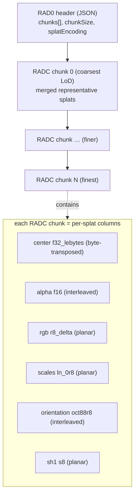
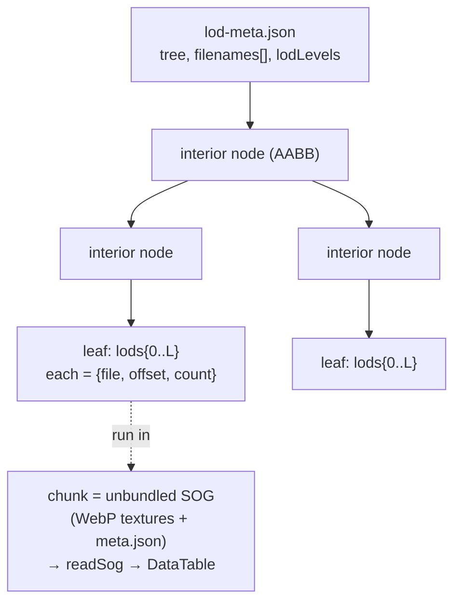
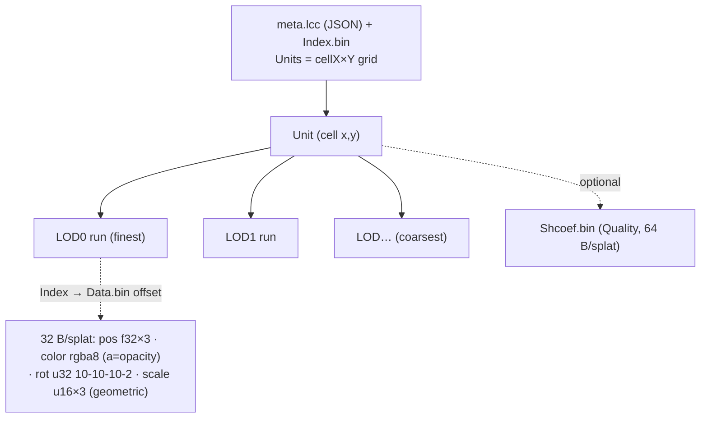
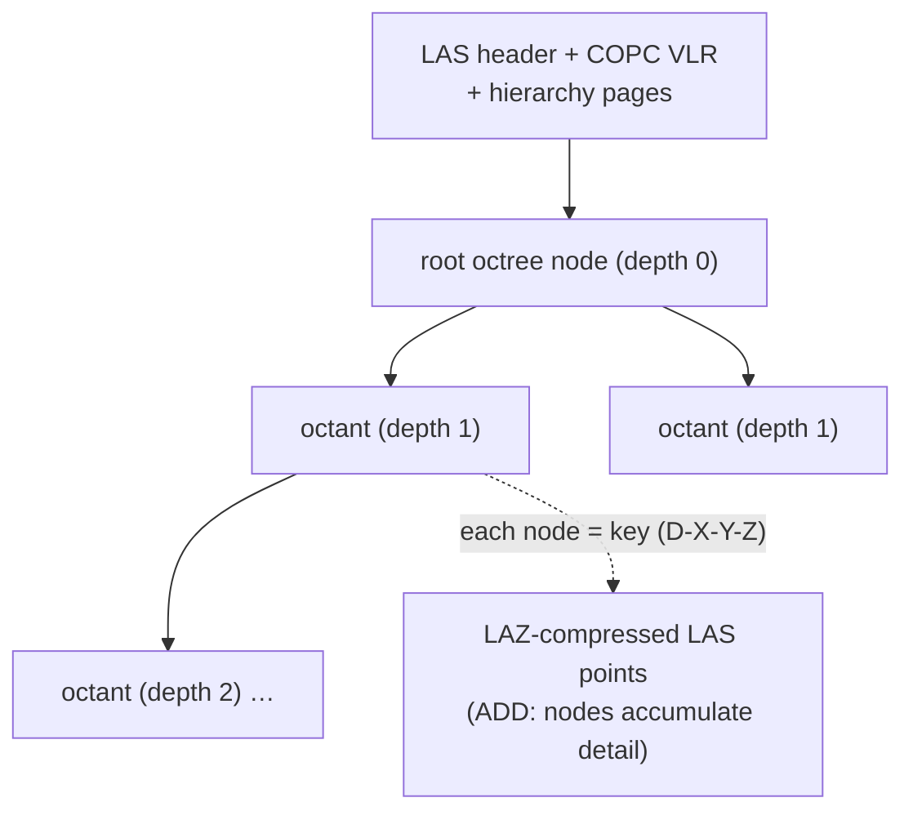

Collapsed by default — expand a format below for its LoD/hierarchy tree as a diagram.

<b>RAD</b> (SparkJS) — LoD merge tree, REPLACE

<b>Streamed SOG</b> (PlayCanvas) — binary spatial tree, REPLACE

<b>LCC</b> (XGRIDS) — Unit grid × LODs, REPLACE

<b>COPC</b> (LiDAR) — octree, ADD

