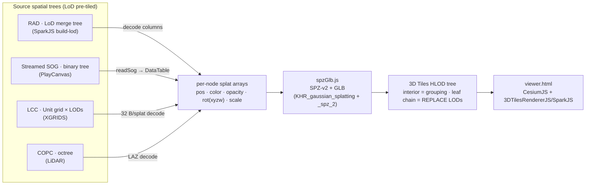

**Producing the tiled inputs (offline tilers):** point-cloud tilers (PotreeConverter, py3dtiles,
gocesiumtiler, PDAL→COPC), splat LoD builders (SparkJS `build-lod`, PlayCanvas `splat-transform`,
XGRIDS LCC), and a note on **why PotreeConverter 2.0 is so fast** — see the
["Offline tilers"](/docs/guide/cli-usage#offline-tilers--building-tiled-hierarchies-point-clouds-splats-meshes)
section of the CLI usage guide.

Tools that tile point clouds, meshes, or splats to 3D Tiles / streaming formats — studied for
format handling, tree/geometric-error strategy, and parallelism:

**Point clouds**
- [PDAL](https://pdal.io/en/latest/) for building COPC
- [Potree / PotreeConverter](https://github.com/potree/PotreeConverter) — the octree format + converter we read.
- [gocesiumtiler](https://github.com/mfbonfigli/gocesiumtiler) — Go LAS → Cesium 3D Tiles point tiler.
- [py3dtiles](https://gitlab.com/py3dtiles/py3dtiles) — Python LAS/XYZ → 3D Tiles `pnts` tiler.
- [yeyan00/potree23dtiles](https://github.com/yeyan00/potree23dtiles) — Potree → 3D Tiles (the
  closest analogue to our `potree-to-3dtiles`; cross-checked our 2.0 decode against it).
- [igd-geo/schwarzwald](https://github.com/igd-geo/schwarzwald) — high-throughput point-cloud tiler (3D Tiles).

**Meshes / CAD / GIS**
- [Gaia3D/mago-3d-tiler](https://github.com/Gaia3D/mago-3d-tiler) — Java OBJ/IFC/GIS → 3D Tiles.
- [fanvanzh/3dtiles](https://github.com/fanvanzh/3dtiles)
- [kitware vtk 3d-tiles-generation](https://www.kitware.com/3d-tiles-generation-using-vtk/)
- [obj2tiles](https://github.com/OpenDroneMap/Obj2Tiles) — OBJ → 3D Tiles (b3dm) with LoD.

**Gaussian splats**
- [@sparkjsdev/spark `build-lod`](https://sparkjs.dev/docs/lod-getting-started/) — PLY/SPZ → RAD LoD (we consume `.rad`).
- [playcanvas/splat-transform](https://github.com/playcanvas/splat-transform) — SOG/PLY/SPZ conversion (we use `readSog`).
- [WilliamLiu-1997/3DGS-PLY-3DTiles-Converter](https://github.com/WilliamLiu-1997/3DGS-PLY-3DTiles-Converter) — PLY → SPZ-GLB 3D Tiles (our cross-validation reference).

### Runtime (Node today / browser-capable?)

All converters run on **Node today** (`fs` for I/O, Node `zlib` for SPZ gzip). The *decoders* are
mostly portable; the Node-only parts are I/O + compression + workers, which `core` abstracts.

| Converter | Decoder portability | Node-only gate(s) → browser path |
|-----------|---------------------|----------------------------------|
| **rad** | pure JS (Buffer math) | `fs` → fetch/File; SPZ `zlib.gzip` → `CompressionStream('gzip')`. Browser-capable. |
| **sog** | **WASM** (`webp.wasm` via splat-transform — a web SDK) | `fs`/`MemoryReadFileSystem` → its `UrlReadFileSystem` already works in-browser. Browser-capable. |
| **lcc** | pure JS (DataView) | `fs` → fetch. Browser-capable. |
| **copc** | **WASM** (`laz-perf`) | `fs` → fetch; `proj4` is browser-ok. Browser-capable. |
| **potree** | pure JS | `fs` → fetch; **2.0 BROTLI needs a WASM brotli** (no standard browser API — DEFAULT encoding is fine). Mostly browser-capable. |
| **i3s** | JS + zip | `fs`/zip → fetch + a browser zip lib. Browser-capable (draft). |
| **output GLB** | `@gltf-transform/core` | works in Node and browser. |

Common gates: **gzip** (SPZ) → browser `CompressionStream`; **brotli** (Potree 2.0) → needs WASM;
**parallelism** `worker_threads` → Web Workers (same task shape); WebP/LAZ decoders are *already* WASM.

---
