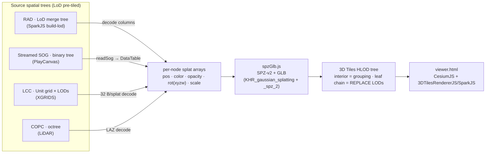

<InlineTOC items={toc} />

Roughly in the order we're tackling them, grouped by theme below.

## Summary

- **Core: "fastest" point-cloud tiler** — proposed new project direction, not a format. Research pass
  (not yet scoped/started) into whether this repo's converters could become the fastest raw-point-cloud
  → COPC/3D Tiles tiler, by reusing PotreeConverter 2.0's counting-sort/out-of-core chunking approach.
  Flags two open questions before committing: no benchmark yet against PotreeConverter 2.0/untwine, and
  `MIERUNE/point-tiler` may already be prior art in the same niche.
- **Tooling ideas** — port the middleware into a native 3DTilesRendererJS plugin (no separate server
  process); a Tauri desktop companion app for local-first conversion + a personal dataset library
  (Unreal integration); further out, a browser splat-transcoding UI, a georeferencing/geolocator step,
  and a cross-platform splat aggregator; wire the real `3d-tiles-tools` package's implicit↔explicit and
  glTF-to-3TILES packaging (only `upgrade` is wired so far).
- **`potree-to-copc`** — assessed, blocked: no pure-JS/WASM LAZ *encoder* exists yet (only decoders).
  Deferred until one is wired.
- **Runtime (Node → browser)** — audit of what's browser-portable per converter; almost everything
  already is except `remote-zip.js`'s SLPK unzip (`node:zlib` call with no browser equivalent).
- **Rendering/viewer** — a drafted upstream feature request for `3d-tiles-rendererjs-3dgs-plugin` to
  expose `lodInflate`/`lodSplatScale` SparkRenderer settings (currently worked around internally).
- **Streaming architecture** — route `tiling=explicit` through the existing `implicit-to-explicit` tool
  instead of bespoke per-adapter logic (design sketch only); a server-side progress endpoint for
  `cache=hierarchy`/`cache=full` jobs.
- **Testing & fixtures** — pin open-data test fixtures as versioned samples instead of relying on live
  third-party hosts; find a real third-party `.3tz`/`.3dtiles` sample; re-verify `cache=all` against
  newer formats; verify the uniform-crop flip table holds for non-georeferenced sources too.
- **Encoding/extract** — WebP texture encode, `simplify`/`weld`/`quantize` geometry ops, encode support
  on `/gltf`; `rtc_center`/decompress for ingesting *existing* remote 3D Tiles; a browser-native bbox
  crop/subsample extract tool.
- **Performance** — Draco+KTX2 decode speed (WebP instead of pngjs, reused decoder instances, worker
  pool); the `WorkerPool` multicore tier isn't wired yet for any converter.
- **Spec direction (noted 2026-10-20)** — point-cloud compression: Khronos closed glTF#1809
  (a Draco point-compression extension) as *superseded by `KHR_meshopt_compression`*, which is what
  `/stream?transform=meshopt` already emits; 3D Tiles 2.0 is being baselined on **glTF 2.1 as a set
  of extensions** (3d-tiles#803), including `3DTILES_georeference` for local → ECEF placement.
  Implications and follow-ups listed in the section below.
- **Format coverage** — spherical harmonics (view-dependent color) for Gaussian splats: every splat
  converter currently emits DC-only color. Design sketch covers what each format (RAD/LCC/SOG/GeoSplats)
  stores and what the `KHR_gaussian_splatting` output extension already supports — LCC/SOG look like a
  straightforward "carry the bytes through" job, RAD needs a "does it even store this" check first.

## Core: "fastest" point-cloud → COPC/3D Tiles tiler

**New project direction (proposed, not a format).** Not a source format to ingest — a **proposed new
project direction**: could this repo's own converters (or a new sibling tool) become the fastest tiler
for raw point clouds into COPC or 3D Tiles output, taking inspiration from Potree's own tiling approach.
This is a **market/feasibility research note** (WebSearch pass, 2026-07-06) — it summarizes public
technical writing and one repo's own README claims, **not** first-hand user feedback gathered from this
project's users. Treat the "community sentiment" items below as what's publicly written, not a survey.

**How Potree's own converter achieves its speed (technical read, not sentiment):**
- **PotreeConverter 2.0's approach is documented in a peer-reviewed paper**: Schütz, Ohrhallinger & Wimmer,
  ["Fast Out-of-Core Octree Generation for Massive Point Clouds"](https://www.cg.tuwien.ac.at/research/publications/2020/SCHUETZ-2020-MPC/)
  (Computer Graphics Forum, 2020). Core technique: a **hierarchical counting sort** to split the point
  cloud into small out-of-core chunks first (cheap, single-pass, parallelizable), then build per-chunk
  LOD via exchangeable subsampling strategies (a fast approximate blue-noise sampler, or a plain uniform
  random sampler) bottom-up. Reported throughput: **up to ~9M points/sec** (uniform sampling) or **~6M
  points/sec** (blue-noise), including out-of-core disk I/O — benchmarked at generating an LOD structure
  for **18 billion points in 1h17m**. This is a **published, citable technical result**, not community
  hearsay.
- **Independently, PotreeConverter's own GitHub README claims 2.0 is 10-50x faster than 1.7 on SSDs**,
  attributing most of the gain to emitting **~3 output files total instead of thousands-to-millions** —
  fewer files means filesystem operations (copy/upload/delete) that used to take hours/days drop to
  seconds/minutes. That's the tool authors' own claim, not independently reproduced here.
- Net technical read: the speed story is less about a novel geometric algorithm and more about (a) an
  out-of-core chunking pass designed for parallelism from the start, and (b) minimizing filesystem
  overhead by consolidating output into few large files rather than many small ones — both principles
  this repo's own streaming/tiled formats (COPC, streamed-SOG, LCC) already lean on for the *output*
  side; the gap would be on the *tiling/build* side for raw, untiled point-cloud input.

**How COPC-focused tools compare (untwine/entwine/PDAL):**
- **untwine** (Hobu Inc., the PDAL maintainers) is the tool actually recommended for building COPC at
  scale: per its own project material, for point clouds **exceeding 500 million points, untwine runs
  2-5x faster than `pdal translate`**, crediting a **parallelized, single-pass chunking algorithm** that
  builds the clustered octree index directly, with **under 5% storage overhead** versus the source LAZ.
  It works **bottom-up** rather than entwine's (its predecessor's) top-down approach.
  ([hobuinc/untwine](https://github.com/hobuinc/untwine))
  Sources: [CAD Interop's COPC writeup](https://www.cadinterop.com/en/formats/cloud-point/copc.html),
  [untwine GitHub](https://github.com/hobuinc/untwine).
- **entwine** (`connormanning/entwine`) is the older, more general EPT/point-cloud organizer that
  untwine's own docs position themselves as a faster, COPC-specific successor to for the large-scale case.
- No independent third-party head-to-head *benchmark* (untwine vs. PotreeConverter 2.0 vs. a hypothetical
  new tool) turned up in this pass — the untwine-vs-`pdal-translate` and PotreeConverter-2.0-vs-1.7
  numbers above are each tool's **own** reported comparison, not a neutral bake-off. Worth flagging before
  treating either as a hard target to beat.

**Public community commentary found (actual sentiment, not just tool-vendor claims):**
- [`visgl/loaders.gl` issue #2911](https://github.com/visgl/loaders.gl/issues/2911) tracks COPC tiled-loader
  support as background/ongoing work — reflects COPC still being treated as an emerging, not-yet-universally
  -supported format in the wider JS geospatial-viewer ecosystem, consistent with this repo's own choice to
  build a live COPC adapter rather than assume off-the-shelf tooling covers it.
  Related loader-quality discussion (`visgl/deck.gl` discussion #7454 on point-cloud layer performance,
  and a Cesium Community forum thread on FPS drops rendering sparse point-cloud 3D Tiles) point at
  **tileset-traversal and per-tile-fragment-count** as recurring real-world pain points **on the render
  side**, not the build/tiling side — i.e. even a fast tiler can produce tilesets that render poorly if
  node/point density per tile isn't tuned for the target GPU fragment budget. Worth folding into any
  "fastest tiler" design goal: fast *and* well-tiled are separate axes.
- [MIERUNE/point-tiler](https://github.com/MIERUNE/point-tiler) (Rust, Rayon-based parallelism, targets
  3D Tiles 1.1 directly from LAS/LAZ/CSV) is a recent (found via this search pass) independent example of
  someone else already pursuing a similar "fast point-cloud → 3D Tiles" goal — worth a direct look/comparison
  before scoping this repo's own effort, since it may already cover some of the same ground.

**Feasibility read for this repo specifically:** the repo's own `ambition.md` already names "be the
fastest point-cloud — and eventually splat — tiler, by reusing the octree-computation principles behind
Potree 2.0's converter" as a longer-running goal. This research pass supports that direction being
technically groundable (Potree 2.0's own published paper gives concrete algorithmic principles to reuse:
out-of-core parallel chunking + few-large-files output; untwine shows the same principles hold specifically
for COPC-shaped output) but flags two things worth resolving before committing: (1) no neutral benchmark
exists yet comparing this repo's own converters' build speed against PotreeConverter 2.0 or untwine — that
would be the natural first step to even know the starting gap; (2) `MIERUNE/point-tiler` looks like
already-published prior art aimed at the same COPC/3D-Tiles-from-raw-point-cloud niche and should be
evaluated before assuming this would be a novel effort.

## Tooling ideas

- [ ] **Port the middleware into 3DTilesRendererJS itself.** Today `packages/tile-server` sits in
  front of 3DTilesRendererJS/CesiumJS as an HTTP layer; the longer-term idea is a 3DTilesRendererJS
  **plugin** (in the spirit of its existing `ImplicitTilingPlugin`/`GaussianSplatPlugin`) that lets the
  renderer consume COPC, Potree, streamed-SOG, LCC, etc. **directly** — any 3D-Tiles-consuming app
  gets native support for these tiled formats without running a separate server process.

- [ ] **local desktop companion app for the middleware.** A Tauri app, distinct in
  shape from the `packages/tile-server` middleware above (that one is a live, no-storage, arbitrary-
  `<fmt>` pass-through server) — this would be local-first and personal instead: pick any source dataset
  in a format this repo already converts, convert it to 3D Tiles **on disk**, keep a local library of
  converted datasets, and serve them from a local HTTP server so their URL can be copied elsewhere —
  named explicitly for **Unreal Engine integration** (UE's Cesium-for-Unreal plugin, or similar, consumes
  a 3D Tiles URL directly). A gallery/browse view of already-converted local datasets would make it read
  as a personal dataset library, not a one-shot CLI wrapper. Purely an idea at this point — no design
  work, no scoping, not started.

- [ ] **The desktop app as a one-stop tiler for raw, untiled input** (noted 2026-11-05). Today it takes sources
  that are already tiled (COPC, Potree, SOG, LCC, RAD, I3S, 3MX) and streams or exports them. The next shape: give it
  a raw LAS/LAZ/E57, a mesh (OBJ, glTF, OSGB) or a splat PLY, and it runs the right third-party tiler for you.
  It would fetch the tool's binary for the platform when a release exists (PotreeConverter, GoTiler, py3dtiles,
  fanvanzh/3dtiles for OSGB, WilliamLiu's 3D Tiles SPZ tooling, splat-transform), expose each tool's own arguments in
  the form, run it as a subprocess as "Run in: CLI subprocess" does today, then hand the result to the stream and
  export flows. Prior art to read first: GeoSolutions' `digital-twin-toolbox` (a self-hosted Docker set of these
  pipelines) and py3dtiles' Docker image. In the app it would be a third flow next to "Stream live" and "Export to a
  folder". Open questions: licences of the redistributed binaries, checksums for the downloads, and unsigned binaries
  under Windows Defender (the app's own launcher is already flagged). Not scoped, not started.

- [ ] Further out: a browser/server tiled-splat transcoding UI in the spirit of SuperSplat's splat-transform
  tooling; a **georeferencing/geolocator** step for splats that don't ship one, along the lines of
  WilliamLiu's `3dtiles-inspector` or MapTiler GeoSplats'; and an **aggregator** unifying the
  export/interchange formats of other splat platforms, behind the same 3D Tiles pipeline. A
  longer-running goal underneath all of this: be the **fastest** point-cloud — and eventually splat —
  tiler, by reusing the octree-computation principles behind Potree 2.0's converter (see the Potree
  sections throughout this doc, e.g. [`potree-to-3dtiles`](/docs/guide/cli-usage#potree-to-3dtiles) and
  [`/stream`](/docs/guide/planning/streaming-architecture-design-log)).

- [ ] **Real `3d-tiles-tools`: implicit↔explicit and glTF-to-3TILES packaging still missing.** The real,
  unscoped `3d-tiles-tools` npm package is now an actual dependency (`packages/3dtiles-tools`) and its
  tileset **upgrade** (1.0→1.1) is wired as `tool=upgrade-real` on `/3dtiles-tools` — see the Design log
  for how that landed and why it's a batch-then-serve-from-cache operation (the real package only
  supports local filesystem/`.3tz`/`.3dtiles` sources, no remote/streaming API). Still open: the same
  real package's **implicit↔explicit** conversion and **glTF-to-3TILES packaging** operations aren't
  wired to anything — worth the same `tool=<name>` treatment once there's a concrete need, following the
  `upgrade-real` pattern (mirror a remote source to a local temp dir first if needed, run the real
  package once, serve the result statically from a cache dir).

## `potree-to-copc` (assessed — blocked on a JS LAZ encoder)

Potree and COPC are both octrees, so the hierarchy/metadata is a near 1:1 map and the read side is
ready (the readers extract points + the octree + the `cloud.js`/metadata **CRS**). The blocker is the
**write**: COPC mandates LAZ, and there is **no pure-JS LAZ encoder** (`laz-perf`'s WASM build is
decode-only; `copc.js` is read-only). Realistic paths: compile a Rust crate
([copc-rs](https://github.com/pka/copc-rs) / [copc-converter](https://github.com/360-geo/copc-converter)
with `laz-rs`) to **WASM**, or shell out to [PDAL `writers.copc`](https://pdal.io/en/stable/stages/writers.copc.html)
/ [copc-lib](https://github.com/RockRobotic/copc-lib). Deferred until a JS/WASM LAZ writer is wired.

## Runtime (Node today / browser-capable?)

All converters run on **Node today** (`fs` for I/O, Node `zlib` for SPZ gzip). The *decoders* are
mostly portable; the Node-only parts are I/O + compression + workers, which `core` abstracts.

| Converter | Decoder portability | Node-only gate(s) → browser path |
|-----------|---------------------|----------------------------------|
| **rad** | pure JS (Buffer math) | `fs` → fetch/File; SPZ `zlib.gzip` → `CompressionStream('gzip')`. Browser-capable. |
| **sog** | **WASM** (`webp.wasm` via splat-transform — a web SDK) | `fs`/`MemoryReadFileSystem` → its `UrlReadFileSystem` already works in-browser. Browser-capable. |
| **lcc** | pure JS (DataView) | `fs` → fetch. Browser-capable. |
| **copc** | **WASM** (`laz-perf`) | `fs` → fetch; `proj4` is browser-ok. Browser-capable. |
| **potree** | pure JS | `fs` → fetch; **2.0 BROTLI needs a WASM brotli** (no standard browser API — DEFAULT encoding is fine). Mostly browser-capable. |
| **i3s** | JS + zip | `fs`/zip → fetch + a browser zip lib. Browser-capable (draft). |
| **output GLB** | `@gltf-transform/core` | works in Node and browser. |

Common gates: **gzip** (SPZ) → browser `CompressionStream`; **brotli** (Potree 2.0) → needs WASM;
**parallelism** `worker_threads` → Web Workers (same task shape); WebP/LAZ decoders are *already* WASM.

## Rendering / viewer

- [ ] **Interactive transform gizmo → bake the result into `/stream` placement params.**
  Today's [globe placement](/docs/guide/cli-usage) is
  *type-the-numbers*: `&lon=&lat=&alt=&heading=&scale=`. That is the right wire format — it lives in
  the tileset, so every client honours it — but it is a poor authoring experience for the actual task,
  which is "nudge this scan until it sits on the building".

  The missing half is a **free 6-DoF gizmo** (translate / rotate / scale) in the viewer that writes
  back to those params, so an interactive session ends with a URL you can paste into Cesium for
  Unreal rather than viewer-only state. Either `TransformControls` in the vanilla three.js path or
  `@react-three/drei`'s `<PivotControls>` / `<TransformControls>` in the R3F path would do; both
  already ship with this repo's dependencies.

  **Prior art to copy from, not reinvent:** WilliamLiu-1997's
  [3DTiles-Inspector](https://github.com/WilliamLiu-1997/3DTiles-Inspector) (pre-installed here under
  `tools-inspector/` — see the [references index](/docs/references)) already does root-transform
  editing plus geometric-error / layer-multiplier scaling on a loaded tileset, and is the closest
  existing thing to this idea. The difference worth preserving is the **output**: the inspector edits
  a tileset in place, whereas the point here is to end at a *stateless URL* against the middleware —
  placement as a request parameter, not a saved file.

  Two design notes for whenever this is picked up:
  - The gizmo must compose **on top of** the adapter's own up-axis flip (SOG's RX(−90°), RAD's
    RX(180°), LCC's `[East, −Up, North]`), not replace it, or every format regresses to Y-up/Z-up
    guessing at the client.
  - `&lon`/`&lat` place the dataset's **own local origin**. A dataset whose origin is not at its
    bounding-box centre lands offset by exactly that amount, so a gizmo built on this will want the
    as-yet-unbuilt `&anchor=center|origin` option to feel predictable.

- [ ] **Feature request draft — expose SparkRenderer LoD options in `3d-tiles-rendererjs-3dgs-plugin`.**
  **Target repo:** https://github.com/WilliamLiu-1997/3D-Tiles-RendererJS-3DGS-Plugin

  **Title:** Allow passing `lodInflate` / `lodSplatScale` (and other SparkRenderer LoD settings) through
  `sparkRendererOptions`.

  **Body:** The plugin's `sparkRendererOptions` currently forwards a fixed allowlist to the shared
  SparkRenderer: `premultipliedAlpha, encodeLinear, maxStdDev, minPixelRadius, maxPixelRadius,
  minAlpha, enable2DGS, preBlurAmount, blurAmount, clipXY, focalAdjustment, sortRadial,
  minSortIntervalMs, depthTest, depthWrite`. It does **not** include the SparkRenderer LoD controls
  that SparkJS's own viewer sets, notably:
  - `lodInflate` (default `true` in SparkJS's viewer) — inflate LoD splats so opacity ≤ 1.0; visibly
    improves blending of coarse/merged LoD splats.
  - `lodSplatScale` — scales the active-splat budget / LoD detail.

  **Why it matters:** when rendering 3D Tiles tilesets whose content is baked LoD Gaussian splats
  (e.g. converted from SparkJS `.RAD` or PlayCanvas Streamed SOG), the coarse tiles are pre-merged
  representatives. Without `lodInflate`, those coarse splats render under-opaque and don't blend the
  way they do in SparkJS's native viewer, so the same data looks sparser/spikier through the plugin
  than in `sparkjs.dev`'s explore viewer.

  **Current workaround:** reach the shared renderer via `getSparkRendererForScene(scene)` and set
  `spark.lodInflate = true; spark.lodSplatScale = …; spark.lodDirty = true;` directly. This works but
  relies on internal properties rather than the public `sparkRendererOptions` surface.

  **Request:** add `lodInflate` and `lodSplatScale` (and ideally the cone-foveation settings
  `coneFov0/coneFov/coneFoveate/behindFoveate`) to the `sparkRendererOptions` allowlist, and to
  `updateSharedSparkRendererOptions`, so they can be set declaratively at plugin construction and at
  runtime.

  *This repo (`3dtiles-converters`) applies the `getSparkRendererForScene` workaround in `viewer.html`
  (`applySparkLodSettings`) until the option is exposed.*

## Streaming architecture

- [ ] **Composable `tiling=explicit`.** The still-open, more invasive half of an earlier item (see
  "Streaming endpoint consolidation" in the [Design log](/docs/guide/planning/streaming-architecture-design-log)):
  route `&tiling=explicit` for COPC/Potree-2.0
  *through* the existing `/3dtiles-tools?tool=implicit-to-explicit` tool against their own implicit
  `/stream` output, instead of each format's live adapter keeping a bespoke `buildTilesetExplicit`.
  Deferred until the consolidation above has settled — untested whether `implicit-to-explicit`'s generic
  walker round-trips cleanly against our own live implicit tilesets. (I3S dropped out of scope here: it
  was simplified to always-explicit directly, having no implicit representation worth composing through
  the tool.) `viewer.html`'s Tools → implicit-to-explicit demo now includes a Potree and a COPC example
  against our own prebuilt output as a stopgap — that's the tool working *against* our formats offline,
  not the live routing described here.

  **Design sketch (not implemented) — what's portable vs. Node-only.** Surveyed what each
  `packages/tile-server/*-live.js` adapter actually leans on:
  - **Range-reads via `fetch` + `Range` header** — portable as-is. `copc-live.js`/`potree-live.js`/etc.
    already use plain `fetch(url, { headers: { Range: ... } })`, no Node-specific HTTP client. Browsers
    support `Range` requests against any host that sends `Accept-Ranges`/honors the header identically.
  - **In-memory hierarchy caching** (`memoizeAsync`-wrapped per-URL context: COPC node maps, RAD chunk
    topology, etc.) — portable as-is. It's a plain `Map`/closure cache, nothing Node-specific; a browser
    tab has the same "cache for the life of this session" lifetime a server process does.
  - **glTF encoding via `@gltf-transform/core`** — portable; `@gltf-transform/core` is isomorphic
    (pure JS/typed-arrays, no `fs`), already used that way in other JS-ecosystem viewers.
  - **Not portable as-is: `remote-zip.js`'s SLPK unzip.** It calls `node:zlib`'s `inflateRawSync`
    directly (`packages/tile-server/remote-zip.js`) for the DEFLATE entries inside `.slpk` archives —
    that's a Node built-in with no browser equivalent. A browser build would need to swap in
    `pako`'s `inflateRaw` or the browser-native `DecompressionStream('deflate-raw')` API. Everything
    else I3S's live adapter does (range-fetch, JSON/binary parsing, LEPCC decode) is plain JS already.
  - **Plugin surface, matched against 3d-tiles-renderer's own `ImplicitTilingPlugin`**
    (`node_modules/3d-tiles-renderer/src/core/plugins/ImplicitTilingPlugin.js`): plugins are plain
    classes with an optional `init(tiles)` (receives the `TilesRenderer` instance),
    `preprocessNode(tile, tilesetDir, parentTile)` (mutate a tile as it's registered — e.g. mark
    unrenderable/implicit tiles), `parseTile(buffer, tile, extension)` (turn fetched bytes into
    renderable content for tiles this plugin owns), `preprocessURL(url, tile)` (rewrite a tile's
    content URL before fetching — this is where a COPC/Potree plugin would synthesize a per-node
    tile URL instead of relying on a server), and `disposeTile(tile)` (cleanup). A per-format plugin
    (`CopcPlugin`, `PotreePlugin`, `SogPlugin`, …) would likely: fabricate the root tileset JSON
    in-memory from the format's own header/hierarchy (what `*-live.js`'s `tileset.json` handler does
    today, minus the HTTP framing) and hand it to `tiles.rootURL`/a synthetic loader; use
    `preprocessURL`/`parseTile` to intercept per-node "URLs" that are really just node-IDs, range-fetch
    that node's bytes directly from the plugin, decode, and hand back a GLB `ArrayBuffer` — the same
    decode logic `*-live.js` already has, just invoked in-browser instead of behind an HTTP route.
  - **What's genuinely new work per format**: none of the *decoders* need rewriting (COPC/LAZ, SPZ,
    LEPCC, OpenCTM are already plain JS with no Node dependency beyond the SLPK unzip above) — the work
    is wrapping each `*-live.js`'s tileset-building + per-node logic behind the plugin hooks above
    instead of Express-style request handlers, and replacing the one `node:zlib` call. This is a design
    sketch, not a scoped work estimate — actually landing it means picking one format (COPC is the
    simplest tree) as a proof of concept before generalizing the pattern to the rest.
- [ ] **Server-side per-cache progress** — the eager-drain (`cache=hierarchy`) and convert
  (`cache=full`) loops need a job-progress endpoint the viewer can poll (the timing-log modal already
  renders client milestones).

## Testing & fixtures

- [ ] **Test fixtures from open data.** Pin the small, `sample-data/`-friendly open datasets this repo
  already references throughout (Autzen, Eiffel COPC tiles, Skatepark/Roman Parish streamed-SOG,
  Tastier RAD, Geghard, Tende 3MX, …) as versioned fixtures — either vendored into their own small
  GitHub repo(s) or referenced by stable upstream URL — so CI and new contributors get a reproducible
  test corpus instead of relying on live third-party hosts.
- [ ] **Find a real open-data `.3tz`/`.3dtiles` package.** `viewer.html`'s Packages pills currently only
  demo our own repo-packed `sample-data/input/3DTILES-PACKAGES/tastier.{3tz,3dtiles}` — we don't have a
  publicly-hosted example of either package format found in the wild to verify `/3dtiles-self-contained`
  against a real third-party `.3tz`/`.3dtiles` file, not just our own packer's output.
- [ ] **Test `/stream?cache=all`.** Recent verification passes (threemx/geosplats migration, uniform
  crop, ArcGIS I3S) only exercised `cache=none`. `cache=all` (routes to `/convert`, preprocess + cache
  the whole dataset) shares the same underlying adapters but hasn't been separately re-verified against
  the newer/changed formats.
- [ ] **Crop uniformity: georeferenced vs. non-georeferenced.** The `SPLAT_FLIP_BAKED` uniform-crop fix
  (see "`/extract`" above) was verified against georeferenced real-world tiles for LCC/SOG/RAD. Not yet
  separately verified: whether the same flip table holds for a **non-georeferenced** (local-frame, no
  ENU→ECEF root transform) source of each format — worth a dedicated pass before trusting it universally.

## Encoding / extract

- [ ] **Encode ops remainder** — geometry encode (`/stream?transform=meshopt|draco`) and in-process
  KTX2 texture encode (`/stream?transform=ktx|ktx-uastc`) are done; still to add: **WebP** texture
  encode (needs a WASM webp encoder; `textureCompress(webp)` would pull in `sharp`, which we
  deliberately avoid), `simplify` / `weld` / `quantize` geometry ops, and exposing encode on the
  `/gltf` proxy (currently only `/stream` has it).
- [ ] **`rtc_center` / decompress for ingestion** — apply the existing per-tile decompress pipeline to
  *existing remote 3D Tiles* (not just our own output) so consumers that can't read Draco/KTX2/
  `CESIUM_RTC` (e.g. blender **BLOSM**) can load them.
- [ ] **Browser-native bbox crop / subsample extract** — pull a cropped/decimated copy of a tiled asset
  (point cloud, mesh, or splat) by an OBB defined in the viewer — BLOSM-style but JS/browser-native.
  See the dump-tiles feature idea (memory). **Refinement-aware traversal**: for **ADD** octrees
  (COPC/Potree) accumulate all points down to the desired geometric error within the OBB; for
  **REPLACE** trees (3D Tiles mesh) descend only where a parent's GE still exceeds the target. **Point
  clouds** → **hand-written LAS** (streamable, O(1) RAM even for 500 GB via header back-patch —
  `core/las-writer.js`, built) → shell to **`pdal writers.copc` / untwine** (out-of-core) for
  LAZ/COPC. **Meshes** → merge tile GLBs (geometry+UV+texture) via glTF-Transform → a binary mesh
  (glb/USD/USDZ). No JS/WASM LAS *writer* exists (node-las is archived; entwine/untwine are C++-only)
  and `laz-perf` WASM is decode-only — so hand-write + native CLI.

## Performance

- [ ] **Draco+KTX2 decode speed** — the per-tile decode (~250 ms/tile) can be cut by (1) **passing
  KTX2 through untouched** when the consumer reads it, (2) emitting **WebP** (WASM encoder) instead of
  `pngjs` PNG, (3) reusing decoder/transcoder instances across tiles, (4) a worker-thread pool. pngjs
  PNG-encode of the ~1.4 MB RGBA is the main avoidable cost.
- [ ] **`WorkerPool` (`worker_threads`) tier not wired.** All converters currently use only the
  async-gzip + `parallelMap` tier (main-thread decode on the libuv pool) — see
  ["Parallelism (per converter)"](/docs/guide/architecture-the-materialization-continuum-cache-none-hierar)
  for the per-converter breakdown of what's worker-extractable. True multicore decode (the WASM/CPU-bound
  decoders — LAZ, WebP, brotli) is unused headroom; the pure-JS decoders (rad, lcc, potree) stand to gain
  the most since they're single-core-bound today.

## Format coverage

- [ ] **Spherical harmonics (view-dependent color) for Gaussian splats.** Every splat converter
  (RAD/LCC/SOG/GeoSplats) currently emits **DC-only** color — the source formats' higher-order SH bands
  are decoded-and-discarded (or never touched) on the way to a 3D Tiles GLB, so specular/view-dependent
  appearance is lost.

  **Design sketch (not implemented) — this is a design note, not a work-estimate promise.**
  - **What each format actually stores** (per this repo's own reference docs):
    - **RAD** (`apps/docs/content/docs/references/3dgs-splats/rad-format-notes.md`) — per-splat LoD tree; the
      converter notes don't document an `sh1`/higher-band column explicitly beyond opacity/orientation/
      scale decode, so the first step for RAD specifically would be confirming which SH bands (if any)
      the monolithic `.rad` chunk layout actually persists before designing a carry-through path —
      flagged here as a gap in the existing notes, not assumed absent.
    - **LCC** (`apps/docs/content/docs/references/3dgs-splats/lcc-format.md`) — `Shcoef.bin`, present only when
      `fileType: "Quality"` (absent for `"Portable"`). **64 bytes/splat = 15 packed-11 coefficients**
      (`sh1`..`sh15`), decoded via `DecodePacked11` then lerped through `attributes.shcoef` min/max —
      i.e. **SH degree 3** (3 coefficients × RGB × ... the doc counts 15 coeffs total, matching degree-3's
      15 AC terms). Already positionally mapped in the doc's own "planned `lcc-to-3dtiles`" section as
      "SH (Quality) → KHR `SH_DEGREE_*` attributes" — i.e. the target mapping is already anticipated,
      just not implemented.
    - **SOG** (`apps/docs/content/docs/references/3dgs-splats/sog.md`) — optional `shN_centroids.webp` +
      `shN_labels.webp` palette: `bands ∈ [1,3]` → **3, 8, or 15 coefficients/channel** (degree 1/2/3),
      16-bit per-Gaussian label indexing a 64-entry-per-row centroid palette, each channel itself a
      codebook index into a shared 256-float `shN.codebook`. Two levels of indirection (label → centroid
      row → codebook value) versus LCC's direct packed-11 lerp.
    - **GeoSplats** — not covered by its own dedicated format-notes doc in `references/` the way
      RAD/LCC/SOG are (it's built on SOG octants per the MapTiler GeoSplats memory notes), so its SH
      story is presumably SOG's `shN_*` mechanism inherited as-is — needs confirming against the actual
      GeoSplats reference doc before design, not assumed here.
  - **What the OUTPUT side needs**: `apps/docs/content/docs/references/3dtiles-gltf/KHR_gaussian_splatting.md`
    (Khronos Release Candidate, 2026) already defines the extension attributes for this —
    `KHR_gaussian_splatting:SH_DEGREE_1_COEF_[0-2]` (VEC3 float, degree 1), `..._DEGREE_2_COEF_[0-4]`
    (degree 2), `..._DEGREE_3_COEF_[0-6]` (degree 3) — all listed **optional** attributes alongside the
    required POSITION/SCALE/ROTATION/OPACITY/`SH_DEGREE_0_COEF_0`. So the glTF-side target already
    exists and needs no new extension design — it's a matter of populating additional accessors that
    the spec already reserves. Degree-3 sources (LCC Quality, SOG `bands:3`) map directly onto the
    extension's own degree-3 ceiling; nothing in RAD/LCC/SOG currently claims degree 4 (SPZ v4 does,
    per this doc's own SPZ roadmap section below, but that's a different source format not yet a
    converter input).
  - **Rough per-converter work sketch**: for LCC and SOG this looks like "carry the extra bytes through
    and write new glTF accessors" rather than a geometry re-derivation — both formats already deliver
    SH coefficients in a fixed per-splat layout that only needs dequantizing (LCC: packed-11 lerp,
    already documented; SOG: label→centroid→codebook, two indirections but no new math) and writing
    into `VEC3 float` accessors matching the extension's `SH_DEGREE_n_COEF_m` semantics — no
    re-deriving normals or a new basis, since the SH basis is defined relative to the existing splat
    rotation/scale the converters already decode. RAD needs the "does the format even carry this"
    question answered first. Quantized (non-float) accessor types aren't listed as allowed for the SH
    attributes in the extension table above (only POSITION/SCALE/ROTATION/OPACITY list
    byte/short/normalized variants) — so output accessors would be plain `float`, meaning the main
    per-converter cost is likely the extra GLB payload size (degree-3 = 15 extra VEC3-float attributes
    per splat) more than decode complexity. This is a sketch to scope future work, not a commitment to
    a specific implementation order or timeline.

## Spec direction: 3D Tiles 2.0 on glTF 2.1 (noted 2026-10-20)

Two upstream decisions worth tracking because they confirm choices this repo already made and
point at the next ones.

### Point-cloud compression: meshopt wins, Draco points are closed

[KhronosGroup/glTF#1809](https://github.com/KhronosGroup/glTF/issues/1809#issuecomment-6001866312)
(a point-cloud Draco extension for glTF) was closed as **superseded by `KHR_meshopt_compression`**
(the promoted form of `EXT_meshopt_compression`). The Cesium benchmark attached to the closure,
313.6 M points, position + colour, 0.01 m compression error, 50 Mbps throttled:

| Encoding | Size | Load |
|---|---|---|
| LAS 1.2 (format 3) | 12.3 GiB | — |
| `.pnts` | 4.38 GiB (3.72 gzip) | 33.3 s |
| `.glb` | 4.68 GiB (3.67 gzip) | — |
| `.pnts` + `3DTILES_draco_point_compression` | 1.19 GiB (0.85 gzip) | 9.25 s |
| `.glb` + `EXT_meshopt_compression` | 1.01 GiB (0.86 gzip) | 9.46 s (decoder not yet in a Web Worker) |

So meshopt on `POINTS` is as small as Draco points, decodes as fast, and is the only one of the two
that survives into glTF 2.1. This is already the repo's position: `core/gltf-compress.js` defaults to
meshopt for point tiles because Draco skips `POINTS`, and `/stream?transform=meshopt` serves it.

- [ ] **Make meshopt the default on point GLBs** served by `/stream` for COPC/Potree/LAS once the
  CPU cost per tile is measured against the ~37 % size (encode is per request unless `cache=full`).
- [ ] **Read `KHR_meshopt_compression`** as well as `EXT_` in `gltf-decompress.js` when glTF-Transform
  ships the name; the decoder is the same `meshoptimizer` WASM.
- [ ] Re-verify the 3DTRjs `PotreePlugin` / `PointCloudEffectsPlugin` path and CesiumJS against a
  meshopt-encoded point tile (both read `EXT_meshopt_compression` today).

### 3D Tiles 2.0 = glTF 2.1 + extensions

Current state, updated 2026-11-02: [Directions: 3D Tiles 2.0 on glTF 2.1](/docs/references/3dtiles-gltf/gltf-2.1-3dtiles-2.0).
`3DTILES_georeference` below has since become `EXT_georeference`, with its own spec text.

Per [CesiumGS/3d-tiles#803](https://github.com/CesiumGS/3d-tiles/issues/803) the plan is to
**sunset 3D Tiles as a separate spec** and baseline 3D Tiles 2.0 on glTF 2.1, as extensions kept in
[CesiumGS/glTF, branch `3d-tiles-2.0`](https://github.com/CesiumGS/glTF/tree/3d-tiles-2.0). The
layering: glTF 2.0 = assets (geometry, materials, textures, metadata); glTF 2.1 = complex scenes
(bounding-volume hierarchy, external glTF references); 3D Tiles 2.0 extensions = the geospatial part
(hierarchical LOD, region bounding volume, CRS).

[`3DTILES_georeference`](https://github.com/andreasplesch/glTF/blob/3d-tiles-2.0/extensions/2.1/Vendor/3DTILES_georeference/README.md)
maps local glTF coordinates to ECEF through a point on the ellipsoid and its **tangential plane**
(east-north-up at the anchor). Only the figure defines that mapping so far; andreasplesch offered a
spec-language draft and the maintainers invited the PR.

Why it matters here:

- The `&lon=&lat=&alt=&heading=&scale=` placement `/stream` bakes into the tile `transform` is
  exactly a `3DTILES_georeference` anchor plus the ENU frame from `core/geo.js` (`enuMatrix`). When
  the extension stabilises, emit it on the root glTF node instead of, or alongside, the tileset
  `transform`, so a tile GLB is georeferenced on its own.
- The planned `&anchor=center|origin` option (transform gizmo item above) is the same question the
  extension has to answer: which local point sits on the tangent plane.
- The quadtree meta-tileset and the Potree-only catalogue idea become glTF 2.1 scene graphs with
  external references, so the aggregate builder should keep its hierarchy format-agnostic.
- Candidate contribution: the tangent-plane wording (ENU basis from geodetic lat/lon, height along
  the ellipsoid normal, handedness, and how `heading` composes) is what this repo's adapters already
  implement in code, so a draft PR against the `3d-tiles-2.0` branch is cheap.

---
